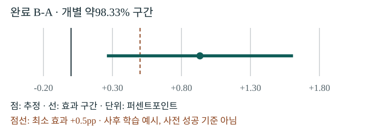
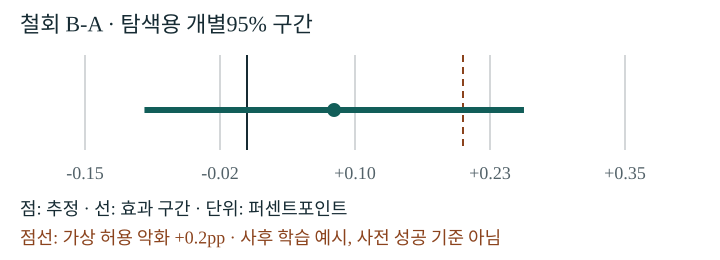

# 6장 · ‘B가 이겼다’는 문장을 다섯 번 묻기

## 보고서의 동사부터 고친다

B의 막대가 가장 높다. 담당자는 이겼다고 말하고, 임원은 다음 달 예산에 반영하자고 한다. 이 짧은 대화에서 관측값, 통계적 추론, 사업 판단, 승인이라는 서로 다른 일이 하나의 동사로 합쳐진다. 이 장은 이겼다는 말을 금지하려는 것이 아니다. 그 말이 어떤 주장인지 끝까지 책임질 수 있게 나누려는 것이다.

먼저 관측상 1위인지 묻는다. 이번 표본에서 비율이 가장 높다는 것은 계산할 수 있는 사실이다. 그러나 다른 고객을 다시 배정하면 순위가 바뀔 수 있다. 다음으로 비교가 유효한지 묻는다. B에만 방문 기록이 빠졌거나, B 고객이 A의 시승 슬롯을 차지했다면 막대의 차이를 메시지의 효과 하나로 읽기 어렵다. 배정과 실행, 측정을 먼저 확인하는 이유다.

그다음 질문은 통계적 우위다. 사전에 정한 대상·주지표·기간·대비에서 개선 근거가 얼마나 강한지 효과와 불확실성을 함께 읽는다. 네 번째 질문은 그 개선이 회사에 충분한지다. 작은 개선을 정밀하게 알아냈다는 것과 도입 비용을 회수한다는 것은 다르다. 마지막으로 고객 관계와 운영, 적용 범위를 고려해 실행할 수 있는지 묻는다. 동의 위반이나 중대한 안전 문제는 이익이 크다는 이유로 통과시키지 않는다.

| 구분 | 답하려는 질문 | 근거와 보고 표현 |
|---|---|---|
| 관측상 순위 | 이번 표본에서 무엇이 가장 높은가? | 분모·사건·점추정. ‘표본에서 B가 가장 높음’ |
| 비교 유효성 | 이 차이를 정책 비교로 읽을 수 있는가? | 배정·실행·원장·관측·간섭. ‘범위 내 비교 가능/제한/불가’ |
| 통계적 우위 | 사전 주지표에서 개선 근거가 있는가? | 효과·구간·검정·다중성·종료. ‘해당 지표 우위 근거’ |
| 사업적 충분성 | 비용·기회비용을 감안할 만큼 개선됐는가? | 최소 사업 효과·원가·가치·모형 위험. ‘충족/미확정/부적합’ |
| 도입 판단 | 누구에게 어느 규모로 적용할 것인가? | 관계·안전·수용량·일반화·사람의 승인. ‘제한 도입/유지/재설계/보류’ |

이 표의 행은 모두 같은 종류의 검정이 아니다. 비교 유효성은 자료와 설계의 판단이고, 통계적 우위는 명시한 모형과 절차 아래의 추론이며, 도입은 불확실성 아래의 선택이다. 자동으로 마지막 칸을 채우는 단일 승리 점수로 합치지 않는다.

## Winner 계약은 결과를 보기 전에 만든다

실험 계약서는 질문, 대상 자격, 배정·분석 단위, 처치와 비교 정책, 주지표, 관측 창, 제외·누락 원칙, 표본과 종료, 비교 가족을 고정한다. 여기에 최소한의 사업 가치와 허용 손실, 행동 조건과 승인자를 붙이면 Winner 계약이 된다. 새 통계 검정법이 아니라 기존 설계 원칙을 회의에서 실행하도록 묶은 저자 제안이다.

예를 들어 ‘시승 안내 B가 좋으면 도입한다’는 계약이 아니다. ‘연락 동의가 있고 기존 시승 경험이 없는 잠재 고객에게, A와 비교한 B 배정 정책의 28일 고객당 시승 완료를 주지표로 읽는다’까지 적어야 비교 대상이 드러난다. H가 실험 메시지 미발송이면 B-H는 별도 정책 질문이다. 계약, 출고, 수익은 또 다른 결과다.

사전 기준이 없는 과거 자료도 분석할 수 있다. 다만 사후 교육 분석 또는 탐색이라고 표시한다. 이미 본 결과에 맞춰 기준을 만들었다면 그 흔적을 남긴다. 파일의 생성 날짜만 옛날처럼 바꾸거나 검정력이 잘 나오는 효과를 골라 과거 계획으로 꾸미지 않는다. 이 책의 v0.3 계획은 생성 전에 로컬에서 동결한 합성 실습 명세이지, 독립 기관의 외부 사전등록이나 실제 기업 실험 등록은 아니다.

## TRI-V에서 각 주장이 머무는 자리

Variable Control은 배정·측정·시간·간섭을 확인해 어떤 비교가 가능한지 정한다. Vector Segmentation은 전체 효과를 먼저 읽고 사전 집단 차이와 탐색 발견을 구분한다. Value-Linked Decision은 비용·관계·운영·기회비용과 남은 불확실성을 판단 문장에 연결한다. 이름은 유지하되, 이 절차가 모든 조건을 자동으로 검증하거나 잘못된 원자료를 고쳐 준다고 약속하지 않는다.

팀마다 승인 규칙은 다를 수 있다. 지표 개선이 매우 작고 되돌리기 쉬우며 비용이 낮다면 기대가치에 근거해 제한 도입을 선택할 수 있다. 반대로 고객 위험이 크거나 장기 계약을 바꾸는 결정이라면 더 강한 근거와 보호 조건을 요구할 수 있다. 중요한 것은 채택을 선택한 이유와 입증한 사실을 같은 문장으로 바꾸지 않는 것이다.

# 7장 · 통계적 승리와 충분한 승리는 다르다

## 점·구간·기준선을 함께 읽기

두 군의 고객당 완료율을 각각 사건 수를 배정 수로 나누어 계산한다. B 비율에서 A 비율을 빼면 절대 차이다. 여기에 100을 곱하면 퍼센트포인트가 된다. 절대 차이를 A 비율로 나누면 상대 변화다. ‘1% 좋아졌다’라는 표현만으로는 어느 계산인지 알 수 없다. 기준 비율과 두 분모를 같이 보여주면 그 혼동을 줄일 수 있다.

점추정은 한 숫자이고 구간은 해당 절차와 가정 아래 불확실성을 표현한다. 귀무가설이 효과 0이라는 pooled 비율 z 검정의 p-value는, 그 귀무가설과 가정 아래 지금만큼 또는 더 극단적인 검정 통계량을 얻을 확률이다. B가 최선일 확률도, 효과가 우연일 확률도 아니다. 일반적인 빈도주의 구간의 신뢰수준은 반복 절차의 포함 성질에 관한 것이다. 이번 구간의 참일 확률이라고 기계적으로 번역하지 않는다.

이 책은 독립 개인 단위의 이항 결과에 pooled z 검정과 Wilson 구간을 결합한 Newcombe 차이 구간을 쓴다. 검정과 구간은 서로 다른 근사 절차이므로 경계가 정확하게 뒤집히는 관계를 항상 보장하지 않는다. 군집·간섭·반복 조회·선택 편향은 숫자 출력 뒤에 사라지는 것이 아니다.

## MDE와 최소 사업 효과를 구분한다

MDE는 정한 표본·유의수준·검정력·분석 방법 아래 검출하도록 설계한 변화 크기를 뜻한다. 사업 최소 효과는 도입할 가치가 있다고 보는 개선 수준이다. 책이나 도구마다 MEI 등의 용어를 다르게 쓰므로 약어보다 정의를 적는다. 이 둘을 무조건 같은 숫자로 취급하면 검정력 계획과 경영 기준이 섞인다.

v0.3은 완료 9%→10%라는 계획 효과를 세 대비의 유의수준 분할 아래 구분하도록 표본을 계획했다. 이는 ‘도입하려면 최소1pp를 반드시 넘어야 한다’는 승인 기준을 정한 것이 아니다. 반대로 사업에서 최소0.5pp를 요구한다고 가정해도, 이미 생성한 실험에 그 기준을 소급해 확증 가설이었다고 할 수 없다.

## 0보다 나음과 δ보다 충분히 나음

효과 구간이 0 위에 있지만 사업 기준 δ를 걸치는 상황을 생각하자. 개선 근거는 있으나 ‘δ 이상 개선했다’는 강한 주장은 뒷받침되지 않을 수 있다. 정한 δ에 대한 우월성 주장은 그 질문에 맞는 사전 가설과 검정·구간 방법이 필요하다. 단순히 기존 p-value가 작다는 사실로 바꿔 말하지 않는다.

그렇다고 구간 하한이 δ를 넘지 않으면 모든 도입을 금지하는 규칙은 아니다. 회사는 평균적인 기대가치, 손실의 크기, 되돌릴 수 있음, 더 기다릴 비용을 고려할 수 있다. ‘효과가 δ 이상임을 확인했다’와 ‘남은 불확실성을 감수하고 작은 범위에 적용한다’는 다른 주장이다. 이 책은 후자를 전자로 위장하지 말라고 요구한다.

실험 뒤 관측값에 맞춰 δ를 낮추는 일도 피한다. 먼저0.5pp를 요구하다 하한이0.26pp라는 결과를 보고0.25pp로 바꾸면, 숫자는 통과하더라도 기준의 독립성이 사라진다. 기준이 현실적으로 바뀌어야 한다면 의사결정 변경으로 기록하고 후속 검증을 계획한다.

## 가드레일은 방향이 반대일 수 있다

시승 완료에서는 B-A가 양수이면 바람직하지만 동의 철회·불만·대기에서는 양수가 악화 방향이다. 손실 지표의 차이를 R이라고 하고 허용 악화 한계를 γ라고 정했다면, R이 γ보다 작다는 근거를 평가하는 비열등성 질문을 설계할 수 있다. 그 한계는 결과를 보고 정하면 안 되며, 고객 보호와 법적 요구에 맞아야 한다.

양측 차이 검정이 비유의하다는 사실은 그 질문의 답이 아니다. 표본이 작거나 사건이 드물면 큰 악화도 배제하지 못한다. 동등성 역시 사전 양쪽 한계와 대응하는 검정·구간 수준이 필요하다. 아무95% 구간이든0을 포함하면 동등하다고 하지 않는다. 여러 가드레일을 동시에 주장한다면 다중성·지표 위계·성공 규칙도 사전에 정한다.

중대한 안전·동의·법적 의무는 이익과 맞바꾸는 γ의 선택으로 끝내지 않는다. 비열등성 계산이 연락 동의나 필수 안전 안내의 의무를 대신하지 않는다. 이 장의 예시 한계는 통계 읽기 연습이지 적법한 운영 기준의 권고가 아니다.

## 여러 후보를 보면 무엇이 달라지는가

A·B·H의 완료를 비교할 때 B-A, A-H, B-H는 세 대비다. 여러 비교를 수행하면 아무 차이가 없는데도 하나가 좋아 보일 기회가 늘어난다. v0.3은 이 세 대비를 주분석 가족으로 정해 Bonferroni를 사용한다. 가족 유의수준5%를 세 개에 나누므로 각 양측 구간 수준은 약98.33%다. 계약·철회·손익·세그먼트를 이 가족이 보호한다고 확대 해석하지 않는다.

다중 비교와 선택된 승자의 과대추정도 구분한다. 후보가 많을수록 가장 높은 관측값은 운이 좋은 후보일 가능성이 있다. 오류율 보정으로 어떤 거짓 양성 위험을 통제했다고 해도 선택된 최대값의 효과 추정이 자동으로 편향 없이 되는 것은 아니다. 선택을 반영한 추정, 수축 모형, 검증 표본, 재실험은 별도 검토 대상이다.

반복 조회도 같은 주의가 필요하다. 매일 고정 표본 p를 보다가 유리할 때 끝내는 방식은 미리 정한 한 번의 분석이 아니다. 고객 안전과 데이터 품질 감시는 계속하되 효능 조기 종료의 규칙과 분리한다. 순차 검정을 유효하게 계획하는 방법은 존재하지만, 결과를 본 뒤 이름만 바꿔 소급 적용하지 않는다.

## 다른 통계 언어로 바꿔도 질문은 남는다

Bayesian 모형에서는 효과가0보다 클 사후확률, 사업 한계보다 클 사후확률, 허용 손실을 넘을 확률과 기대 손실을 구분할 수 있다. 하지만 사전분포·모형·선택 과정·검증이 필요하다. 빈도주의 p를1에서 뺀 값을 그대로 사후확률로 쓰지 않는다. 어떤 통계 언어도 충분한 정보, 비교의 타당성, 명확한 사업 기준을 면제해주지 않는다. 이 판의 수치 실습은 실제 구현·대조한 고정 표본 빈도주의 경로를 따른다.

# 8장 · 여섯 사례로 끝까지 읽는 Winner

## 사례 1 · 예약은 이겼지만 주지표는 불확실하다

### 질문과 결과 전 계약

가치 안내 A 대신 시승 편의 안내 B를 보내면 고객이 실제 시승을 더 많이 완료하는가? 먼저 작은 기본 자료를 읽는다. 이 자료는 v0.1에서 생성해 v0.2 읽기본에서 분석한 JH Motors 합성 표본이다. 연락 동의와 자격을 갖춘 잠재 고객을 개인 단위로 A/B 배정하고, 배정 후28일의 시승 완료를 교육용 주지표로 둔다. 실제 기업 사전등록은 아니며 이 분석은 사후 교육 분석이다.

이 자료에는 미발송군이 없다. 따라서 어떤 문구가 더 나은지는 검토할 수 있지만, 메시지를 보내는 정책이 미발송보다 좋은지는 답하지 못한다. A/B 결과가 있다는 이유로 증분 매출을 만들지 않는다.

### 원본에서 집계까지

분모는 원본 assignments의 배정 고객이다. 전달 실패 고객도 포함한다. journey_events의 고객·배정 연결과 발생 시점을 확인하고, 배정일부터28일 내 고유 배정의 완료·예약·철회를 각각 집계한다. 같은 고객의 클릭이 여러 번 있다고 분모가 늘어나지 않는다. experiment_outcomes 뷰와 원본 이벤트의 유일 배정 수를 대조했다.

| 지표·역할 | A 사건/배정 | B 사건/배정 | 차이pp | 개별95% 구간pp | 미보정 p |
|---|---:|---:|---:|---:|---:|
| 완료·주지표 | 298/3,269 | 332/3,286 | +0.99 | [-0.44, +2.42] | 0.1750 |
| 예약·진단 | 373/3,269 | 456/3,286 | +2.47 | [+0.86, +4.08] | 0.0027 |
| 철회·가드레일 | 27/3,269 | 41/3,286 | +0.42 | [-0.07, +0.93] | 0.0920 |

### 계산을 읽는 순서

완료의 점추정은 B가 높지만95% 구간은 손실과 개선을 함께 포함한다. p≈0.1750은 보통의0.05 기준에서 완료 우위를 선언할 근거가 부족하다는 뜻이지, 두 정책이 같거나 B가 실패할 확률이17.5%라는 뜻은 아니다. 예약은 미보정 p≈0.0027의 증가 신호가 있지만 진단 지표다. 좋은 예약 숫자를 보고 주지표를 바꾸면 결과 선택이 된다.

예약 후 완료율도 진단으로 계산할 수 있다. 다만 예약 여부는 처치 이후 변수다. B가 평소에는 예약하지 않을 경계 고객까지 들어오게 했다면 예약자 구성도 바뀐다. 예약자 중 완료가 낮다는 이유만으로 B가 고객을 방해했다고 인과 해석할 수 없다. 배정 전체의 완료 효과와 조건부 퍼널 진단을 구분한다.

### 반론과 대안 설명

“시승 슬롯이 모자랐던 것 아닌가?”라는 반론에는 지점·날짜별 예약 가능 슬롯, 요청·확정·취소·노쇼, 대기일을 요구한다. “B 기록이 늦게 들어온 것 아닌가?”에는 발생 시점과 수집 시점, 독립 방문 원장·ID 연결률을 대조한다. “그냥 표본이 적은 것 아닌가?”에는 구간과 계획 효과·후속 설계를 보여준다. 현재 집계만으로 세 설명 중 원인을 하나 선택하지 않는다.

### 판단과 다음 확인

회의의 결론은 ‘예약 개선 신호는 있으나 완료 주지표는 불확실’이다. 전면 확대보다 원장·운영 대조와 관계 위험 점검, 사업 최소 효과를 포함한 후속 실험 설계를 권한다. 유의할 때까지 기존 실험을 임의 연장하는 것과는 다르다. 원자료 대조는 분석 담당자, 슬롯은 운영 담당자, 최소 가치와 비용은 사업 담당자가 책임을 맡는 형식으로 기록한다.

### 독자 과제와 해설

과제: “예약이21.6% 늘었으므로 매출도 늘어난다”는 문장에서 두 번의 도약을 찾는다. 해설: 상대 예약 변화는 완료 주지표의 승리가 아니고, 예약이나 시승은 관측되지 않은 매출·이익의 승리도 아니다. 답에는 완료의 절대 차이·구간, 주지표 역할, 매출 데이터의 부재가 들어가야 한다. 숫자가 맞아도 주장 범위는 틀릴 수 있다.

## 사례 2 · 완료는 이겼지만 ‘충분한 개선’과 안전은 남는다

### 질문과 결과 전 계약

이번에는 v0.3의 새 A/B/H 합성 설계를 읽는다. 같은 이름의 회사지만 작은 자료를 단순히 이어 붙인 것이 아니다. 정책 확률과 대조 정책, 관측 구조도 달라졌다. 그러므로 두 버전의 유의성 차이를 표본 수만의 효과라고 설명하지 않는다. 표본만 바꾸는 비교는 앞 장의 동일 모형 반복 실험에 따로 있다.

v0.3은 생성 전에 동결한 명세대로 배정 후28일 완료의 B-A·A-H·B-H를 주분석 가족으로 정했다. 개인 단위 독립 이항, 고정 분석, 가족 유의수준5%·Bonferroni를 가정한다. 관계 철회는 가드레일이지만 사전 비열등성 한계는 없고, 계약·손익은 탐색이다. 고객 수가 주지표 목표에 충분하다는 사실만으로 이 역할을 바꾸지 않는다.

### 원자료와 효과

outcomes의 고유 배정 행을 분모로 사용하고 events의 고유 assignment_id 및 배정 후 기간을 대조했다. 주지표 구간은 세 대비에 대해 각 약98.33% 수준이다. 구간의 동시 포함 성질도 이항 근사와 절차의 가정에 의존한다.

| 완료 정책 대비 | 차이pp | 개별 약98.33% 구간pp | 가족 보정 p |
|---|---:|---:|---:|
| B-A | +0.93 | [+0.26, +1.61] | 0.00273993 |
| A-H | +3.00 | [+2.39, +3.61] | 1.08053e-31 |
| B-H | +3.93 | [+3.31, +4.56] | 3.47796e-51 |

B-A의 완료는 A 1,971/21,637(9.11%), B 2,212/22,024(10.04%)였다. 절대 차이+0.93pp와 상대 차이+10.26%는 같은 관측을 다른 단위로 표현한다. 세 완료 대비 보정 p=0.00274, 약98.33% 구간[+0.26,+1.61]pp다. 합성 설계와 가정 아래 완료의 개선 근거가 있지만, 이 p는 B가 최선일 확률이 아니다.

### 최소0.5pp라면 무엇이 달라지는가

사업 부서가 최소+0.5pp 개선을 요구한다고 가정해 보자. 이 숫자는 책의 사후 민감도 예시이며 원 실험의 사전 기준이 아니다. 구간 하한+0.26pp는0.5pp보다 낮다. 완료가0보다 높다는 근거와, 적어도0.5pp만큼 높다는 근거는 같지 않다. 점추정+0.93pp만 보고 최소 기준을 확정 통과했다고 말하지 않는다.

“그러면 손해인가?”라는 질문에도 아직 답하지 못한다. 효과가0.5pp보다 작을 가능성을 배제하지 못했다는 것이 손실의 입증은 아니다. 무엇을 주장할지, 잘못 도입하거나 놓쳤을 때 손실이 얼마인지, 제한 도입으로 정보를 더 얻을 수 있는지까지 판단해야 한다. 불확실성이 남는다는 이유로 자동 실패나 자동 연장을 선택하지 않는다.

### 가드레일을 별도로 읽기

철회는 A 181/21,637(0.837%), B 202/22,024(0.917%)였다. B-A는 +0.081pp이며, 개별 미보정95% 구간은 [-0.095,+0.256]pp다. p=0.3662가 크다는 사실로 악화가 없다고 결론내리지 않는다. 이 구간은 주지표 가족의 약98.33% 구간과 수준·역할이 다르다.

가상의 허용 악화+0.2pp를 놓아도 이 탐색 구간 상한은 그보다 높다. 단, 사후 한계를 붙인 이 그림이 비열등성 설계를 완료했다는 뜻은 아니다. 현재 답은 ‘원 계획에 안전 한계가 없으며, 관계 위험 통과를 선언하지 않는다’다. 같은 고객으로 여러 질문을 계산할 수 있어도 각 질문에 필요한 정보량과 오류 통제는 다르다.
여기서는 양측95% 탐색 구간을 비교했을 뿐이다. 정식 비열등성 평가는 사전 한계와 단측 유의수준에 맞는 검정·상한으로 설계한다.

### 반론·판단·후속 확인

“보정 p가 작으니 도입하면 되는 것 아닌가?”에는 이 p가 세 완료 대비 가족만 다룬다는 사실로 답한다. “철회는 차이가 없지 않나?”에는 ‘차이가 발견되지 않음’과 ‘허용 위험 안임을 입증함’이 다르다고 답한다. 값이 작다는 이유로 철회 동의 처리 자체를 무시하지 않는다.

따라서 상태표에는 완료 우위 지지, 사업 최소 효과 미확정, 관계 안전 미확정, 경제성·확대 운영 별도 검토라고 쓴다. 다음 설계는 사업 기준과 고객 보호 기준을 먼저 정한 뒤 표본·기간·지표 위계·분석 규칙을 검토한다. 관계 위험을 감시하며 제한 도입을 논의하더라도, 그것을 이 데이터가 전면 도입을 증명했다고 쓰지 않는다.

### 독자 과제와 해설

과제: B의 구간을 보고0.25pp를 승인 기준으로 새로 정하면 통과라고 보고해도 되는가? 해설: 구간 하한과 숫자의 대소 관계는 계산할 수 있지만, 결과에 유리한 기준을 고른 사후 선택이 사라지지는 않는다. 변경된 의사결정 가정으로 기록하고 독립적인 후속 검증을 구분해야 한다. ‘미확정’은 ‘0’이 아니다.

## 사례 3 · 시승 Winner와 사업 가치 Winner는 다르다

### 같은 데이터, 다른 질문

문구 중 가장 좋은 것을 고르는 질문과, 메시지를 아예 보내지 않는 정책보다 좋은지를 묻는 질문을 나눈다. v0.3의 H는 해당 실험 메시지 미발송이다. H에서도 자연 예약·시승·계약은 발생한다. 이는 전사 모든 캠페인 홀드아웃을 구현했다는 뜻이 아니다. 여기서는 하나의 정책만 비교한다.

완료 기준으로는 A-H와 B-H 모두 증가 근거가 있다. 그렇다고 계약 가치와 비용을 반영한 순기여액도 같은 순서로, 같은 확실성으로 증가한다고 할 수 없다. 완료 고객 중 계약으로 넘어가는 생성 확률은 군마다 저자가 정한 가정이며 실제 OEM에서 추정한 값이 아니다.

### 경제 지표 계약과 고객당 계산

이 실습에서는 계약1건당 캠페인 전 기여액200만원, 메시지 시도당20원, 시승 완료당1만5천원, B의 고정 준비비20만원을 가정한다. 계약은 배정 후180일 창이다. 출고·취소·보증·금융·회계상 수익 인식·장기 LTV는 포함하지 않는다. 차량 가격4000만원을 그대로 순이익으로 곱하지 않는다.

고객 i의 모형 값은 `2000000×계약_i −15000×완료_i −20×발송시도_i`다. B에는 고정 준비비를 B 배정 수로 나누어 차감한다. 이를 모든 배정 고객에서 평균 낸다. 구매자만 평균내면 정책당 기여액이라는 질문이 바뀐다. 배정 고객 수가 다르므로 합계의 크기로 정책 순위를 매기지도 않는다.
20만원/B 배정 수는 현재 실험 규모의 배분 규칙이다. 동일한 일회성 비용이라면 확대 규모 N에서 고객당 비용은20만원/N으로 달라진다. 이미 발생한 매몰비용과 향후 채택에 추가로 드는 증분 비용도 구분한다.

| 군 | 배정 고객당 합성 순기여액 |
|---|---:|
| A | 16,916원 |
| B | 22,801원 |
| H | 20,181원 |

A의 완료는 H보다 높지만 고객당 합성 순기여액 점추정은 H보다 낮다. 이 모순처럼 보이는 결과는 오류가 아니다. 퍼널 앞 단계의 성과가 뒤 단계의 확률·비용과 결합되기 때문이다. 반면 이 점추정만 보고 ‘A는 손실 정책임이 확정’이라고 단정하는 것도 지나치다.

### 이번에는 이익에도 불확실성을 붙인다

v0.4에서는 배정 고객별 계약·완료의 결합을 유지한 모형 값을 만들어 탐색용 Welch 평균 차이 구간을 추가했다. 독립 개인과 고정 비용·기여액을 가정한 개별 미보정95% 구간이다. 서로 다른 분산을 허용하지만 군집·선택·반복 조회를 보정한 절차는 아니다. 계약이 희귀한 분포이며 실제 원가 가정의 오차까지 포함하지도 않는다. 고객별 벡터를 쓰는 이유는 계약과 완료를 별개 사건처럼 독립 처리하지 않기 위해서다.

| 손익 대비 | 고객당 차이 | 개별 탐색95% Welch 구간 |
|---|---:|---:|
| B-A | +5,886원 | [+2,061, +9,711]원 |
| A-H | -3,266원 | [-6,950, +419]원 |
| B-H | +2,620원 | [-1,317, +6,557]원 |

B-A에서는 이 고정 모형 아래 탐색 구간이 양수지만, B-H는0을 포함한다. A-H도 점추정이 음수라는 것과 확실히 음수라는 주장을 구분해야 한다. 더구나 세 손익 비교는 완료 주분석 가족이 아니라 사후 탐색이다. 이 표만으로 확증 재무 Winner를 선언하지 않는다. ‘문구 B가 A보다 좋아 보인다’가 ‘캠페인 B가 미발송보다 이익을 더 낸다고 확인했다’로 바뀌지 않는다.

### 사업 가정의 민감도

표본 변동만큼 모형 가정도 중요하다. 계약1건의 기여액을 바꾸되 고객별 결과·발송·시승 비용은 고정해 보면 다음과 같다. 이것은 서로 다른 실험을 다시 뽑은 결과가 아니라 같은 표본에 대한 가정 민감도이며, 범위를 바꾼 실제 원가 추정은 아니다.

| 계약1건 기여액 가정 | A 고객당 | B 고객당 | H 고객당 | B-H 차이 |
|---|---:|---:|---:|---:|
| 500,000원 | 3,189원 | 4,549원 | 4,358원 | +191원 |
| 1,000,000원 | 7,765원 | 10,633원 | 9,632원 | +1,001원 |
| 2,000,000원 | 16,916원 | 22,801원 | 20,181원 | +2,620원 |
| 3,000,000원 | 26,067원 | 34,970원 | 30,730원 | +4,240원 |

관측된 상대 정책 차이가 같아도 규모별 고정비·수용량·고객 믹스가 달라지면 채택 결론이 달라질 수 있다. 여기서 산출한 구간도 ‘기여액을 정확히 안다’는 조건부 불확실성일 뿐이다. 실제 사업 판단에는 원가 장부·계약 취소·출고·잠식과 다른 채널의 비용을 연결해야 한다.

### 반론·판단·다음 실험

“시승을 늘린 목적이 판매였으니 이제 성공 아닌가?”에는 대리지표와 최종 가치의 차이로 답한다. “B의 총액이 가장 크니 B를 전국 적용하자”에는 분모, 미발송 대비 구간, 규모별 비용과 용량을 보여준다. “가상의 원가이니 분석이 무의미한가?”에는 계산 구조를 배우는 실습으로는 유효하지만 실제 기업의 수익성을 입증하지 않는다고 답한다.

현재 권고는 B를 검토 후보로 남기되 실제 회계 기여액과 충분한 후속 관측, 비교 가족·가드레일·운영 제약을 정한 다음 정책 결정을 하자는 것이다. 기다릴 비용도 평가하되 미확인을 확정 수익으로 예산에 넣지 않는다. 재무 담당자는 기여액 정의와 불확실한 입력을, 운영 담당자는 규모별 비용을, 분석 담당자는 고객당 지표·원장·새 설계의 오류 통제를 책임진다.

### 독자 과제와 해설

과제: B-H의 모형 값이 양수인데 구간이0을 포함하면 보고서에 무엇을 남기는가? 해설: 점추정의 방향과 불확실성, 탐색 분석이라는 성격, 고정 합성 원가 조건, 실제 출고·회계 자료의 부재를 함께 적는다. ‘미발송보다 이익 증가 확정’도 ‘아무 가치 없음’도 답이 아니다. 추가 자료가 결정을 바꿀지 평가하고 후속 확인을 정한다.

## 사례 4. 같은 고객의 승자가 측정 오류로 바뀐다

가상 자동차 OEM인 JH Motors의 시승 안내 문구 B가 A보다 효과적인지 알고 싶다고 하자. 대시보드에서는 A의 완료율이 더 높다. 그러나 현장 접수 원장에서는 B가 더 높다. 어느 숫자가 더 보기 좋은가를 고르는 문제가 아니다. 두 자료가 같은 사람의 같은 사건을 기록하는지, 무엇을 빠뜨렸는지 먼저 물어야 한다. 이 사례는 허재혁의 합성 저자 검토본을 위한 새 교육용 실습이며 실제 회사나 실제 고객의 성과가 아니다. 기존 JH v03 원본의 재분석이나 수정도 아니다. 여기서 독립 원장은 애초에 완전하다고 정의한 생성 자료다. 현실에서 특정 원장을 진실로 선언하려면 별도의 수집·대사·감사가 필요하다.

### 질문과 결과 전 계약

질문은 동의한 적격 고객에게 B 안내를 배정하면 A 안내보다 배정 후 28일 안에 시승을 완료할 확률이 높아지는가이다. 배정 단위와 분석 단위는 고객 한 명이고 군당 4,000명, 총 8,000명으로 고정한다. 각 군 표본 수를 고정한 완전 무작위배정의 결과를 군별 합성 ID로 표현하며 고객 특성 차이는 별도로 생성하지 않는다. 완료 여부는 A 0.12, B 0.16의 독립 베르누이 시행으로 생성한다. 전 고객이 28일을 채운 뒤 한 번 분석하며 전달·예약·로그 포착 여부로 분모를 줄이지 않는다. 비교 가족은 B 대 A의 완료율 하나이고 양측 유의수준은 5%다. 각 비율에는 95% Wilson 구간, 차이에는 95% Newcombe 구간을 사용한다. 여기서 z검정은 두 독립 이항비율의 정규근사 검정이며 한 표본 exact binomial test라는 뜻이 아니다.

사업 판단의 교육용 사전 가정은 배정 고객당 최소 +1pp 개선이다. 이는 실제 승인 기준이나 검정력으로 정한 MDE가 아니다. 도입 보호 조건으로 배정자와 원장의 100% ID 대사, 원인 미해결의 군별 선택 누락이 없을 것을 요구한다. 수신 거부·민원·안전 사건을 이 실습에서 생성하지 않았으므로 고객관계 가드레일 통과는 선언하지 않는다. 관측한 효과가 사업 기준을 넘더라도 이 보호 조건과 실제 원가 검토 없이는 전면 도입을 결정하지 않는다.

### 행 단위 자료에서 집계로

자료 경로는 `e-book/analysis/winner_v04/scenarios/case4_truth.csv`와 같은 폴더의 `case4_log.csv`다. CSV는 엑셀에서 한글을 읽도록 UTF-8 BOM을 포함한다. 각 행에는 `customer_id`, `arm`, `observation_days`, `completed`가 있고 오류 로그에는 `injected_missing`이 추가된다. 원장은 처치별로 분리된 SDK가 아니라 독립적으로 수집했다고 가정한 기준 자료다. 로그는 원장을 복사한 뒤 B의 완료 사건만 확률 0.50으로 지운다. 이는 현실의 추정 누락률이 아니라 교육자가 명시적으로 심은 오류다. 완료하지 않은 고객과 모든 배정자는 로그에 그대로 남는다. 따라서 이 오류는 분모 누락이 아니라 분자 사건 누락이다. `injected_missing`은 교육용 정답 열이지 실제 운영에서 자동으로 알 수 있는 정보가 아니다.

난수 시드는 4042026다. 원장과 로그를 ID로 연결하면 실제로 주입된 누락은 341건이다. 모든 행에서 원장 완료−로그 완료가 누락 표시와 같음을 검사한다. A와 B의 분모가 각각 4,000명으로 완벽히 균형을 이루고 ID 중복이 없어도 이런 오류는 남는다. SRM이나 파일 구조 점검의 통과를 측정 정확성의 보증서로 쓰면 안 되는 이유다. 분석자는 전달 성공자만 남기거나 사건이 있는 행만 세지 않고 각 파일의 전 배정 고객을 그대로 합산한다.

### 계산 결과와 승자 역전

독립 원장을 집계하면 A 480/4,000명(12.00%), B 630/4,000명(15.75%)이다. B−A는 +3.75pp이며, 95% Newcombe 구간은 [+2.24pp, +5.26pp]이고 양측 두 이항비율 z검정 p값은 1.226e-06이다. 반면 오류 로그에서는 A 480/4,000명(12.00%), B 289/4,000명(7.22%)이다. B−A는 -4.78pp이며, 95% Newcombe 구간은 [-6.07pp, -3.49pp]이고 양측 두 이항비율 z검정 p값은 4.336e-13이다. 두 구간이 각각 0의 반대쪽에 놓이므로 이번 합성 실현값에서는 점추정 순위뿐 아니라 통계적 방향도 뒤집힌다. 차이의 구간은 Wilson 구간을 단순히 빼서 만든 것이 아니라 두 비율의 Wilson 경계를 결합한 Newcombe 방식이다. 코드에는 Wilson 폐형식과 Newcombe 결합식을 별도로 구현하여 라이브러리 값과 대조한다. 추가로 Fisher 양측 정확검정을 실행했으며 원장 p는 1.4e-06, 로그 p는 4.487e-13이다. 근사검정 선택만 바꾼다고 사건 누락이 복구되지는 않는다.

각 군 자체의 95% Wilson 비율 구간도 확인한다. 원장 A는 [11.03%, 13.04%], 원장 B는 [14.65%, 16.91%]이고, 오류 로그 A는 [11.03%, 13.04%], 오류 로그 B는 [6.46%, 8.07%]다. 군별 구간의 겹침 유무를 차이 검정의 대체물로 사용하지 않는다.

두 파일은 같은 고객을 공유하므로 원장 결과와 로그 결과를 서로 독립인 두 실험처럼 다시 검정하지 않는다. 각 파일 안에서 A와 B를 비교한 결과가 측정 체계에 따라 어떻게 달라지는지를 보는 실습이다. 특히 로그의 좁은 신뢰구간은 잘못 측정된 완료 확률을 정밀하게 추정할 수 있음을 보여준다. 신뢰구간은 임의의 측정 편향까지 자동으로 포괄하지 않는다. 표본을 늘리면 이 종류의 오류를 고치기는커녕 틀린 방향에 대한 확신만 강해질 수 있다.

### 반론, 대안 설명, 판단

“B 고객이 실제로 덜 완료한 것 아닌가”라는 반론에는 독립 원장의 같은 ID와 날짜 범위를 대조한다. 이번 실습에서는 생성 원장이 완전하다는 가정과 주입 명세를 알고 있으므로 선택 누락임을 확인한다. 현실에서는 지점별 처리 지연, 취소 후 재예약의 중복, 앱과 현장 간 타임존, 동일 고객의 여러 차량, 결과 창 밖의 늦은 등록도 경쟁 설명이다. 단순히 B의 성공 건수를 두 배로 보정해서는 안 된다. 진짜 누락 확률은 지점·기기·완료일·고객 상태에 따라 다를 수 있고, 알려진 상수 0.50은 여기서만 교육자가 제공한 정보다.

따라서 로그 기준 A 우위 주장은 비교 유효성 단계에서 보류한다. 원장 기준 B의 완료 우위는 이 생성 모형에서 지지되지만, 독립 감사 없는 현실 적용까지 지지하는 것은 아니다. 최소 +1pp 기준은 원장 차이의 하한과 비교하여 읽되, 실제 수익·고객 위험·현장 실행은 미확인으로 남긴다. ‘통계적 B 우위’, ‘측정 정상’, ‘사업 채택’을 하나의 체크박스로 합치지 않는다. 오류가 생긴 대시보드에서 더 많은 고객을 모집하는 대신 자료 엔지니어와 현장 담당자가 사건 생성부터 적재까지의 경로를 복구해야 한다.

### 후속 확인과 독자 과제

후속 확인은 B 로그 모듈의 장애를 고친 뒤 새로 성숙한 고객에서 원장과 로그의 ID별 대사를 반복하는 것이다. 과거 자료를 복구하면 원본·복구본·변경 이유를 남기고 동일한 분석 코드를 다시 실행한다. 감사 표본은 군·지점·기기별로 추출하고 완료 사건뿐 아니라 원장상 미완료도 점검한다. 복구 전후 자료를 중간에 유리하게 섞어 종료 시점을 바꾸지 않는다. 실제 누락 원인이 알려지지 않으면 누락 가정별 민감도를 보고하고 결과를 미확정으로 둔다.

독자 과제는 로그의 8,000명 분모를 유지한 채 군별 완료를 세고, 두 파일을 ID로 연결해 누락 건수를 재구성하는 것이다. 이어 “p가 작으므로 A가 실제로 더 효과적”이라는 문장에서 빠진 전제를 적어 본다. 해설은 누락이 무작위로 양 군에 같게 발생한다는 가정이 없고, 이번에는 B의 완료만 지웠으므로 그 전제가 깨졌다는 것이다. 로그 분모를 사건 포착자 수로 바꾸는 답도 틀리다. 그렇게 바꾸면 원래의 배정 고객당 완료율이라는 질문 자체를 바꾸게 된다. 올바른 첫 행동은 승자 배지가 아니라 측정 계약의 복구다.

## 사례 5. 전체의 승리와 고객 상태별 효과는 같지 않다

JH Motors가 모든 고객에게 같은 문구를 보내야 하는지, 고객 상태에 따라 다른 문구를 써야 하는지 검토한다고 하자. 전체 평균은 예산 회의에 편리하지만 서로 다른 고객의 반응을 덮을 수 있다. 그렇다고 결과표를 수십 번 잘라 가장 높은 집단을 고르면 우연한 패턴을 타기팅 전략으로 포장하게 된다. 이 사례의 질문은 처치 전에 정한 두 상태에서 B−A 효과가 실제로 다른가이다. 한 집단의 p값이 0.05 아래이고 다른 집단은 위라는 관찰로 답하지 않고 두 효과의 차이를 직접 계산한다.

### 질문과 결과 전 계약

분석 대상은 시승 안내에 동의한 12,000명이며, 캠페인 시작 전 CRM 상태를 동결한다. `new`는 현재 차량 보유 이력이 없는 신규 관심 고객, `existing`은 기존 차량 보유 고객이라는 교육용 정의다. 발송 후 클릭·예약·실제 방문 여부로 집단을 만들지 않는다. 상태별로 6,000명을 두고 그 안에서 A 3,000개와 B 3,000개 라벨을 무작위로 섞어 배정한다. 표본 수를 고정한 층화 완전 무작위배정이며 효과나 유의성을 맞추기 위한 결과 균형 설계가 아니다. 각 고객 완료 결과는 배정 후 독립 생성하고 모두 28일을 관측한다. 시드는 5052026이며 신규의 완료 확률은 A 0.08, B 0.15, 기존의 완료 확률은 A 0.20, B 0.17로 생성 전에 정한다.

주분석은 두 상태를 각각 50% 포함한 표적 구성에서의 고객당 완료율 차이다. 고정 층화 배정을 반영해 두 상태 위험차의 0.5/0.5 가중 평균과 층내 분산의 가중 합으로 95% Wald 구간을 계산한다. 단순 전체 pooled z·Newcombe는 비교용 참고 수치로만 남긴다. 고정 상태 구성에서 서로 다른 기준율을 단일 동일분포 이항으로 취급하는 계산을 주 추론으로 쓰지 않는다. 사전 지정한 핵심 보조 질문은 위험차 척도의 상호작용, 즉 (신규 B−A)−(기존 B−A)다. 이에 95% Wald 구간을 붙인다. 주분석과 보조 상호작용을 함께 확증하는 가족 전체 오류율을 통제한 설계는 아니므로 두 결과를 동시에 ‘가족 수준 95% 확증’이라고 부르지 않는다. 두 상태의 후속 효과를 각각 읽을 때는 두 비교에 Bonferroni를 적용하여 각 97.5% Newcombe 구간과 두 배 보정 p를 제시한다. 더 많은 상태·차종·기간을 뒤져 고른다면 이 두 비교 보정만으로 전체 탐색을 보호할 수 없다.

사업 기준은 전체 +1pp를 최소 관심 개선으로 두는 교육용 가정이다. 보호 조건은 처치 전 상태의 정확성, 군별 누락 없는 28일 관측, 상태별 관계 손상 점검이다. 마지막 항목의 실제 불만·철회 데이터는 생성하지 않으므로 안전은 미확인이다. 개인 단위 독립성과 간섭 없음은 여기서의 통계 모형 가정이며 다음 사례의 공유 슬롯 환경에서는 그대로 유지되지 않는다.

### 행 자료와 전체·층별 집계

원시 자료는 `e-book/analysis/winner_v04/scenarios/case5_customers.csv`다. 한 행은 한 고객이며 `pretreatment_segment`, `arm`, `observation_days`, `completed`를 갖는다. 총 12,000행의 ID 유일성, 각 상태·군의 정확한 3,000명, 동일한 28일 창을 검사한다. 각 군 안에서 상태 구성이 50 대 50이므로 이 사례의 전체 위험차는 두 상태별 위험차의 단순 평균과 정확히 같다. 이 항등식도 코드가 검사한다. 전체와 층별을 보고 다른 결론이 나왔다고 무조건 심슨의 역설이라고 부르지 않는다. 여기서는 군 간 구성 불균형이 아니라 서로 다른 처치 반응이 핵심이다.

주분석의 층화 표준화 효과는 +2.33pp, 95% Wald 구간 [+1.07pp, +3.59pp], 양측 p=0.0002856다. 각 층의 위험차 분산에 0.5의 제곱을 곱해 더한 뒤 표준오차를 계산하며 고객별 잔차 집계와 대조했다. 참고용 비층화 전체 집계는 A 820/6,000명(13.67%), B 960/6,000명(16.00%)이다. B−A는 +2.33pp이며, 95% Newcombe 구간은 [+1.06pp, +3.60pp]이고 양측 두 이항비율 z검정 p값은 0.0003235이다. 신규 고객에서는 A 217/3,000명(7.23%), B 455/3,000명(15.17%)이다. B−A는 +7.93pp이며, 97.5% Newcombe 구간은 [+6.12pp, +9.75pp]이고 양측 두 이항비율 z검정 p값은 1.979e-22이다. 기존 고객에서는 A 603/3,000명(20.10%), B 505/3,000명(16.83%)이다. B−A는 -3.27pp이며, 97.5% Newcombe 구간은 [-5.51pp, -1.02pp]이고 양측 두 이항비율 z검정 p값은 0.001112이다. 여기서 층별 구간은 앞서 계약한 97.5% 수준이다. 신규 보정 p는 3.959e-22, 기존 보정 p는 0.002224다. 전체의 양의 값만 전달하면 기존 고객의 잠재적 손실을 숨길 수 있고, 기존 고객의 음의 값만 전달하면 신규 고객의 유용한 반응을 놓칠 수 있다. 어느 수준을 적용 대상으로 삼을지 질문을 먼저 고정해야 한다.

### 상호작용을 직접 계산한다

위험차 상호작용 추정치는 +11.20pp, 표준오차는 1.286pp이고 95% Wald 구간은 [+8.68pp, +13.72pp]다. 양측 상호작용 p는 3.114e-18다. 계산은 네 개의 독립 셀에서 비율 p와 표본 수 n을 얻은 뒤 분산 p(1−p)/n 네 개를 더하고 제곱근을 취한다. 신규 효과에서 기존 효과를 빼므로 양의 상호작용은 B의 상대적 이득이 신규에서 더 크다는 뜻이다. 코드에서는 같은 분산을 고객별 잔차 제곱합으로도 계산해 맞는지 대조한다. 이 구간은 큰 표본의 근사이고 군집·가구 중복·상태 오분류가 있으면 이 표준오차를 그대로 쓰지 않는다.

이 결과는 “신규 유의, 기존 비유의”를 근거로 하지 않는다. 설령 두 상태의 개별 p가 같은 쪽이더라도 효과 차이에 대한 답은 별도로 계산해야 한다. 또한 위험차 척도의 상호작용과 오즈비 척도의 상호작용은 같은 명제가 아니다. 상태별 기준 완료율이 다르므로 어떤 척도를 사업 의사결정에 쓸지도 계약에 넣는다. 여기서는 배정 100명당 완료가 몇 명 달라지는지가 슬롯·비용 계획에 연결되므로 pp를 사용한다.

### 반론과 대안 설명, 적용 판단

“전체에서 이겼으니 모두에게 B를 보내면 된다”는 반론은 전체가 어떤 고객 구성의 평균인지 빠뜨린다. 이 실습은 신규와 기존이 절반씩인 모집단을 대상으로 한다. 실제 발송 대상에서 기존 고객 비중이 커지면 전체 효과는 달라질 수 있다. 새로운 구성의 예측에는 상태별 효과의 이동 가능성과 그 불확실성을 추가로 검토해야 한다. “상태별 차이는 관찰자료의 고객 특성 차이 때문”이라는 반론에는 상태 안에서 A/B가 무작위배정되었다고 답한다. 다만 신규와 기존 자체의 기준율 차이는 무작위 처치 효과가 아니며, 상태를 바꾸면 효과도 바뀐다는 인과 주장까지 하지 않는다.

다른 설명으로는 기존 고객에게 이미 익숙한 혜택을 새 혜택처럼 강조한 데서 생긴 피로, CRM 보유 상태의 낡은 갱신, 대리점 간 실행 차이를 생각할 수 있다. 이번 합성 모형에는 그런 메커니즘을 실제로 구현하지 않았다. 상호작용을 발견했다고 그 이유까지 입증한 것으로 쓰면 안 된다. 신규 B·기존 A라는 정책은 유망한 후속 후보이지만 현재 비교는 두 상태별 A/B 효과이지 그 혼합 정책을 독립 운영에서 검증한 시험은 아니다.

따라서 전체 B의 지표 우위와 보조 상호작용 근거를 보고하되 일괄 채택을 자동 승인하지 않는다. 신규 한정 B를 독립 확인할 가치가 있고 기존은 A를 유지하는 보수적 선택이 가능하다. 이는 실제 매출·관계 안전·용량이 모두 검증되었다는 뜻이 아니다. 상태별 추가 비용, 연락 빈도, 철회율, 차종 접근성을 함께 확인한 다음 허재혁의 저자 검토안과 별개인 실제 운영 승인 절차를 거쳐야 한다.

### 후속 확인과 독자 과제

후속 시험은 상태 정의와 집단별 효과 방향, 비교 가족, 최소 사업 개선과 허용 악화를 다시 동결하고 별도의 고객 코호트에서 시행한다. 이번 결과를 본 뒤 정한 타기팅 정책은 후속 시험의 사전 가설로 승격할 수 있지만 이번 분석을 소급해 독립 검증이라고 부르지 않는다. 배정 후 상태 변경자는 초기 상태에 남기는 ITT 원칙을 유지하고, 상태 결측·갱신 지연·고객 중복을 별도 감사한다. 신규에서만 확증할지, 두 상태를 모두 확증할지에 맞춰 표본과 다중성 설계를 새로 계산한다.

독자 과제는 전체 효과가 두 상태 효과의 평균과 같은지 원시 CSV로 확인하고, 신규 비중이 20%인 정책 대상의 표준화 점추정치를 0.2×신규 효과+0.8×기존 효과로 계산하는 것이다. 해설에서는 이번 CSV의 가중 점추정치가 -1.03pp임을 얻는다. 이 가중 평균은 다른 표적 구성에 대한 모형 기반 전이 계산이지 새 무작위실험 결과가 아니다. 두 상태의 자료를 모두 본 뒤 선택한 신규 정책에는 선택 편향과 효과 과대추정 위험도 남는다. 마지막으로 개별 p값 두 개의 차이를 상호작용 p값 대신 쓰지 않았는지 확인한다. 효과의 차이에는 효과 차이의 불확실성이 필요하다.

## 사례 6. 개인에게 좋은 안내가 전면 운영에서는 슬롯을 막는다

시승 완료율을 높이는 문구를 찾았다고 해서 전국 지점에 곧바로 같은 효과가 생기지는 않는다. JH Motors의 안내 B가 더 많은 요청을 만들면 고객들이 같은 직원·시승차·시간대를 두고 경쟁한다. 한 사람의 처치가 다른 사람의 수용 가능성에 영향을 주므로 개인 독립이라는 가정이 깨진다. 소수 B 고객의 완료율 차이를 전체 고객 수에 곱하는 계산은 이 상황의 전면배포 효과가 아니다. 이 사례는 그 빈틈을 실제 운영 관측이 아닌 명시적 공유 용량 시뮬레이션으로 드러낸다.

### 질문과 결과 전 계약

질문은 동일한 12,000명과 동일한 28일 수요 환경에서 A 전면, B 10% 파일럿, B 전면 정책을 시행하면 요청·수용·미수용·완료·비용이 어떻게 달라지는가이다. 고객 행은 자료 단위지만 정책 비교의 분석 단위는 이 28일 공유 운영 시스템 전체다. 고객 12,000개를 독립적인 정책 반복 12,000회로 취급하지 않는다. 하루 슬롯을 40, 60, 90개로 바꾼 세 민감도는 사전에 정한 교육용 시나리오다. 주 결과는 28일 총 완료, 비용과 순가치이며 보호 조건은 요청 중 미수용 비율 10% 이하라는 합성 기준이다. 기대 순가치 증가를 도입 후보 조건으로 보되 실제 안전이나 법적 동의는 별도의 중단 조건이다.

시드 6062026로 고객마다 잠재 요청 난수, 완료 난수, 도착일, 도착 순서를 한 번만 만든다. 파일럿 B 대상 1,200명도 한 번 무작위 추출한다. 정책이나 용량을 바꿔도 이 값은 다시 뽑지 않는다. A 요청 확률은 0.10, B는 0.19이고 수용된 고객의 완료 확률은 A 0.85, B 0.88이다. 이는 실제 관측률이 아니라 생성 가정이다. 같은 균등난수를 쓰므로 B에서는 A가 요청할 고객에 추가 요청자가 붙는 구조다. 이 결합은 분산을 줄여 정책 차이를 읽기 쉽게 하는 공통 난수 설계이지 현실의 개인별 반사실을 관측한 것이 아니다. 조건부 완료 확률을 배정 고객 완료율로 오인하지 않는다.

공유 용량 규칙은 당일 선착순이다. 각 고객은 한 번만 요청하고 그날 슬롯이 남으면 수용한다. 수용된 슬롯은 이후 미완료가 되더라도 다른 사람에게 다시 배정하지 않는다. 남은 요청은 그날 미수용으로 끝나며 다음 날 대기열에 이월하지 않는다. 따라서 데이터의 `waiting_end_window`는 28일 모형에서 수용되지 못한 요청 수를 뜻하고 실제 며칠을 기다렸다는 대기시간 지표가 아니다. 취소 슬롯 재판매, 재요청, 지점 이동, 직원 학습은 구현하지 않은 단순화다. 이를 실제 예약 최적화 엔진으로 소개하지 않는다.

### 행 자료, 비용 계약, 실제 집계

고정 고객 자료는 `e-book/analysis/winner_v04/scenarios/case6_fixed_demand.csv`, 정책별 고객 행은 같은 폴더의 `case6_operations.csv`다. 전자는 12,000행, 후자는 3개 정책×3개 용량×12,000명인 108,000행이다. 정책·용량·고객 ID를 함께 묶어 키로 읽어야 하며 108,000명을 서로 다른 실제 고객처럼 합산하지 않는다. 고객별 요청, 수용, 미수용, 완료, 연락비, 변동비를 포함한다. 모든 행에서 완료≤수용≤요청을, 각 정책에서 요청=수용+미수용을, 매일 수용≤공유 슬롯을 검사한다. 용량을 늘렸을 때 요청 수가 바뀌지 않는지도 검사한다.

비용은 A 연락 200원, B 연락 1,500원, 수용 한 건의 서비스 변동비 25,000원, 미수용 요청 한 건의 처리비 3,000원으로 고정한다. 수용 후 미완료도 변동비를 부담한다. 확보한 슬롯에는 사용 여부와 무관하게 슬롯당 하루 5,000원의 인력·차량 가용비를 부과한다. 완료 한 건의 가치는 60,000원으로 둔다. 따라서 총비용은 고객 행의 변동비 합계+하루 용량×28×5,000원이고 순가치는 완료×60,000원−총비용이다. 이 값은 차량 판매 매출이나 실제 순이익이 아니라 동일 교육용 가치 계약 아래 정책을 비교하는 수치다. 서로 다른 용량을 비교할 때 추가 확보 비용을 빼먹지 않는다.

| 하루 슬롯 | 정책 | 요청 | 수용 | 미수용 | 완료 | 총비용(원) | 순가치(원) |
|---:|---|---:|---:|---:|---:|---:|---:|
| 40 | all_A | 1,167 | 1,086 | 81 | 928 | 35,393,000 | 20,287,000 |
| 40 | pilot_10pct_B | 1,284 | 1,111 | 173 | 951 | 37,854,000 | 19,206,000 |
| 40 | all_B | 2,303 | 1,120 | 1,183 | 988 | 55,149,000 | 4,131,000 |
| 60 | all_A | 1,167 | 1,167 | 0 | 997 | 39,975,000 | 19,845,000 |
| 60 | pilot_10pct_B | 1,284 | 1,284 | 0 | 1,100 | 44,460,000 | 21,540,000 |
| 60 | all_B | 2,303 | 1,680 | 623 | 1,486 | 70,269,000 | 18,891,000 |
| 90 | all_A | 1,167 | 1,167 | 0 | 997 | 44,175,000 | 15,645,000 |
| 90 | pilot_10pct_B | 1,284 | 1,284 | 0 | 1,100 | 48,660,000 | 17,340,000 |
| 90 | all_B | 2,303 | 2,301 | 2 | 2,034 | 88,131,000 | 33,909,000 |

중간 용량 60개에서 A 전면의 완료는 997건, 10% B 파일럿은 1,100건, B 전면은 1,486건이다. A 전면 대비 B 전면 완료 차이는 +489건이지만 순가치 차이는 -954,000원이다. B 전면 미수용 비율은 27.05%로 교육용 10% 보호 조건과 직접 비교한다. 완료가 늘었다는 사실 하나로 대기 부담과 비용을 덮지 않는다. 파일럿은 적은 B 고객의 요청 증가를 공유 여유로 흡수할 수 있지만 전면에서는 그 여유 자체가 줄어든다.

### 계산을 어떻게 해석할 것인가

이 표에는 p값이나 95% 고객 독립 신뢰구간을 붙이지 않는다. 고정한 한 수요 세계에서 조건부로 계산한 정책 결과이기 때문이다. 앞 사례의 두 이항비율 검정을 이 표의 고객 행에 적용하면 공유 슬롯 때문에 생기는 의존성과 정책별 노출 변화를 놓친다. 파일럿 안의 A와 B 완료율은 원시 행에서 기술적으로 구할 수 있지만, B 10% 환경에서의 비교를 B 100% 환경의 효과로 재사용해서는 안 된다. 요청 잠재 확률은 동일해도 슬롯 경쟁과 수용 확률은 처치 비중에 따라 바뀐다.

민감도 세 개 역시 신뢰구간의 하한·중앙·상한이 아니다. 하루 40개는 강한 제약, 60개는 중간 제약, 90개는 완화된 제약이라는 가정별 결과다. 실제 운영의 불확실성을 추정하려면 독립된 날짜·지점·수요 세계를 여러 번 생성하거나 실제 지점·기간을 배정 단위로 삼아야 한다. 반복 시뮬레이션의 Monte Carlo 오차와 현실 모형 오차도 다르다. 한 시드에서 숫자가 정확히 재현된다는 것만으로 요청 확률, 완료 가치, 인력비의 현실 타당성이 검증되지는 않는다.

### 반론과 대안 설명, 도입 판단

“슬롯만 늘리면 해결된다”는 반론에는 완화 용량의 수용 증가와 함께 고정 가용비 증가를 보라고 답한다. 표에서 용량별로 같은 정책의 요청은 일정하지만 완료와 비용은 변한다. 최대 완료 정책과 최대 순가치 정책이 반드시 같지 않은 이유다. “B 문구가 과장되어 저품질 고객을 모은 것 아닌가”라는 반론은 현실에서 중요한 경쟁 가설이다. 다만 이번 모형은 B의 수용 후 완료 확률을 더 높게 설정했기 때문에 그 가설을 검증한 사례가 아니다. 실제로는 B가 요청자의 구성·취소·연락 불만을 바꿀 수 있으므로 별도 관측이 필요하다.

다른 대안은 슬롯 예약을 먼저 확보한 고객만 발송하기, 지역별 시간차 발송, 수요가 많은 날의 발송 중단, B 연락비 축소, 노쇼 슬롯 재사용이다. 어느 대안도 이번 표에서 자동으로 효과가 입증되지 않는다. 그 정책의 수용·비용 규칙을 명시한 새 비교가 필요하다. 특히 저용량에서 대기 피해가 커지는 경우 전체 평균 개선을 이유로 보호 조건을 완화하면 사전 계약을 위반한다. 보호 기준을 바꿔야 한다면 이유·승인·새 실험을 남기지, 결과를 보고 통과선을 뒤로 옮기지 않는다.

판단은 ‘B의 개인 지표가 좋아 보인다’와 ‘B 전면의 공유 운영 가치가 좋다’를 분리하는 것이다. 이 합성 모형에서 요청 증가는 생성 가정이고 정책 완료·비용은 그 가정의 결과다. 실제 고객관계·안전은 미확인이다. 하루 용량과 지역 제약을 확인하지 않은 전면 도입은 보류하고 지점 운영 책임자가 확보 용량, 최대 미수용률, 연락 중단 규칙을 승인한 범위에서만 후속 파일럿을 설계한다. 숫자가 불편하다고 고객당 원래 효과를 그대로 곱해 대체하지 않는다.

### 후속 확인과 독자 과제

후속 검증은 지점 또는 지점×기간 단위의 무작위 정책 배정이나 사전 지정한 포화도 실험을 검토한다. 서로 다른 지점의 자원이 실제로 분리되는지 먼저 확인하고 지점 간 이동이 있다면 이를 관측하거나 배정 단위를 키운다. 시간 교차 실험을 쓴다면 대기열의 이월과 학습·요일 효과를 고려해 세척 기간과 비교 창을 정한다. 실제 요청·취소·대기일·완료·인력 투입·민원 데이터를 수집하여 생성 모수를 갱신하되, 갱신 전의 합성 결과와 실제 관측을 다른 열과 파일로 구분한다. 확대 중 보호 한계를 넘으면 연락을 중단하거나 용량을 재조정하는 롤백 규칙도 결과 전에 적는다.

독자 과제는 중간 용량 B 전면에서 요청=수용+미수용을 직접 확인하고, 총비용에서 고정 가용비와 고객 변동비를 분리하는 것이다. 이어 하루 90개 결과에서 ‘완료가 많으니 재무 승리’라고 말할 수 있는지 설명한다. 해설은 완료 한 건의 60,000원 가치와 비용 가정이 실제 검증되지 않았고 미수용·고객관계·기회비용도 함께 판단해야 한다는 것이다. 마지막으로 한 고객의 처치가 다른 고객의 슬롯을 차지하는 경로를 그림으로 그려 본다. 그 화살표를 인정하면 개인 독립 구간을 확대 정책에 그대로 재사용할 수 없다는 결론이 자연스럽게 나온다.

### 세 사례의 재현 범위

생성과 계산은 `scripts/build_winner_scenarios_v04.py`, 단일 수치 원장은 `e-book/analysis/winner_v04/scenario_results.json`이다. 본문 숫자는 실행된 JSON 구조에서 자동 삽입한다. CSV를 다시 열어 집계한 결과로만 JSON을 만들고, JSON을 다시 연 뒤 원시 CSV 집계와 재대조한다. 명시된 신뢰구간은 사례 4·5의 고객 독립 이항 모형 범위이며 사례 6에는 추론용 신뢰구간이 없다. 이 산출물은 저자·통계·OEM 운영 전문가의 검토를 위한 합성 원고이며 제공자 최종본이나 실제 성과 인증이 아니다.
