# 읽기 전에

이 책의 주 독자는 CRM 캠페인을 운영하거나 기획하지만 실험 결과를 자신의 말로 설명하는 데 아직 익숙하지 않은 마케터다. 메시지의 오픈율과 클릭률을 확인하는 일에서 한 걸음 더 나아가, 이번 캠페인이 고객 행동을 바꿨다고 말할 수 있는지와 다음에도 적용할 근거가 있는지를 판단하려는 사람을 생각하며 썼다. 통계 전공 지식이나 특정 발송 플랫폼의 사용 경험은 전제로 두지 않는다. 다만 비율의 분모를 확인하고, 표에 적힌 수와 문장의 주장을 맞춰 읽는 수고는 필요하다.

책을 따라가며 무엇을 비교하는지 설명하는 실험 명세를 쓰고, 관측한 차이와 아직 모르는 것을 나누어 해석한 뒤, 적용 범위와 책임을 담은 결정문을 완성한다. 이 세 산출물이 따로 남지 않고 하나의 판단으로 이어지게 하는 저자의 방법론이 TRI-V다. 각 단계에서 무엇을 확인하고 어떤 결론을 멈춰야 하는지는 공통 운용 기준에서 살펴본다. 방법의 이름을 외우기보다 이 기록들이 어떻게 이어지는지 따라가면 된다. 독자가 직접 고쳐 쓸 것은 비교 명세와 결과 보고문, 현재 선택을 설명하는 기록이다. 계산 방법의 적정성 검토와 고객 보호 평가, 실제 발송 승인은 각 담당자와 협업해 확인한다. 독자가 써야 할 문장과 담당자에게 요청할 근거를 구분해 읽으면 된다.

처음 읽는 독자는 1장부터 6장까지 비교와 판단의 기초를 읽고 여섯 사례로 넘어가면 된다. 1장부터 4장은 정화, 해체와 입체화, 언어의 전환이 어떤 질문을 맡는지 다룬다. 5장과 6장은 표를 읽는 데 필요한 통계와 정보량을 같은 자동차 CRM 맥락에서 풀어 쓴다. 공식을 모두 외우려고 멈추기보다, 그 계산이 어떤 불확실성을 드러내는지 따라가길 권한다. 낯선 용어는 마지막의 키워드 색인에서 찾아볼 수 있다. 본문은 결과표와 판단문을 읽는 경로이고, 계산 방법과 구현을 검토하는 경로는 부록 A의 [분석 담당자와 확인할 계산 방법](#analysis-method-notes)으로 나눴다. 분석을 직접 맡는 독자는 두 경로를 함께 확인한다.

이미 A/B 테스트를 운영하는 독자는 7장의 사례와 12장의 관통 실습을 먼저 읽어도 된다. 예약과 완료가 엇갈릴 때, 같은 결과를 두고 문구의 승자와 캠페인의 승자가 달라질 때, 기록이 손상됐을 때, 고객군별 효과가 반대일 때, 전면 적용으로 용량이 부족해질 때를 다룬다. 12장에서는 하나의 가상 캠페인을 처음의 질문부터 집계, 해석, 반론, 결정문까지 연결한다. 기존 사례의 숫자를 다른 실험에서 다시 확인한 것처럼 반복하는 장이 아니라, 흩어진 판단을 한 업무 흐름으로 복원하는 장이다.

실험을 승인하거나 분석을 검토하는 독자는 8장의 결정 기록과 10장의 조직 기록, 11장의 방법론 평가를 함께 읽으면 된다. 기록을 볼 때에는 이익으로 바꿀 수 없는 동의와 보호 조건이 무엇인지, 비용과 기준을 결과 뒤에 정하지는 않았는지, 작은 실험을 큰 규모로 옮기면서 무엇을 가정했는지 살펴보면 좋다. 이 항목을 확인해도 빈칸은 남을 수 있다. 그 빈칸을 의사결정자의 자신감으로 메우거나, 반대로 모든 불확실성이 없어질 때까지 무조건 보류하기보다 확인한 근거와 감수한 위험을 구분해 남기는 것이 이 책의 목표다.

JH Motors와 이 책의 고객, 사건, 비용은 교육을 위해 만든 합성 자료다. 실제 자동차 제조사의 내부 운영이나 성과를 보고한 자료가 아니다. 기본 A/B와 큰 A/B/H 실험, 측정 오류와 집단 효과 및 용량 실습은 서로 다른 자료이므로 합쳐 읽지 않는다. 특히 시승 완료의 개선은 차량 계약이나 출고, 매출과 고객생애가치의 개선을 자동으로 뜻하지 않는다. 그 차이를 지키는 것이 이 책에서 연습할 첫 판단이다.

숫자의 단위도 미리 맞춰 두자. 비율의 차이는 퍼센트포인트를 뜻하는 pp로, 기준 비율에 대한 상대 변화는 %로 구분한다. 구간은 추정치의 가정과 함께 읽고, 보호 지표에서 유의한 악화가 없다는 결과를 곧바로 안전이라고 부르지 않는다. 사전 기준과 사후 예시는 문장에서 구별한다. 각각의 이유는 본문에서 다시 만나게 된다.

책을 읽은 뒤에는 자신의 캠페인을 설명하는 문장을 써 보길 바란다. 이 책의 표현을 그대로 옮기기보다 실제 조직의 대상과 지표, 운영 제약을 넣어 보면, 근거는 있는데 결론으로 넘어갈 수 없는 대목이 드러날 수 있다. 그 사이에 어떤 질문이 빠졌는지 찾는 데 이 책을 썼으면 한다. 답을 외워 보고하는 데서 멈추지 않기를 바란다.


처음 읽을 때는 1장의 [TRI-V 공통 운용 기준](#tri-v-operating-contract)에서 비교 명세, 적용 범위 문장과 결정문을 먼저 확인해도 좋다. 세 축의 질문은 함께 검토하되 모든 실험에 복잡한 집단 분석과 경제 모형을 요구하지 않는다. 별도 결정 기록 양식은 실험 전 기준, 결과 후 해석, 기준 변경과 재검토 이력을 같은 실험 식별자 아래 연결한다.

# 들어가며

나는 마케팅을 공부하면서 고객이 왜 어떤 선택을 하는지 알고 싶었다. 경영학과 마케팅 트랙에서 출발해 정치외교학을 함께 공부한 것은 그 선택을 둘러싼 이해관계와 구조까지 보고 싶어서였다.

정보통신 소대장으로 군단 노드를 연결할 때 구성과 경로의 대안을 여러 차례 시험했다. 실패 원인을 기록하면 다음에 무엇을 확인할지 골라야 했고, 대안을 선택하려면 어떤 조건에서 문제가 생겼는지 설명해야 했다. 그때 익힌 것은 무엇을 비교하고 무엇을 확인한 뒤 선택했는지 남기는 작업 방식이다. 군 통신망의 비교를 CRM 캠페인과 같다고 보는 것이 아니라, 서로 다른 업무에서도 선택의 근거를 기록하는 일이 필요하다는 뜻이다.

프로젝트를 만들고 검토할 때도 숫자를 제시하는 일보다 그 숫자가 선택의 근거가 되는지 설명하는 일을 중요하게 봤다. CRM LOOP에서 정제한 753,458줄과 대상 666명은 같은 단위가 아니다. 데이터가 많다는 설명으로 대상 선정 이유를 대신할 수 없다. MC에서는 열람률과 미발송 수치를 그대로 믿고 결론을 내리기 전에 그 수치가 무엇을 뜻하는지 확인해야 했다. Aurora에서는 안전 VOC의 생성 시각을 기준으로 기한이 계산되는지 확인했다. 정보가 부족하다고 모두 막지는 않았다. 차주와 차량 정보가 공란인 접수는 보완하면서 진행하도록 두고, 팀장 이관이 필요한데 담당 팀장이 없는 경우에는 저장을 막는 경로를 확인했다. 정상적으로 동작하는 장면을 더 보여주는 것만으로는 그 판단을 대신할 수 없었다.<span class="footnote" data-note-id="fn-1">저자 프로젝트 문서의 기록을 참고했다. 실제 발송 효과를 입증하거나 이번 책 작업에서 Salesforce 환경을 다시 검증했다는 뜻은 아니다. 서지 [5], [6].</span>

이 경험을 A/B 테스트의 설계로 옮기려면 무엇이 더 필요할까. 고객 동의와 무작위 배정, 관측 기간과 행동 지표를 갖춘 비교를 별도로 설계해야 한다. 앞의 작업을 모두 A/B 테스트라고 부를 수는 없다. TRI-V는 그 작업에 새 이름을 붙이기보다, 당시 중요하게 여긴 확인과 선택의 방식을 A/B 테스트의 설계와 인과 추론의 언어로 재구성한 것이다.

나는 근 1년 동안 토스와 카카오뱅크, 신한은행, 우리은행, 카카오페이 같은 금융 앱과 T-멤버십의 화면을 살펴보는 일이 취미가 됐다. 처음에는 리워드를 모으려는 목적이 컸지만, 점차 같은 행동을 요구하는 화면이 어떻게 다르게 설계되는지 관심이 옮겨갔다. 어떤 안내는 다음 행동을 쉽게 만들었고 어떤 안내는 보상을 확인하는 데 더 많은 탐색을 요구했다. 다만 서로 다른 화면을 봤다는 경험만으로 내가 특정 무작위 실험의 대상이었다고 확인할 수는 없다. 앱 버전이나 개인화 정책의 차이일 수도 있다. 이 경험은 실험 결과의 증거가 아니라 가설의 출발점이다. 편리하게 느낀 화면이 실제 고객의 행동도 개선하는지, 누구에게 편리한지, 그 개선이 회사와 고객에게 어떤 가치로 이어지는지를 묻게 됐다.

CRM에서는 안내 문구를 바꾼 뒤 예약이 늘었다는 결과를 만날 수 있다. 하지만 그 결과만으로 캠페인을 계속할지는 정할 수 없다. 늘어난 예약을 현장에서 받아낼 수 있는지, 시승이 계약으로 이어지는지, 연락을 원하지 않는 고객도 함께 늘었는지를 살펴야 한다. 예약 증가를 확인하는 분석이 끝나도 이런 질문에 답해야 결정할 수 있다.

나는 이런 결과를 다루는 방법을 TRI-V로 정리했다. 비교를 믿을 수 있는지 확인하고, 누구에게 적용할지 살피며, 실행할 조건을 정하는 일이다. 비교와 적용 범위, 실행 조건을 세 축의 질문과 기록으로 연결한다. Variable Control, Vector Segmentation, Value-Linked Decision을 각각 정화, 해체와 입체화, 언어의 전환으로 설명한다. 통계는 이 과정을 떠받치는 도구다. 유의확률이 작다는 문장만으로는 세 단계를 지나갈 수 없다.

이 책에서는 가상 자동차 회사 JH Motors의 시승 안내를 따라 그 과정을 풀어간다. 고객과 데이터, 비용은 학습을 위해 만든 것이며 실제 제조사의 성과가 아니다. 처음에는 세 단계를 익히고, 필요한 통계와 표본 설계를 읽은 뒤, 결과가 엇갈리는 여섯 상황을 살펴본다. 계산 방법을 외우는 데서 멈추지 않고 자신이 담당한 실험을 어떤 말로 설명할지까지 생각해 보길 바란다.

# 1장 TRI-V로 실험에서 결정까지

좋은 문구를 골랐다는 보고만으로는 적용 여부를 정하기 어렵다. 차이를 믿을 수 있는 이유와 영향을 받은 고객을 알아야 적용 범위를 정할 수 있고, 비용을 부담할 조직과 운영 여건을 알아야 실행할 수 있기 때문이다. 고객 상황과 유입 경로, 발송 시점과 현장 응대, 시승차와 기록 방식처럼 결과에 영향을 줄 조건은 많다. 비교를 포기하기보다 무엇을 맞췄고 남은 차이가 결론을 어디까지 제한하는지 따져야 한다. TRI-V는 문구의 결과를 설명하는 데서 실행할 범위를 정하는 데까지 이 질문을 이어 가는 나의 방법론이다.


## TRI-V를 시승 안내로 먼저 이해하기

자동차 회사가 고객에게 시승 안내를 보낸다고 해 보자. 기존 안내 A보다 새 안내 B를 받은 쪽에서 예약이 늘어난 것처럼 보인다. 앞으로 모두에게 B를 보내려면, 예약 차이가 안내문 때문인지부터 확인해야 한다. 그 차이가 다른 고객에게도 이어질지, 늘어난 예약을 현장에서 감당할지도 아직 알 수 없다. TRI-V는 이 질문을 비교, 대상, 실행의 순서로 살피는 방법이다. 실제 회사의 결과가 아닌 가상 상황을 따라 각 질문이 왜 필요한지 살펴보자.

<a id="b-denominator"></a>

먼저 “정말 안내문 때문에 달라졌을까”를 묻는다. A는 평일에 보내고 B는 주말에 보냈다면 안내문과 날짜의 차이가 섞인다. B의 예약 기록만 더 잘 수집됐다면 실제 반응이 아니라 기록 방식이 달라진 것일 수 있다. 같은 대상 풀에서 고객을 무작위로 나누고 같은 기간과 규칙으로 관측했는지 확인하는 것이 출발점이다. 이것이 정화(Purification), Variable Control이다. 배정한 고객 전체를 분모에 남겼는지, 완료 기록을 양쪽에서 같은 정의로 수집했는지까지 확인해야 비교를 믿을 수 있다. 모든 외부 요인을 없애겠다는 뜻은 아니다. 요일이나 경쟁사의 활동이 있었다고 비교가 자동으로 무효가 되는 것도 아니며, 무작위 배정이라는 이름만으로 기록 오류가 해결되는 것도 아니다.

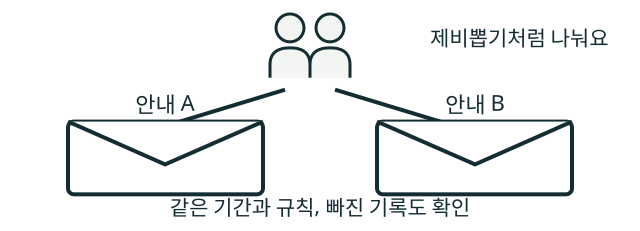

다음 질문은 “어떤 고객에게 좋았을까”다. 처음 차를 알아보는 사람에게 편한 안내가 이미 차를 가진 고객에게도 똑같이 도움이 된다고 단정할 수는 없다. 전체 결과를 먼저 읽고 그 효과가 어떤 고객 구성에서 나왔는지 살핀다. 이것이 해체와 입체화(Prism), Vector Segmentation이다. 정책에 중요하고 자료가 뒷받침된다면, 처치 전 고객 상태에 따라 미리 나누기로 정한 집단에서 효과가 다른지도 확인한다. 전체 평균을 버리거나 모든 고객을 끝없이 쪼개는 일이 아니다. 나눌 이유 없이 가장 좋은 조각만 고르면 우연을 전략으로 오해할 수 있다. 지금 결과가 누구까지 설명하는지 남기고, 더 살필 자료가 없다면 모른다고 적는다.


마지막으로 “그래서 지금 써도 될까”를 묻는다. 예약이 늘어도 실제 시승까지 이어지는지는 따로 봐야 한다. 시승차와 직원이 부족하면 기다림이 길어지고, 추가 비용이나 원하지 않는 연락이 늘어날 수도 있다. 이것이 언어의 전환(Translation), Value-Linked Decision이다. 좋은 숫자를 돈으로 포장하는 일이 아니라 관측한 차이와 남은 불확실성을 회사의 선택에 연결한다. 실제 계약이나 이익을 관측하지 않았다면 그 부분은 모른다고 남긴다. 비용뿐 아니라 고객 관계, 운영 부담, 결정을 되돌릴 수 있는지도 살핀다. 넓게 쓰기, 제한해서 시험하기, 자료를 더 확인하기, 중단하기 중 무엇을 선택하고 누가 확인할지 적어야 한다.


세 질문의 답은 비교 명세, 적용 범위 문장, 결정문으로 남긴다. 기록이 길어야 하는 것은 아니다. 무엇을 비교했고 어떤 차이를 관측했으며, 어느 고객에게 어디까지 적용할 수 있고 무엇을 더 확인해야 하는지 설명할 수 있으면 된다. TRI-V의 세 질문은 이 기록이 한 판단으로 이어지게 한다.

좋은 결과의 기준과 감수하지 않을 피해는 결과가 나오기 전에 정해 둔다. 나중에 모르는 사실이 드러나면 앞 질문으로 돌아간다. TRI-V는 반드시 실행하거나 반드시 보류하게 만드는 주문이 아니다. 공통 운용 기준은 이 방법을 사용할 때 질문과 기록을 빼먹지 않도록 돕는 사용설명서다.

결정문을 쓰다가도 앞에서 확인한 근거를 다시 살펴야 할 수 있다. 비용을 계산하는 데 필요한 실제 계약 기록이 없다면 측정으로 돌아간다. 고객군별 효과가 뒤집히면 집단의 정의와 배정을 다시 확인한다. 시승 슬롯이 부족해 고객들이 서로의 기회를 바꾸고 있다면 처음 설계한 비교 자체를 고쳐야 한다. 이처럼 뒤의 판단에서 드러난 문제에 따라 앞의 작업을 다시 여는 것이므로, 정화, 입체화, 번역을 차례로 체크했다고 검토가 끝나는 것은 아니다.


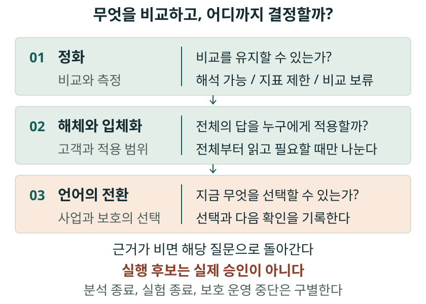


<a id="tri-v-operating-contract"></a>

## TRI-V 공통 운용 기준

이 책에서 TRI-V는 A/B 테스트의 근거와 적용 범위, 선택을 연결하는 저자의 실무 검토 틀이다. PDCA도 계획과 실행, 검토와 반영을 정리하는 틀로 참고할 수 있지만, 독자가 두 방법을 따로 외우거나 상황마다 골라 쓸 필요는 없다. 여기서는 TRI-V의 세 축을 유지하고, 필요한 확인을 빠뜨리지 않으면서 현재 선택에 기여하지 않는 작업을 줄이는 데 집중한다. 이 목표는 실제 조직의 누락과 시간을 줄였다는 검증 결과와는 구분한다.

결과표를 열기 전에 무엇을 결정할지 적는다. 같은 대상에서 A를 B로 바꾸려는지, 정한 일부 대상에만 적용하려는지, 더 알아보기 위한 새 실험을 설계하려는지는 다른 선택이다. 제한된 적용을 검토할 근거와 전면 전환을 뒷받침할 근거도 다를 수 있다. 작은 규모로 시도한다는 이유로 잘못된 비교가 유효해지지는 않는다. 불확실성을 감수하는 선택이라면 확인한 효과와 감수한 불확실성을 따로 남긴다.

<a id="b-primary"></a>

비교 명세, 적용 범위 문장과 결정문을 연결한다고 해서 문서를 세 개로 늘릴 필요는 없다. 같은 실험 식별자 아래 기존 계획을 참조하되, 그 계획에서 대비, 적격 대상과 동의, 배정 및 분석 단위, 주지표와 분모, 관측과 종료, 비교 가족과 다중성, 사업과 보호 기준을 확인할 수 있어야 한다. 확인할 수 있는 명세는 양식에 다시 입력하지 않는다. 없는 명세는 링크만 적어도 채워지지 않는다. 아래 여섯 항목에는 이렇게 확인한 근거와 남은 공백을 기록하며, 작성용 한 장 양식도 같은 순서를 따른다.

책을 처음 읽을 때에는 아래 기록표를 한 번에 완벽하게 채우려 하지 않아도 된다. 먼저 이 비교를 믿을 수 있는지, 누구에게 적용할 수 있는지, 지금 무엇을 선택할 수 있는지를 자기 말로 적어 보자. 아직 배우지 않은 계산이나 확인하지 못한 조건은 미확인으로 남긴다. 효과와 구간을 읽는 방법은 통계 장에서, 필요한 고객 수와 관측 기간은 정보량을 다루는 장에서 익힌 뒤 기록을 고쳐 쓴다. 직접 계산하거나 평가 설계를 정하기 어려운 부분은 분석 담당자에게 확인할 질문으로 남긴다. 이는 배우는 순서이며, 실제 실행에 필요한 확인을 생략해도 된다는 뜻은 아니다.

| 기본 기록 | 남길 내용 |
|---|---|
| 지금 결정할 것 | 가능한 대안과 적용 범위. 전체 전환, 범위가 정해진 적용, 현행 유지 또는 새 검증 중 무엇을 판단하는지 적는다. |
| V1 믿고 쓸 근거와 제한 | 주지표와 보호 지표의 결과 위치, 의존 원장과 현재 사용할 수 없는 주장의 범위를 연결한다. |
| V2 적용 대상 | 배정, 분석, 적용 모집단이 같으면 같다고 적고 다르면 차이와 근거만 남긴다. |
| V3 현재 선택 | 실행 후보, 조건부 실행 후보, 추가 확인, 미확대 또는 운영 중단 제안. 통계 판단, 보호 상태와 실제 승인을 구분한다. |
| 추가 확인 또는 생략 | 어떤 확인 결과가 어떤 선택을 바꾸는지 적는다. 필요하면 조건별 행동과 담당 및 기한을, 생략하면 이유와 예외를 남긴다. |
| 다시 검토할 조건 | 어느 관측과 가정 변화가 들어오면 현재 선택을 다시 볼지 적는다. |

V1에서는 측정 상태와 추론 상태를 나눈다. 자료를 해석할 수 있어도 효과의 방향은 불확정일 수 있다. 측정 결함이 있으면 그 원장에 의존하는 주장만 제한하고 복구 검사를 적는다. 완료 원장이 손상됐다면 그 완료로 계산한 이익도 제한된다. 독립적으로 대사한 다른 원장이 있으면 그 결과까지 자동으로 버릴 필요는 없지만, 독립성을 확인하지 않고 남겨서는 안 된다. 현재 상태는 해석 가능, 일부 지표 제한 또는 비교 보류로 기록한다.

V2의 기본 경로는 현재 전체 범위만 지지하는지 확인하는 것이다. 세분화를 하지 않았다는 기록은 효과가 균일하다는 증명이 아니다. 집단 차이나 다음 대상의 변화가 선택에 중요할 때 사전 정의, 직접 효과 차이와 불확실성 및 다중성을 검토한다. 집단 차이는 탐색인지, 범위 밖 적용은 추가 확인이 필요한지 구분한다. 적절하게 계획하고 검증한 집단의 적용 근거가 이미 있으면 무조건 재실험을 요구하지 않는다. 사후에 좋아 보이는 집단을 원래 목표였다고 바꾸는 것은 허용하지 않는다.

V3의 실행 후보는 근거와 범위가 정리됐다는 뜻이지 발송과 운영을 승인했다는 뜻이 아니다. 조건부 실행 후보에는 적용 규모, 감수할 불확실성, 관찰과 복구 책임이 있어야 한다. 필요한 조건과 승인자가 미정이면 그 사실과 이를 정할 역할을 남긴다. <u class="reader-emphasis">B를 채택하지 않더라도 A가 모든 대안 중 최선이라는 답이 나온 것은 아니다.</u> 이번에 비교한 대안과 범위에서는 전환 근거가 부족해 현행을 유지한다고 쓰면 된다. 다른 대안이 더 나을 가능성까지 모두 실험해야 현재 질문에 답할 수 있는 것은 아니다.

추가 확인을 정할 때에는 그 결과가 달라지면 현재 선택도 달라지는지 먼저 묻는다. 실제 비용이 궁금하다면 선택이 바뀌는 비용 범위와 그 범위를 벗어날 현실적 이유를 살핀다. 고객군 분석이 필요하다면 현재 적용 대상에 전체 결과를 옮기기 어려운 구체적 이유를 적는다. 이렇게 써야 자료를 더 모으는 일이 어떤 판단에 필요한지 알 수 있다. 어떤 결과가 나오든 현재 행동이 같다면 그 확인은 현재 결정에 필요하지 않을 수 있다. 다만 이 판단으로 동의와 안전, 권리 대응과 법정 감사 및 다른 사업 목적의 의무까지 생략할 수는 없다.

여기서 <u class="reader-emphasis">추가 분석을 멈추는 것, 실험을 종료하는 것, 운영을 중단하는 것은 서로 다르다.</u> 추가 세분화가 선택에 기여하지 않으면 그 분석을 하지 않을 수 있다. 실험의 통계적 종료는 사전에 정한 고정 종료나 적절한 순차 절차를 따른다. 유리한 결과가 잠깐 나왔다는 이유로 조기 종료하지 않는다. 운영 중단은 보호 문제 등에 따른 실행 조치이며, 피해 대응을 분석 완료 때까지 늦추지 않는다.

<a id="b-sensitivity"></a>

측정이 제한되면 해당 주장과 복구만, 적용 범위가 달라지면 그 차이와 근거만 상세 기록으로 연다. 비용이나 공유 용량이 선택을 바꾸면 그 범위와 민감도를 추가한다. 자료가 부족하다는 이유로 모든 심화 분석을 자동으로 요구하지 않는다. 보완 가능한 정보의 공란과 비교 또는 보호에 필수인 근거의 누락을 구분하는 것이 최소 경로의 핵심이다.

세 축의 질문은 함께 검토하고, 결과가 나오기 전에 기준을 정한다. 원 계획과 실제 자료의 버전, 관측 시점과 계산 위치를 연결한다. 결과를 본 뒤 제안한 값은 사후 판단 가정으로 구분하고 변경 전후와 이유, 결과 열람 여부, 승인 상태와 영향을 받는 주장을 남긴다. 유리한 지표로 주지표를 바꾸거나 보호 한계를 느슨하게 고쳐 원래의 성공 조건처럼 쓰지 않는다. 새로운 피해를 발견했으면 계획에 없었다는 이유로 보호 조치를 미룰 필요도 없다.

뒤의 여섯 사례와 관통 실습은 이 기록을 다른 조건에 적용한다. 측정 역전은 제한된 주장으로, 고객군 차이는 적용 범위로, 공유 용량은 비교 설계와 실행 규모로 되돌아간다. 충분한 근거가 있는 경우에는 현재 범위의 실행 후보로 넘긴다. 무엇을 반드시 확인하고 무엇을 더 하지 않을지를 같은 결정에서 설명하는 것이 TRI-V의 역할이다.

이미 잘 작성된 A/B 테스트 계획이 있다면 TRI-V를 쓰기 위해 명세를 다시 입력하지 않는다. JH Motors의 원 계획인 `e-book/virtual-data/v03/experiment_plan.json`을 그대로 참조해 보자. 아래 대조는 기존 여섯 기록 항목에 무엇을 연결하고 무엇만 더 물을지 보여 준다. 결과를 읽는 위치는 뒤의 관통 실습에서 확인한다.

| 기본 기록 | 이미 있는 근거와 참조할 것 | 현재 비어 있어 추가 확인할 것 |
|---|---|---|
| 지금 결정할 것 | 완료 비교 목록에서 B-A는 안내 변경의 질문에, A-H와 B-H는 발송 여부의 질문에 연결한다. | 완료 개선을 어느 사업 조건에서 실제 안내 변경으로 옮길지는 비교 목록만으로 정해지지 않는다. |
| V1 믿고 쓸 근거와 제한 | 배정 고객당 28일 완료, 고객별 지속 배정과 완료 비교의 다중성 보정을 참조한다. 철회는 보호 관측으로 지정돼 있다. | 계획대로 측정과 집계가 이뤄졌는지 결과와 원장을 대조한다. 보호 관측이 곧 안전 비열등성 설계는 아니다. |
| V2 적용 대상 | 잠재 고객 중 기준 시점 SMS 동의가 있고 기존 시승 완료가 없는 대상이다. 집단별 발견은 미검증이다. | 다음 대상의 구성과 동의 상태가 같은지, 다른 대상까지 옮길 근거가 있는지 확인한다. |
| V3 현재 선택 | 계약과 합성 재무 결과가 탐색 분석이라는 지위를 유지한다. | 실제 도입 기준, 보호 조건과 운영 가능 범위가 미정이므로 결과를 실행 승인으로 바꾸지 않는다. |
| 추가 확인 또는 생략 | 교육용 비용 가정과 실제 회계 및 공유 용량을 구현하지 않았다는 모형의 한계를 확인한다. | 재무와 운영 담당자에게 실제 비용과 수용 범위를 요청한다. 선택과 무관한 세분화는 이유를 남기고 생략할 수 있으나 보호 의무는 남는다. |
| 다시 검토할 조건 | 원 계획에 적힌 로컬 동결 기록을 참조한다. 외부 사전등록이나 결과 전 동결 시각을 독립적으로 확인한 증거는 아니다. | 실제 기준과 보호 평가가 갖춰지거나 대상, 비용, 용량이 달라질 때 무엇을 다시 판단할지 연결한다. |

여기서 더하는 것은 새 데이터나 검정법이 아니라, 이미 있는 근거가 어느 선택을 지지하며 미확인 조건은 누구의 답으로 채울지를 잇는 기록이다. 적절하게 수행한 표준 A/B 테스트에서도 같은 근거와 조건으로 같은 결론에 도달할 수 있다. 이 대조는 TRI-V만이 가능한 판단이나 작업 효율의 입증이 아니다. 기존 계획에 이 연결까지 있다면 그 문단을 참조하면 된다. 없는 조건을 링크로 대신하거나 결과 후의 기준을 원 계획에 덧씌우지는 않는다.

# 2장 정화, 비교할 수 있는 결과를 만들기

JH Motors가 시승 안내 문구 A와 B를 비교한다고 하자. A에는 차량의 가치를, B에는 시승 예약의 편의를 강조한다. 문구를 고르기 전에 고객에게 어떤 다음 행동을 기대하는지 정해야, 나중에 어떤 숫자를 성공으로 읽을지도 정할 수 있다. 그 행동을 비교할 고객은 누구인가. 연락에 동의한 잠재 고객인지, 이미 시승을 마친 사람은 제외하는지, 한 고객이 여러 경로로 중복 참여할 수 있는지를 확인한다. 결과표를 열기 전에 두 정책의 차이와 안내를 받을 고객부터 정해야 하는 이유다.

<a id="b-incrementality"></a>

A와 B의 비교는 메시지를 보낼지 말지의 비교와 다르다. B가 A보다 낫더라도 미발송보다 낫다는 답은 나오지 않는다. 원래 방문할 고객이 어느 군에도 있을 수 있기 때문이다. 메시지 자체의 증분 효과가 궁금하다면 해당 메시지를 보내지 않는 정책과의 비교를 별도로 설계한다. 이 책의 큰 표본에는 그 정책을 H로 두었다. H를 전사적인 모든 마케팅 활동의 중단으로 해석해서는 안 된다.

대상을 정했다면 배정한 고객이 분석에도 남는지 확인한다. 개인을 배정한 실험에서는 우선 그 개인 전체의 결과를 읽는다. 메시지가 도착하지 않았다는 이유로 고객을 빼면, 배정할 때의 대상이 아니라 전달에 성공한 대상으로 비교가 바뀐다. 전달 성공은 처치 이후의 조건이기 때문이다. 실제 발송 정책의 효과를 묻는다면 전달 실패도 그 정책의 일부로 남겨야 한다. 전달자만 분석한 값은 별도의 질문에 답하므로, 배정 고객 전체에서 얻은 값과 같은 효과라고 부를 수 없다.

배정한 고객이 분석에 남아 있어도 그 고객의 행동이 빠짐없이 기록됐는지는 별도로 확인해야 한다. 데이터베이스의 구조가 멀쩡하고 배정 수가 정확해도 B의 완료 사건만 빠질 수 있다. 원본 배정과 결과를 연결한 뒤, 방문 원장과 이벤트를 같은 고객의 같은 기간에 맞춰 대조한다. 클릭 오류가 확인됐다면 그 클릭을 쓰는 판단을 멈춘다. 이때 독립된 계약 원장까지 무조건 버릴 필요는 없지만, 계약 기록이 그 오류와 독립적으로 수집됐는지 확인해야 다른 판단에 쓸 수 있다. 시스템이 정상이라는 확인만으로는 이 측정 검사를 대신할 수 없다.

배정 비율 검사도 역할이 정해져 있다. 50:50으로 계획한 실험에서 설명하기 어려운 인원 차이가 나타났다면 원본 배정과 분석 대상 포함 과정을 조사할 단서가 된다. 계획한 비율과 잘 맞는다고 해서 이벤트 누락까지 없다는 뜻은 아니다. 반대로 애초에 다른 비율로 배정했다면 50:50을 기준으로 이상을 검사해서는 안 된다. 정상이라는 한 단어 대신 무엇을 검사했는지 써야 한다.

시간도 같은 방식으로 다룬다. 월요일의 A와 주말의 B를 비교하면 문구와 날짜의 차이가 섞인다. 가능한 한 같은 기간에 배정해 공통 변화를 함께 겪게 한다. 다만 공통 충격이 양쪽에 같은 방식으로 작용하는지, 운영이나 고객 구성이 중간에 바뀌지 않았는지는 남는다. 실험 뒤에 설명하기 어려운 차이를 임의 가중치로 눌러 없애는 것은 통제가 아니다. 사전 공변량 조정도 어떤 추정과 가정으로 사용할지 계획해야 한다.

<a id="b-randomization"></a>
<a id="b-units"></a>

지점마다 평소의 완료율이나 고객 구성이 크게 다르다면 배정 단계에서 그 정보를 쓸지 검토한다. 단순 무작위배정은 운영하기 쉽지만 모든 상황에서 가장 정밀한 방법은 아니다. 처치 전에 알 수 있고 결과와 관련이 큰 고객 상태나 지점 안에서 무작위로 나누는 블록 설계는 비교의 정밀도를 높이는 데 도움이 될 수 있다. 다만 집단을 지나치게 잘게 만들면 배정과 분석의 부담이 커진다. 실제로 관리할 수 있는 사전 정보인지, 분석이 배정 구조를 반영하는지 보고 선택한다. 블록 안에서 고객을 무작위로 나누더라도 모든 특성이 정확히 같아지는 것은 아니다. 같은 지점의 시승차를 서로 빼앗는 간섭도 블록이라는 이름으로 해결되지 않는다. 이때에는 배정 단위와 비교 정책부터 다시 검토한다.<span class="footnote" data-note-id="fn-2">블록 설계의 선택 원칙은 NIST 공개 문서를 참고했다. 단순 무작위배정의 보편적 열등을 뜻하지 않는다. 서지 [3].</span>

뒤의 사례5를 설계 단계로 되돌려 보자. 신규 관심 고객과 기존 고객이 메시지를 받기 전부터 구분되고, 평소 반응과 운영 조건도 다를 것으로 예상된다면 이 상태 안에서 A와 B를 배정하는 안을 검토할 수 있다. 기록에는 배정 직전의 상태와 블록 식별자, 각 상태 안의 배정 확률과 실제 배정 수를 남긴다. 발송 뒤 클릭한 사람을 새 블록으로 만드는 것은 이 설계가 아니다. 클릭 자체가 메시지의 영향을 받기 때문이다.

| 설계에서 확인한 조건 | 선택과 남길 근거 |
|---|---|
| 같은 적격 대상에서 독립적인 개인을 비교하며 중요한 사전 차이를 따로 관리할 이유가 크지 않음 | 단순 무작위배정을 기본안으로 두고 배정 확률과 분모를 기록한다. |
| 결과와 관련된 고객 상태를 처치 전에 안정적으로 알 수 있음 | 상태 안 무작위배정을 검토하고 목표 고객 구성과 분석 가중치를 사전에 정한다. |
| 같은 지점의 시승 슬롯을 고객끼리 경쟁함 | 상태별 균형만으로 해결하지 않는다. 배정 단위와 운영 정책을 다시 설계한다. |

<a id="b-estimand"></a>

사례5의 고정된 신규와 기존 구성은 그 실습의 추정 대상이다. 블록을 쓴 뒤에는 전체 고객을 아무렇게나 합치는 대신 정한 목표 구성에 맞게 효과와 불확실성을 읽어야 한다. 신규가 많은 다음 캠페인으로 옮기면 평균 효과가 달라질 수 있으므로 같은 추정값을 복사하지 않는다. 설계 검토 기록은 “사전 고객 상태 안에서 무작위배정하고 정한 구성으로 전체 효과를 읽는다. 지점 간 자원 간섭이 있으면 개인 비교를 그대로 승인하지 않는다”로 정리할 수 있다. 이는 실제 배정을 완료했다는 보고가 아니라, V1의 비교 근거와 V2의 적용 대상을 정하는 문장이다.

배정 후 28일의 시승 완료를 묻는다면 늦게 들어온 고객에게도 28일의 관측 기회를 줘야 한다. 달력의 종료일만 같게 맞추면 고객마다 결과를 만들 수 있는 시간이 달라질 수 있기 때문이다. 등록 직후 시승 기록이 없는 고객을 곧바로 영구적인 미완료로 확정해서는 안 된다. 계약과 출고에는 더 긴 시간이 필요할 수도 있다. 사건이 없다는 값인지, 아직 관측 시간이 지나지 않은 상태인지, 기록이 빠진 것인지 먼저 구분해야 관측 결과를 읽을 수 있다.

마지막으로 배정 단위 바깥의 영향을 살펴야 한다. 같은 가구가 차량을 함께 고르거나 같은 지점의 시승차를 나누어 쓰면 한 고객의 처치가 다른 고객에게 영향을 줄 수 있다. 고객 수가 많다는 이유로 이런 의존성이 사라지지는 않는다. 개인 실험으로 답할 수 있는 질문인지, 지점이나 기간을 묶어 비교해야 하는지 다시 정한다. 뒤의 용량 사례에서는 바로 이 지점으로 되돌아온다.

다음 단계로 넘어가기 전에, 무엇을 비교했고 데이터가 어떤 경로로 모였는지 설명할 수 있어야 한다. 남아 있는 문제가 어느 결과를 제한하는지도 함께 밝혀야 한다. 정화가 끝났다는 말은 이 설명을 할 수 있다는 뜻이지 현실의 잡음을 완벽히 제거했다는 선언이 아니다. 설명하지 못한 공백은 다음 단계에서 더 정교한 검정을 고른다고 메워지지 않는다.

이 축의 작성 결과는 1장의 공통 운용 기준에 있는 비교 명세다. 해석 가능, 일부 지표 제한, 비교 보류 중 현재 상태와 근거를 남기고, 미확인 자료의 소유자와 확인 기한 또는 기한 결정 책임자를 적는다. 모든 칸을 채웠다는 사실이 통계적 타당성을 보증하는 것은 아니다.

# 3장 해체와 입체화, 평균 아래의 고객을 읽기

전체 완료율이 올랐다는 보고는 실험 대상으로 삼은 고객 전체에 어떤 변화가 있었는지 보여준다. 그 결과를 실행으로 옮길 때에는 누구에게 어떤 행동을 요구할지 정해야 한다. 연락을 처음 받는 고객, 이미 차량을 가진 고객, 관심 모델을 바꾼 고객에게 같은 안내가 똑같이 도움이 된다고 전제할 수는 없다. 전체 평균을 먼저 읽되, 그 평균을 바탕으로 정책을 적용할 고객을 다시 살펴야 하는 이유다.

<a id="b-segments"></a>

TRI-V의 두 번째 단계에서는 고객을 나눈 뒤 실제로 어떤 행동을 달리할 수 있는지 묻는다. 예를 들어 구매 가능성이 높은 고객을 찾는 일과 메시지 때문에 구매가 늘어날 고객을 찾는 일은 다르다. 원래 구매할 고객의 높은 구매율을 캠페인이 만든 성과로 읽으면, 연락하지 않아도 살 사람에게 예산을 몰아줄 수 있다. 따라서 세그먼트를 정할 때에는 분류의 이름보다 그 분류에 따라 행동을 달리할 이유를 설명해야 한다.

<a id="b-diagnostic"></a>
<a id="b-post-treatment"></a>

집단은 가능하면 처치 전의 상태로 정한다. 발송 뒤 클릭한 고객끼리 비교하면 B가 클릭하도록 만든 사람이 A와 다를 수 있다. 클릭, 예약, 상담처럼 처치 이후에 나타나는 행동으로 대상을 고르면 원래의 무작위 비교를 그대로 유지하기 어렵다. 예약자 중 완료율은 퍼널을 진단하는 데 쓸 수 있다. 그렇지만 배정 고객 전체에 대한 정책 효과를 대신하지는 못한다.

사전에 신규와 기존 고객을 나누었다면 전체 효과를 먼저 보고 각 집단의 효과를 읽는다. 고객군에 따라 정책을 달리하려면 여기서 한 번 더 물어야 한다. 두 집단의 효과는 얼마나 다른가. 신규에서는 유의하고 기존에서는 유의하지 않다는 결과만으로는 이 질문에 답할 수 없다. 표본 수가 다르면 같은 크기의 효과도 한쪽에서만 유의해질 수 있기 때문이다. 두 집단의 효과 차이를 직접 추정하고 그 불확실성을 계산해야 집단 간 차이를 판단할 수 있다.

<a id="b-interaction"></a>

효과를 표현하는 척도도 결정에 맞아야 한다. 완료율이 낮은 집단과 높은 집단에서 같은 상대 변화가 생겨도, 고객 100명당 늘어나는 완료 수는 다르다. 시승 슬롯과 비용을 계획한다면 퍼센트포인트의 절대 차이가 도움이 된다. 오즈비에서의 상호작용과 위험차에서의 상호작용은 같은 명제가 아니다. 어느 척도로 어떤 결정을 하려는지 먼저 적는다.

집단별 효과를 읽었다면 다음에는 그 집단이 적용 대상에 얼마나 포함되는지 살펴야 한다. 신규와 기존이 절반씩인 실험에서 얻은 전체 효과를 기존 고객이 대부분인 캠페인에 그대로 옮길 수는 없다. 집단별 효과를 새 구성에 맞게 가중하려면, 고객 상태 안에서 효과가 이동할 수 있다는 가정을 두고 그 불확실성도 함께 읽어야 한다. 이렇게 계산한 값은 새 회사에서 직접 관측한 효과가 아니라, 기존 결과를 다른 구성에 옮겨 본 추정이다.

고객 구성이 중요하다고 해서 자료를 계속 잘게 나누면 되는 것은 아니다. 고객 상태, 차종, 채널, 기기, 기간을 끝없이 조합할수록 우연히 좋은 집단을 찾기 쉽다. 그래서 처음부터 확인하기로 한 집단과 결과를 본 뒤 발견한 집단을 구분해야 한다. 사후에 발견한 집단은 다음 실험의 대상으로 삼을 가치가 있을 수 있지만, 이번 결과를 독립적으로 검증한 근거로 소개할 수는 없다. 나눈 집단의 수보다 그 집단을 언제, 왜 살펴봤는지가 중요하다.

해체와 입체화의 끝에는 적용 대상에 관한 문장이 남는다. 이번 평균이 누구를 대표하는지, 고객별로 정책을 달리할 근거가 있는지, 새로 시험할 대상은 누구인지 쓰는 것이다. 전체의 승리와 모든 고객의 승리를 구분할 수 있다면 두 번째 단계가 의사결정에 기여한 셈이다.

여기서 남길 것은 공통 운용 기준의 적용 범위 문장이다. 현재 전체 효과만 읽는 이유와 다음 대상의 차이를 적는 것까지가 최소 경로다. 추가 집단 분석이 필요하다면 그 질문과 정보량, 사전 및 사후 지위를 표시한다. 세분화를 하지 않은 기록도 효과가 균일하다고 보장하지 않는다면 정당한 결과물이 될 수 있다.

# 4장 언어의 전환, 차이를 회사의 선택으로 옮기기

실험에서 차이를 확인했다면 그 개선을 실제로 얻기 위해 무엇을 감당해야 하는지 계산해야 한다. B의 완료율이 높더라도 추가 발송비와 상담 인력이 필요할 수 있다. 시승 증가가 계약 증가로 이어지는지, 바뀐 안내가 고객의 기대를 과도하게 높이지는 않았는지도 남은 질문이다. Value-Linked Decision은 관측한 개선과 이런 조건을 함께 놓고 현재 선택할 수 있는 범위를 살핀다.

<a id="b-ltv"></a>

시승 완료만 관측했다면 선택을 설명할 때에도 그 사실에서 출발한다. 매출, 고객생애가치, 고객획득비용 같은 지표를 계산하려면 그에 맞는 실제 자료가 필요하다. 계약이나 장기 유지로 이어지는 비율을 가정해 계산했다면, 관측한 값과 구분하고 가정을 바꿨을 때 판단이 얼마나 달라지는지 보여줘야 한다. 나는 이런 구분을 통해 무엇을 선택할 수 있는지 설명하는 일을 언어의 전환이라고 본다. 경영진이 듣고 싶어 할 숫자를 만들어내는 일과는 다르다.

선택을 설명하려면 어느 정도의 개선이 있어야 바꿀 만한지도 정해야 한다. 이것이 바꾸는 비용과 기회를 고려한 최소 사업 효과다. 한편 표본 계획의 최소 검출 효과는 정한 유의수준과 검정력에서 구분하려는 변화이므로, 두 기준은 같지 않다. 회사가 최소 0.5퍼센트포인트의 완료 개선을 필요로 하더라도 기존 실험이 그 기준을 입증하도록 설계됐는지 별도로 확인해야 한다. 기준은 가능하면 결과 전에 정하고, 나중에 정했다면 사후 판단 가정으로 남긴다.

차이가 0보다 크다는 근거가 있어도 최소 사업 효과 이상이라고 말할 근거는 부족할 수 있다. 이때에는 부족한 근거를 어떻게 다룰지 정해야 한다. 개선 크기를 더 확실히 확인할 후속 실험을 설계할 수도 있고, 비용이 낮고 되돌리기 쉬운 범위에서 불확실성을 감수하며 적용할 수도 있다. 후자를 택한다면 확인한 효과와 감수한 불확실성을 구분해 써야 한다. 적용하기로 했다는 사실이 충분한 크기의 효과를 확인했다는 뜻으로 바뀌지는 않는다.

고객 관계에 대해서는 좋은 방향이 반대일 수 있다. 완료율에서 양의 차이는 반갑지만 철회율과 불만률에서는 그렇지 않다. 차이를 발견하지 못했다고 안전한 것으로 처리하지 않는다. 의미 있는 악화를 배제할 만큼 정밀한지, 사전에 정한 허용 한계와 맞는 방법으로 평가했는지 확인한다. 중대한 안전이나 동의의 문제를 이익과 상쇄하는 점수표도 만들지 않는다.

재무 지표로 정책을 비교할 때에도 배정 고객 전체가 분모에 남아야 한다. 계약한 고객만 골라 평균을 내면 구매하지 않은 고객이 사라지고, 총액만 비교하면 고객이 더 많이 배정된 군이 유리해질 수 있다. 고객당 단위로 맞춘 뒤 매출에서 할인, 운영비, 취소, 잠식을 어디에 반영했는지 확인한다. 이어 앞으로의 선택 때문에 새로 드는 비용과 이미 발생해 되돌릴 수 없는 비용을 구분해야 한다. 캠페인을 새로 만들 때의 고정비와 매몰비용은 향후 결정에서 역할이 다르기 때문이다.

비용만큼 운영의 범위도 중요하다. 적은 고객에게 B를 보낼 때에는 비어 있던 시승 슬롯이 전면 발송에서는 부족할 수 있다. 같은 B라도 처리할 수 있는 규모가 다르면 고객이 겪는 경험이 달라진다. 이때 평균 효과를 전체 고객 수에 곱하는 대신 용량과 대기를 포함한 정책을 다시 비교해야 한다. 비용을 번역하다 비교 설계로 돌아가는 일이 생기는 것이다.

이 단계의 결과는 실행, 중단, 전환 가운데 하나의 단어로 끝나지 않는다. 실행한다면 누구에게 어느 규모로 적용할지, 전환한다면 무엇을 고쳐 다시 비교할지, 보류한다면 누가 어떤 자료를 마련하면 재개할지 적는다. Go, Stop, Pivot은 결정을 압축한 이름일 뿐 그 이유를 대신하지 못한다.

통계적 우위를 기록한 뒤에도 실행에 필요한 질문은 남는다. 관계 위험을 모르면 그 부분은 미확인으로 남겨야 하고, 평균은 좋아도 어떤 고객에게 손실이 있다면 적용 정책을 다시 생각해야 한다. 데이터가 손상됐다면 그 결과를 잠시 내려놓고 확인해야 한다. 이 축에서는 확인한 차이가 어느 선택까지 뒷받침하는지 설명하고, 아직 뒷받침하지 못하는 부분은 다음에 할 일로 남긴다. 통계적 우위와 실행 선택을 서로 다른 기록으로 쓰는 이유다.


이 축의 산출물은 공통 운용 기준의 결정문이다. 현재 선택과 근거, 미확인 조건, 책임과 기한 및 재검토 계기를 함께 쓴다. 사업과 보호 기준은 가능하면 결과 전에 공통 기준에 기록하고 사후 변경은 별도 이력으로 남긴다. 조건부 실행 후보와 실제 승인, 보호 조치와 분석 결론을 서로 대신하지 않도록 한다.

# 5장 숫자를 읽을 때 필요한 통계

JH Motors의 CRM 담당자는 차량 가치 안내 A와 시승 편의 안내 B 중 어느 정책이 실제 시승 완료를 늘리는지 알고 싶다. H는 해당 실험 메시지를 보내지 않는 비교 정책이다. 이 두 장에서는 같은 합성 사례로 결과를 읽고 다음 실험을 설계한다. 고객 수와 행동 확률은 교육용 가정이다. 실제 자동차 회사의 성과나 자료 규모에 따른 현실성의 검증으로 읽지 않는다.

<a id="b-itt"></a>
<a id="b-pvalue"></a>

담당자의 첫 작업은 p-value를 찾는 것이 아니라 문장의 분모를 고정하는 일이다. 이 실험의 주지표는 배정 후 28일 안에 시승을 완료한 고객 수를 배정 고객 수로 나눈 비율이다. 한 고객이 여러 번 클릭해도 분모는 늘지 않고, 완료 기록이 여러 건이어도 주지표에서는 완료 고객 한 명으로 센다. 전달에 실패한 고객도 원래 배정군에 남긴다. 정책을 실제로 운영했을 때 생기는 전달 실패까지 포함한 배정 정책의 효과를 묻기 때문이다. 전달 성공자만 남기면 질문과 비교 대상이 달라진다.

자료의 A에는 21,637명 중 1,971명, B에는 22,024명 중 2,212명의 완료가 있다. 나누어 보면 A 완료율은 약 9.11%, B는 약 10.04%다. B의 완료 건수가 더 많다는 사실만으로는 충분하지 않다. B에는 배정 고객도 더 많기 때문이다. 두 비율을 비교해야 같은 고객 수 기준으로 정책의 차이를 읽을 수 있다. 그렇다고 분모를 억지로 맞추려고 B 고객 일부를 버릴 필요는 없다. 실제 분모를 유지하고 그 차이를 반영하는 분석을 하면 된다.

<a id="b-effect"></a>

B 비율에서 A 비율을 뺀 절대 차이는 약 +0.93퍼센트포인트이며, 이 책에서는 퍼센트포인트를 pp로도 쓴다. 같은 차이를 A 비율로 나눈 상대 변화는 약 +10.26%다. 앞의 값은 고객당 완료 확률이 얼마나 달라졌는지, 뒤의 값은 A의 수준에 견주어 얼마나 커졌는지를 말한다. 상대 변화만 크게 인쇄하면 작은 절대 차이를 큰 사업 성과처럼 느끼기 쉽다. 보고서에는 두 군의 분모와 사건 수, 기준율, 절대 차이를 먼저 적고 상대 변화는 보조 설명으로 붙인다.

그렇다면 이번에 얻은 +0.93pp는 배정이 달라져도 비슷했을까. 배정 결과가 달랐다면 군별 완료 고객 수와 추정값도 달라질 수 있다. 고객별 결과와 무작위배정에 따른 표본 변동이 남아 있기 때문이다. 이제 읽어야 할 것은 차이의 방향만이 아니라, 그 차이를 얼마나 정밀하게 추정했는가다.

표준오차는 같은 설계와 모형 아래 표본을 다시 얻을 때 추정값이 얼마나 흔들릴지를 나타내는 크기다. 고객 한 명의 결과가 얼마나 다양하다는 표준편차와 구분한다. 이 사례에서는 각 고객이 완료 또는 미완료로 기록되고 두 군이 독립이라고 가정한다. 각 군의 비율과 고객 수로 비율 추정의 분산을 구한 뒤 더하고 제곱근을 취하면 차이의 표준오차를 근사할 수 있다. 식으로는 `제곱근[pB×(1−pB)/nB + pA×(1−pA)/nA]`다. 여기의 pA와 pB는 관측 비율이고 n은 배정 수다.

교육용 독립 이항 가정에서 위 식으로 계산한 표준오차는 약 0.28pp다. 이 값을 효과 0.28pp나 고객의 0.28%에 생긴 오류로 읽으면, 추정의 흔들림과 고객의 결과를 혼동하게 된다. 여기서는 +0.93pp라는 추정값의 정밀도를 읽는 눈금으로 쓴다. 같은 비율에서 독립 고객의 정보가 늘면 보통 이 눈금은 작아진다. 반면 같은 고객의 클릭 기록을 복제해도 독립 정보는 늘지 않는다. 정밀도를 높였다고 말하려면 로그 행 수가 아니라 고객 수를 확인해야 하는 이유다.

<a id="b-ci"></a>

신뢰구간은 효과 추정의 흔들림을 범위로 읽는 데 쓴다. 표준오차가 클수록 구간 폭이 넓어진다는 직관을 잡되, 실제 보고값은 검증 장부의 구간을 읽는다. 직관을 설명하는 근사와 보고 구간의 계산 절차는 다를 수 있으므로 사용한 방법도 확인한다. 구간을 산출하고 대조하는 방법은 [계산 방법과 분석 확인](#analysis-method-notes)에 남긴다.

A/B/H의 세 완료 대비를 함께 고려한 B-A 구간은 약 +0.26pp에서 +1.61pp다. 점추정은 +0.93pp지만 불확실성을 읽을 때에는 양 끝도 함께 본다. 이 범위는 분석 가정과 절차 아래 효과를 추정한 결과이지, 앞으로 발생할 고객별 결과의 범위가 아니다. 신뢰수준은 같은 절차를 반복했을 때 만들어지는 구간들의 포함 성질을 말한다. 이번 구간에 참값이 들어 있을 확률을 그대로 신뢰수준이라고 번역하거나, 그 안의 모든 효과가 똑같이 그럴듯하다고 해석하지 않는다.

구간이 좁아졌다면 무엇을 더 잘 알게 된 것일까. B의 방문 기록만 누락되었거나 다른 캠페인이 B에 더 많이 노출되었다면, 표본을 더 모아 구간을 좁혀도 치우친 비교는 그대로 남는다. 슬롯 경쟁으로 B 고객이 A 고객의 기회를 빼앗는 상황 역시 독립 이항 계산의 범위를 벗어난다. 구간 폭은 명시한 모형 안의 표본 불확실성을 주로 보여준다. 따라서 측정 오류와 간섭, 적용 고객의 변화, 원가 가정의 오차는 따로 점검해야 한다. 좁은 구간을 보고 자료 품질까지 확인했다고 결론내릴 수 없는 까닭이다.

p-value를 읽을 때는 먼저 무엇을 차이 없음으로 놓았는지 확인한다. 여기서 B-A의 양측 검정은 두 정책의 완료 확률 차이가 0이라는 가설을 기준으로, 분석 가정 아래 양쪽 방향에서 관측한 검정통계량만큼 또는 더 극단적인 값이 나올 확률을 구한다. 이 확률을 계산하는 방법은 [계산 방법과 분석 확인](#analysis-method-notes)에서 분석 담당자와 확인한다.

이 사례의 미보정 p는 약 0.0009133이다. 효과가 없다는 귀무가설과 분석 가정 아래에서, 관측한 검정통계량만큼 또는 그보다 더 극단적인 값을 얻을 확률이다. 이 조건의 방향을 거꾸로 읽으면 효과가 우연일 확률이나 귀무가설이 참일 확률, B가 최선일 확률로 오해하게 된다. 자료를 평가할 때 가정을 조건으로 삼았다는 점을 놓치지 않아야 한다. 또 p가 작더라도 효과의 크기는 따로 읽어야 한다. 작은 차이도 매우 정밀하게 추정하면 작은 p를 얻을 수 있기 때문이다. 그래서 이 값을 읽은 뒤에는 효과의 크기와 구간으로 돌아가야 한다.

<a id="b-multiplicity"></a>
<a id="b-alpha"></a>

이 사례에서는 B-A뿐 아니라 A-H와 B-H도 묻기 때문에 미보정 p만으로 판단하지 않는다. 세 완료 대비를 주분석 가족으로 정하고 Bonferroni를 적용했다. 가족 유의수준 5%를 나누면 각 대비의 기준은 0.05/3이고, 대응 양측 구간 수준은 약 98.33%다. B-A의 보정 p는 약 0.00274다. 보정 p는 가족 기준과, 미보정 p는 나눈 기준과 비교한다. 보정 p에 기준까지 다시 나누면 중복 보정이다.

어떤 결과까지 이 보정으로 보호받는지는 함께 하기로 정한 주장에 달려 있다. 화면에 숫자를 나란히 놓았다고 같은 가족이 되지는 않는다. 이 완료 가족이 다루는 범위 밖에는 철회와 계약, 손익, 모든 세그먼트 결과가 남아 있다. 결과를 본 뒤 가장 유리한 지표나 집단을 골라 같은 확증 결론에 붙이면 비교 기회가 늘어나므로 그 선택도 다루어야 한다. 고객 전체의 효과를 본 다음 신규 고객과 기존 고객을 탐색할 수는 있다. 다만 한 집단에서만 유의하고 다른 집단에서는 비유의하다는 관찰만으로 두 효과가 다르다고 결론내릴 수는 없다. 그 차이를 알려면 집단 차이 자체를 묻는 비교와 선택의 처리가 필요하다.

여러 후보 중 관측값이 가장 높은 정책은 운이 좋은 후보일 수도 있다. 다중 비교 보정은 정한 가족의 거짓 양성 위험을 다루지만, 선택된 최고 효과가 얼마나 과장되는지를 자동으로 해결하지는 않는다. 이번 표본의 최대값을 다음 달의 확정 효과로 예산에 넣지 않는 이유다. 독립된 새 표본에서 확인하거나 선택 과정을 반영한 추정을 검토할 수 있다. 후보를 고르는 일과 고른 후보의 효과를 신뢰할 만하게 추정하는 일은 관련되어 있지만 같은 과제가 아니다.

<a id="b-cluster"></a>

검정 결과와 신뢰구간은 함께 읽되, 서로 다른 근사 절차이므로 모든 경계에서 정확히 같은 판단을 준다고 보장하지 않는다. 사건 수가 적거나 군집과 반복 관측이 있다면 익숙한 공식을 그대로 쓰지 않는다. 배정 단위와 결과 형태, 독립성, 관측 종료와 비교 가족에 맞는 방법인지 분석 담당자와 확인한다. 방법별 대조는 [계산 방법과 분석 확인](#analysis-method-notes)에 남긴다.

정한 완료 가족과 분석 가정 아래에서는 B가 A보다 완료율을 높인다는 근거가 있다. 이 결론은 시승 완료에 관한 것이지 계약 이익에 관한 것이 아니다. H 역시 이번 실험 메시지의 미발송일 뿐 모든 CRM 접촉을 막은 전사 대조군은 아니다. B-A는 문구 정책의 차이, B-H는 이번 메시지를 보내는 정책과 보내지 않는 정책의 차이를 뜻한다. 보고서에도 대비 이름을 남겨 같은 계산이 다른 사업 주장의 근거로 쓰이지 않게 한다.

완료 개선 근거를 얻었으니 도입할 가치도 충분할까. 사업 담당자가 최소 +0.5pp 개선이 있어야 도입할 만하다고 제안했다고 하자. 이는 기존 결과를 읽는 사후 교육용 민감도 가정이며 실험 전 승인 기준으로 정한 값은 아니다. B-A 점추정 +0.93pp는 그 값보다 크지만 구간 하한 +0.26pp는 낮다. 따라서 개선이 0보다 크다는 근거를 최소 +0.5pp 이상이라는 강한 주장으로 옮길 수는 없다. 후자를 정식으로 입증하려면 그 기준에 맞는 사전 가설과 분석을 설계해야 한다. 기존의 작은 p가 답한 질문과 사업 담당자가 지금 묻는 질문이 다르기 때문이다.

구간이 사업 기준을 걸친다고 반드시 손해라는 뜻도 아니다. 회사는 기대가치와 도입 비용, 되돌릴 수 있음, 정보를 더 얻는 비용을 고려해 제한 적용을 선택할 수 있다. 다만 그 선택은 불확실성을 감수한 의사결정이라고 기록한다. 최소 효과를 확정 입증했다는 문장으로 바꾸지 않는다. 결과를 본 뒤 통과하기 쉬운 기준으로 낮추는 경우에도 변경 이유와 사후 선택을 남긴다. 통계가 결정을 자동으로 내려주지는 않지만, 어떤 불확실성을 감수했는지 숨기지 않게 도와줄 수는 있다.

고객 보호 판단은 방향부터 다시 읽는다. 완료는 증가가 좋은 쪽이지만 동의 철회는 증가가 나쁜 쪽이다. 기존 장부의 B-A 철회 차이는 약 +0.08pp이고, 미보정 95% 탐색 구간은 약 -0.09pp에서 +0.26pp다. p는 약 0.3662다. <u class="reader-emphasis">차이를 발견하지 못했다는 결론을 안전 확인으로 바꾸지 않는다.</u> 구간에는 악화도 들어 있고, 표본이 그 악화를 구별하기에 충분하지 않을 수 있다. 관측상 철회가 늘었다는 기술과 악화를 확정했다는 추론도 서로 구분한다.

허용 악화 한계를 +0.2pp로 가정해 보아도 탐색 구간 상한은 그보다 높다. 이 한계 역시 사후 교육 가정이며 원 계획의 보호 기준이 아니다. 정식 비열등성 평가는 결과 전에 정한 한계와 단측 유의수준에 맞는 검정 또는 상한으로 설계한다. 동등성은 사전 양쪽 한계와 대응하는 절차가 필요하다. 아무 양측 구간이든 0을 포함하면 같거나 안전하다고 처리하지 않는다. 더구나 법적 동의와 중대한 안전 의무는 허용 악화 숫자와 이익을 맞바꾸어 면제할 수 없다.

회의에서는 먼저 완료율에서 B가 높았다는 관측과 정한 완료 가족에서 개선 근거를 얻었다는 통계 판단을 적는다. 그다음 사업 최소 효과를 확정 충족했는지와 관계 안전을 통과했는지를 따로 묻는다. 앞의 근거만으로는 그 두 질문에 답할 수 없으며, 실제 수익과 확대 운영에도 추가 자료가 필요하다. 분모와 효과, 불확실성 및 가정을 먼저 밝히고 통계, 사업, 보호 판단을 나누어 쓰면 긍정적인 결과가 어디까지 선택을 뒷받침하는지 드러난다.

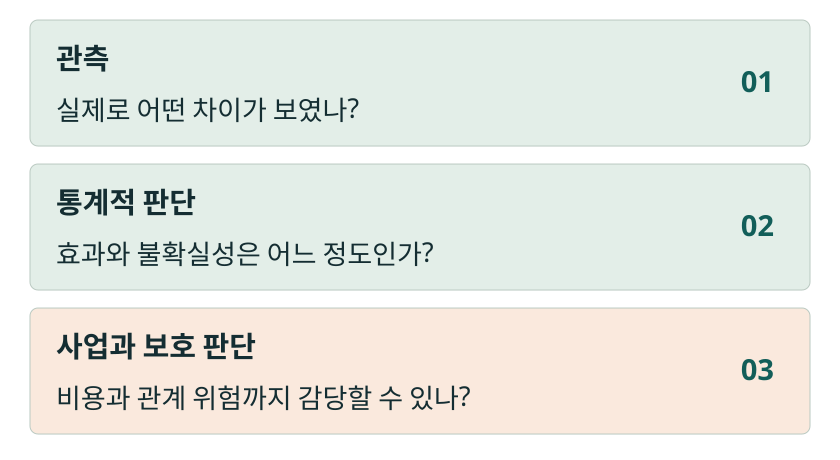

# 6장 고객 수보다 필요한 정보량부터

다음 실험에서는 어느 질문에 답할 정보가 더 필요할까. 보유 고객 수를 세기 전에 판단할 지표와 변화 크기, 감수할 오류 수준을 정해야 한다. 그래야 앞 장의 분모와 효과를 얼마나 정밀하게 추정하고 어느 정도 발견할 수 있어야 하는지 물을 수 있다. 시승 완료와 드문 계약, 관계 악화는 필요한 고객 수와 기다릴 시간이 서로 다르다. 고객이 많은 CRM이라도 무엇을 판단하려는지 정하지 않으면 충분한 정보가 있는지 답하기 어렵다.

모집단은 결과를 적용하고 싶은 고객의 범위이고, 표본은 실제로 관측한 고객이다. 실무에서는 데이터베이스 전체, 이번 실험의 적격 고객, 실제 배정 고객, 관측이 끝난 고객을 더 구분해야 한다. JH Motors 합성 자료의 전체 고객은 120,000명이고 적격 배정은 65,559명이다. 잠재 고객인지, 기준 시점에 연락 동의가 있는지, 기존 시승 경험이 없는지를 확인한 결과다. 이 표본의 근거로 이미 시승을 마친 고객이나 동의가 없는 고객까지 정책을 넓히면 적용 범위가 달라진다.

적격 고객 안에서 정책을 비교할 수 있게 되었다면 모든 미래 고객에게도 결과를 옮길 수 있을까. 무작위배정과 무작위추출을 구분해야 이 질문에 답할 수 있다. 적격 고객을 A/B/H에 무작위배정하는 일은 그 집단 안의 정책 차이를 비교하는 데 도움이 된다. 그러나 모든 미래 고객과 모든 지점의 대표성까지 보장하지는 않는다. 모집 경로와 계절, 지점 수용량이 달라지면 적용 효과도 달라질 수 있기 때문이다. 정밀도를 평가하는 작업과 적용 범위를 정당화하는 작업은 서로 대신할 수 없다. 표본 확대가 필요한지는 목표 정밀도에 따라 판단한다.

<a id="b-power"></a>

필요한 고객 수를 정할 때에는 기준율과 구분하고 싶은 절대 효과를 함께 적는다. 기준율이 시승 완료 9%이고 목표가 10%라면 계획 차이는 1pp다. 검정력은 그 계획 효과가 실제로 있을 때 정해 둔 절차가 귀무가설을 기각할 확률이다. 유의수준은 귀무가설이 참인 조건에서 잘못 기각할 위험의 기준이다. 검정력 80%를 이번 결과가 참일 확률이나 도입이 성공할 확률로 읽지 않는다. 실험을 반복하는 설계의 능력이지 한 번 얻은 결과의 정답률이 아니다.

다음 표는 독립 개인의 이항 결과, 동일한 두 군 배정, 단일 양측 비교, 유의수준 5%, 검정력 80%를 가정한 계획이다. 손실과 군집, 중간 분석 보정은 포함하지 않았다. 희귀 불만과 작은 시승 변화에는 장부의 수치 검정력 탐색값을 사용했다. 근사식과 끝자리가 다를 수 있으며, 각 수치는 이 조건에서 필요한 고객 수이지 모든 실험의 최소 인원이 아니다.

| 구분할 변화 | 군당 고객 | 두 군 합계 | 관측 기간 |
|---|---:|---:|---:|
| 클릭 10%에서 12% | 3,841 | 7,682 | 7일 |
| 시승 9%에서 10% | 13,495 | 26,990 | 28일 |
| 계약 1%에서 1.2% | 42,693 | 85,386 | 180일 |
| 철회 0.8%에서 1% | 35,001 | 70,002 | 28일 |
| 희귀 불만 0.1%에서 0.12% | 431,212 | 862,424 | 28일 |
| 작은 시승 변화 9%에서 9.09% | 1,594,361 | 3,188,722 | 28일 |

표의 첫 번째와 마지막 행에서 필요한 고객 수가 크게 갈리는 이유는 회사 규모가 아니라 묻는 변화 크기와 지표에 있다. 9%에서 10%는 절대 1pp지만 9%에서 9.09%는 상대 1%다. 더 작은 차이를 안정적으로 구분하려면 훨씬 많은 정보가 필요하므로, 이 표로 어떤 회사는 실험이 가능하고 다른 회사는 불가능하다고 나눌 수는 없다. 적은 고객으로 큰 변화를 다루는 실험은 가능할 수 있는 반면, 많은 고객으로도 아주 작은 변화나 희귀 위험은 판단하기 어려울 수 있다. 계획은 얼마나 작은 차이까지 중요하게 볼 것인지 정하는 데서 시작한다.

그렇다면 목표 차이를 더 작게 잡을 때 정보는 얼마나 더 필요할까. 기준율과 변동성, 유의수준과 검정력 및 배정 구조가 같은 작은 효과의 근사에서는 필요한 표본이 목표 효과 제곱의 역수에 대략 비례한다. 이 조건에서 목표 차이를 절반으로 줄이면 표본은 약 네 배가 된다. 이 관계는 계획의 부담을 가늠하는 데 쓰되, 정확한 고객 수는 해당 구조에 맞춰 계산해야 한다. 희귀 사건과 군집, 중간 판단 및 관측 누락이 있으면 계산 조건도 달라진다. 감당하기 어려운 표본 수가 나왔다면 사업적으로 중요한 차이와 이번 설계로 읽을 수 있는 차이가 얼마나 떨어져 있는지 드러내고, 모집 시간과 마지막 고객의 결과를 기다릴 시간을 따로 적는다.

<a id="b-mde"></a>
<a id="b-business-threshold"></a>

MDE는 정한 표본과 유의수준, 검정력, 분석 방법 아래 검출하도록 설계한 변화 크기다. 이에 비해 최소 사업 효과는 도입할 가치가 있다고 보는 기준이다. 하나는 설계가 읽어낼 변화, 다른 하나는 회사의 선택을 바꿀 변화이므로 두 값이 같을 필요는 없다. 중요한 것은 그 사이의 간격이다. 사업이 중요하게 여기는 차이를 검출하지 못한다면 회의에서 이를 드러내야 하며, 검출 가능한 차이에 맞추어 사업 기준을 사후로 바꾸어 간격을 지워서는 안 된다. 비용과 위험이 크면 더 큰 효과를 요구할 수 있고, 되돌리기 쉬운 정책이라면 작은 기대 개선을 받아들일 수도 있다.

<a id="b-maturity"></a>

이번에는 같은 회사의 후속 실험을 새로 계획한다고 가정해 보자. 이는 앞의 A/B/H 실험을 다시 해석하거나 그 표본을 바꾸는 일이 아니다. 미리 확보할 수 있는 적격 고객이 총 20,000명이고, 같은 기간에 A와 B에 10,000명씩 배정할 수 있다는 별도 교육용 조건이다. 독립 개인의 시승 완료를 단일 양측 비교로 보고, 기준율 9%에서 10%로의 1pp 변화, 유의수준 5%와 검정력 80%를 목표로 둔다. 미발송군은 없으므로 발송 자체의 증분 효과에는 답하지 않는다. 관측 창은 배정 후 28일로 놓되 누락, 군집과 중간 분석 보정은 이 계산에 넣지 않았다.

현재 수에서 1pp 변화를 발견할 계획 검정력은 같은 정규 근사와 가정 아래 약 67.4%다. 목표 80%에 필요한 수는 군당 13,495명, 합계 26,990명이어서 적격 고객 6,990명을 더 확보해야 한다. 현재 20,000명에서 목표 검정력에 맞춘 최소 검출 효과는 약 1.17pp다. 실제 관측 효과나 발견을 보장하는 경계가 아니라 계획값이므로, 다음 표의 선택을 비교하는 데 쓴다. 계산식과 라이브러리 대조는 [계산 방법과 분석 확인](#analysis-method-notes)에서 확인한다.

| 가능한 선택 | 얻는 것과 포기하는 것 |
|---|---|
| 적격 고객을 추가 확보해 목표 수를 채움 | 같은 1pp 질문의 목표 검정력을 유지한다. 모집 가능성과 대기 비용, 관측 성숙 시간을 확인해야 한다. |
| 현재 수에서 더 큰 변화를 노리는 개입을 설계함 | 큰 효과를 학습할 수 있지만 기존의 1pp 질문을 해결한 것은 아니다. 결과를 보기 전에 새로운 개입과 목표를 정한다. |
| 현재 수와 1pp 질문을 유지하고 낮은 검정력을 수용함 | 무작위 비교가 자동으로 무효가 되는 것은 아니다. 계획 효과를 놓칠 위험을 더 감수하며 비유의를 효과 없음으로 보고하지 않는다. |

사업 담당자가 최소 1pp를 중요하게 본다면 MDE를 1.17pp로 고쳐 적어도 설계와 사업 질문 사이의 간격은 남는다. 고객을 더 모을 수 있는지, 그 기다림이 현재 선택을 바꿀 만큼 가치가 있는지를 확인해야 한다. 보고서도 “고객이 부족하다”에서 멈추지 않고 “현재 모수에서는 정한 계획 효과의 발견 능력이 목표보다 낮다”라고 이유를 밝힐 수 있다. 이어 추가 모집 가능성과 비용을 확인해 목표 검정력을 유지할지, 다른 개입을 학습할지, 낮은 발견 능력을 수용할지 정한다. 이 선택은 결과를 보기 전에 해야 하며, 결과를 본 뒤 유리한 효과 크기로 계획을 갈아 끼우지 않는다.

이 기록은 기존 여섯 칸을 그대로 쓴다. 첫 칸의 결정은 후속 설계의 선택이고, V1에는 계산 가정과 정밀도 한계, V2에는 연락 동의와 미시승 적격 고객의 범위, V3에는 현재 승인 상태를 남긴다. 추가 확인에는 모집 가능성과 대기 비용의 담당 역할을, 재검토 조건에는 확보 가능한 고객 수나 기준율이 바뀌는 경우를 적는다. 위 수는 주지표에 대한 계획일 뿐 철회와 불만의 보호 정보량까지 충족했다는 뜻은 아니다. 실제 모집과 발송 전에 보호 기준과 필요한 수를 별도로 설계하고 승인받아야 한다.

같은 사례의 A는 차량 가치 안내, B는 시승 편의 안내, H는 해당 실험 메시지 미발송이다. 앞 장에서 사용한 분모와 결과는 다음과 같다. 모집단 속성, 배정, 전달, 결과, 시점에는 고정된 별도 난수 스트림을 사용했고 유의한 결과가 나올 때까지 다시 뽑지 않았다. 명세는 생성 전에 로컬에서 동결했다. 외부 기관의 사전등록이나 실제 기업 현장 실험이 아니라 이 설계로 생성한 합성 결과다.

| 군 | 배정 고객 | 28일 완료 | 180일 계약 |
|---|---:|---:|---:|
| A | 21,637 | 1,971 | 198 |
| B | 22,024 | 2,212 | 268 |
| H | 21,898 | 1,338 | 231 |

앞의 단일 비교와 달리 주지표의 세 완료 대비를 Bonferroni로 처리하면 왜 더 많은 고객이 필요할까. 9%에서 10% 변화를 구분하는 계획에 군당 18,001명이 필요했던 것은 대비별 기준이 더 엄격해졌기 때문이다. 단일 비교의 군당 13,495명과 수가 다른 이유다. 실제 배정은 각 군에서 계획 수를 넘었지만, 목표는 각 계획 대비의 검정력이며, 세 대비 모두를 동시에 발견할 공동 검정력은 아니다. 따라서 계획 수를 채웠다고 세 대비가 반드시 모두 유의할 것이라 기대해서는 안 된다. 고객 수가 충분하다고 보고할 때에도 어느 질문과 성공 규칙을 기준으로 했는지 적어야 한다.

현재 A/B 고객 수에 원래 계획 효과를 넣은 완료 검정력은 약 87.9%다. 계약 1%에서 1.2% 변화는 약 51.7%, 철회 0.8%에서 1.0% 변화는 약 59.9%다. 완료는 세 대비 보정 기준이고, 뒤의 두 수는 단일 양측 비교의 설계 가능성 시나리오다. 동일한 오류 통제의 확증 지표들이 아니다. 이 값들은 관측 효과가 아니라 미리 정한 가정 효과를 넣은 값이므로, 유의한 결과를 정당화하려고 관측 차이로 계산한 사후 검정력과 구분한다.

계약의 계획 검정력이 낮아도 사건 수와 구간을 분석해 탐색 근거로 남길 수 있다. 다만 계획한 크기의 개선이 있더라도 놓칠 가능성이 큰 설계였음을 함께 설명해야 한다. 이미 얻은 관측 효과를 다시 검정력 계산에 넣으면 p와 비슷한 정보를 반복하기 쉽다. 현재 결과에는 효과와 신뢰구간을 보고하고, 후속 설계에는 사업적으로 중요한 효과를 명시한다.

표본 수와 기간도 별개다. 등록된 고객이 많아도 각자의 결과를 기다리지 않았다면 필요한 정보는 아직 도착하지 않았다. 하루 최대 2,000명씩 등록하는 이 자료의 시작 28일째에는 58,000명이 배정되어 있지만 개인별 28일 창을 채운 고객은 2,000명뿐이다. 이 시점에는 180일 계약 창을 채운 고객도 없다. 달력에 적힌 실험 경과일이 모든 고객의 추적 기간인 것은 아니다. 후반에 들어온 고객에게는 같은 길이의 관측 기회를 보장해야 한다.

등록 종료일과 최종 결과 확정일을 따로 적는다. 늦게 들어온 고객을 미완료로 확정하면 아직 기다릴 시간을 실패로 바꾸고, 관측이 빨리 끝난 고객만 고르면 모집 시점의 구성이 달라질 수 있다. 고정 개인별 창을 사용한다면 성숙한 결과를 읽고 중간 보고에는 배정 수, 관측 성숙 수, 현재 사건 수를 나눈다. 시간 정보를 다루는 다른 분석을 설계할 수는 있지만 조기 스냅샷을 완성 자료처럼 쓰지는 않는다.

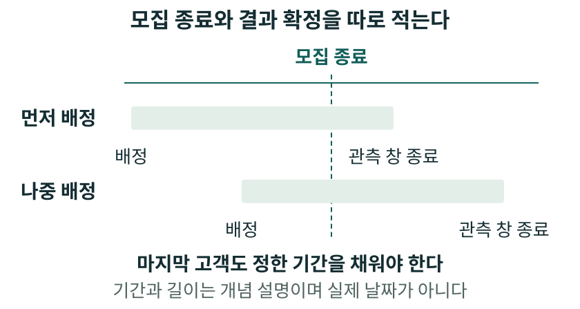

관측 창을 늘리면 항상 더 좋은 답이 나오는 것도 아니다. 짧으면 늦게 나타나는 계약을 놓칠 수 있지만, 길어지면 다른 접촉과 환경 변화, 자료 누락을 더 다루어야 한다. 시승 28일과 계약 180일은 이 실습의 교육용 정의다. 현실에서는 고객의 의사결정 주기와 어떤 정책 효과를 알고 싶은지에 맞춰 정한다. 결과를 본 뒤 유리한 날짜까지 창을 늘리거나 특정 주간만 잘라내면 원래 질문이 바뀐다. 기간은 계산을 위한 장식이 아니라 결과 정의의 일부다.

작은 기본 자료와 큰 자료는 정책과 생성 모형도 다르므로 유의성의 차이를 고객 수만으로 설명할 수 없다. 표본만의 영향을 분리한 다음 모의실험에서는 A=9%, B=10%의 독립 이항 모형을 고정하고 군당 수를 바꾸어 5,000회씩 반복했다. 대비의 양측 기준은 0.05/3이다. 표는 같은 교육 가정에서 절차의 발견 능력을 비교한 결과이며 새 기업 성과가 아니다.

| 군당 고객 | 5,000회 중 계획 효과 발견률 |
|---|---:|
| 1,000 | 5.00% |
| 5,000 | 24.32% |
| 18,001 | 80.54% |

세 행에는 같은 크기의 효과가 존재하도록 가정했는데도 발견률은 크게 다르다. 첫 행의 비유의 결과들을 효과 없음이라고 부르면 실제로 넣어 둔 개선을 놓치게 된다. 마지막 행도 매번 발견하지는 못한다. 이 반복은 표본 규모와 계획 효과의 관계를 보여주지만 세 대비 전체의 공동 오류율을 실증한 것은 아니다. 반복 횟수가 유한하므로 표의 발견률 자체도 흔들린다. 모의실험에서 얻은 수치를 모든 현장의 정확한 검정력이나 안전 보증으로 받아들이지 않는다.

희귀 사건에서는 총 고객 수보다 실제 사건 수를 함께 보는 일이 특히 중요하다. 불만이 아주 드물면 고객이 많아 보여도 두 정책의 작은 위험 차이를 구분하기 어렵다. 표에서 희귀 불만에 많은 고객이 필요한 까닭이다. 심각한 불만이 관측되지 않았다는 사실만으로 위험 확률이 0이라고 할 수도 없다. 사건 정의와 수집 경로가 제대로 작동했는지, 누가 신고에서 빠지는지, 관측 기간이 충분한지도 확인한다. 희귀 사건에는 이항 근사의 적절성부터 살피고 사건 구조에 맞는 정확 방법이나 다른 모형을 검토한다.

<a id="b-guardrail"></a>

특히 철회 악화를 발견하는 설계와 철회가 허용 한계 안임을 입증하는 설계는 다르다. 표의 철회 행은 0.8%에서 1%로 달라지는 것을 발견하는 양측 비교 계획이지, 자동으로 비열등성 안전 검증에 필요한 표본이 아니다. 허용 한계와 방향, 단측 수준, 예상 위험률, 성공 조건을 새로 정해야 한다. 여러 보호 지표를 동시에 통과해야 한다면 그 주장 구조와 오류 통제도 함께 설계한다. 완료에 필요한 고객 수를 확보했다는 이유로 관계 보호의 정보량까지 충족했다고 하지 않는다.

운영 현실에서는 독립 고객 수라는 가정부터 달라질 수 있다. 같은 가구가 메시지를 공유하거나 같은 지점의 시승 슬롯을 경쟁하면 고객 결과가 서로 연결된다. 지점 단위로 배정했다면 지점 안의 고객을 모두 독립 표본처럼 세지 않는다. 충분한 고객 수와 충분한 독립 배정 단위 수는 다르다. 군집 구조와 규모 차이, 지점 사이 변동을 반영한 설계가 필요하다. 기존 표에 임의의 여유분만 더해 현실 보정을 끝냈다고 하지 않고, 실제 배정과 분석 단위에 맞는 계획을 검토한다.

<a id="b-sequential"></a>
<a id="b-peeking"></a>

중간 결과를 자주 확인하는 문제도 모집 규모와 연결된다. 매일 고정 표본 p를 보다가 유리한 날 끝내면 원래 계획한 한 번의 검정이 아니다. 고객 안전과 배정 이상, 측정 장애는 계속 감시하되 성과 조기 종료와 구분한다. 중간 효능 판단이 꼭 필요하다면 순차 방법과 조회 시점, 종료 규칙, 비교 가족을 결과 전에 설계한다. 이미 본 경로에 순차 검정이라는 이름만 붙여 오류 통제를 소급해서 얻을 수는 없다. 계속 모집할지의 규칙도 통계 절차의 일부다.

계획된 중간 판단의 경계는 여러 번 기회를 얻으면서도 정한 오류 기준을 지키기 위한 장치다. 각 조회에 고정 종료 때와 같은 통과선을 무조건 반복하는 방식과는 다르다. 어떤 경계를 쓸지는 효과의 방향과 조회 시점, 비교 구조와 방법에 따라 달라지므로 임의의 숫자를 가져오지 않는다. 자동차 CRM에서는 모집을 멈추더라도 이미 배정한 고객의 시승과 계약 결과가 아직 도착하지 않았을 수 있다. 모집 중지, 효능 판단, 개인별 결과 확정과 고객 보호 조치를 같은 종료로 묶지 않아야 빠른 결정을 미성숙 자료의 확신으로 바꾸지 않을 수 있다. 순차 방법을 쓴다고 언제나 더 빨리 끝나거나 적은 정보로 같은 결론을 얻는 것도 아니다. 정해진 조회 때의 경계를 쓰는 설계와 계속 확인할 수 있도록 만든 추론의 조건을 구분하고, 보통의 고정 표본 p값을 이름만 바꾸어 사용하지 않는다.<span class="footnote" data-note-id="fn-3">연속 모니터링의 도입 설명만 참고했다. 순차 방법 전체를 구현하거나 증명을 검증한 것은 아니다. 서지 [8].</span>

추가 모집으로 목표 수를 확보하는 안이 채택됐다면, 종료 조건도 같은 설계서에서 정한다. 이 후속 설계가 고정 종료 방식이라면 목표 고객의 배정이 끝난 날과 모든 고객의 개인별 28일 창이 성숙한 날을 따로 기록한다. 목표 인원을 채웠다는 이유로 마지막 고객의 미성숙 결과를 미완료로 확정하지 않는다. 모집이 멈췄어도 결과 확인은 계속될 수 있다.

| 실행 중 들어온 정보 | 그때 할 수 있는 행동과 결론 |
|---|---|
| 배정 누락이나 이벤트 수집 장애 | 원장을 조사하고 해당 지표의 해석을 제한한다. 성과 우위로 읽지 않는다. |
| 일반 고정 표본 p값이 중간에 작아짐 | 예정한 최종 판단을 대신하지 않는다. 조기 효능 판단 절차가 없었다면 그 통과선으로 확대를 제안하지 않는다. |
| 중대한 권리 침해나 고객 피해 | 보호 절차에 따라 대응하고 필요하면 운영을 중단한다. 통계적 유의성을 기다리지 않는다. |

사업 담당자가 중간 효능 판단을 요구한다면 먼저 그 정보로 어떤 행동을 바꿀지 정해야 한다. 실험 전 요구를 실제 중간 판단에 반영하려면 분석 담당 역할이 조회 규칙과 오류 통제를 갖춘 설계를 사전에 제시해야 한다. 이미 결과를 본 뒤라면 같은 자료의 일반 p값에 새 순차 이름을 붙여 소급 승인할 수는 없다. 이때는 계획 이탈과 보류한 주장을 기록하고 기존 결과로 말할 수 있는 범위를 검토한 뒤, 아직 보지 않은 자료의 후속 설계를 정한다. 각 설계의 가정과 비교 가족이 다르므로 여기에 보편적인 순차 경계 숫자를 제시하지 않는다. 빠른 판단을 원하더라도 고객 보호 대응이나 개인별 관측 기회를 생략하는 선택으로 바뀌어서는 안 된다.

고객이 부족할 때 선택할 수 있는 길은 질문을 정직하게 조정하는 것이다. 사업적으로 의미 있는 더 큰 개입을 시험하거나, 정말 필요한 주 비교만 남기거나, 적격 유입과 관측 기간을 현실적으로 확보할 수 있는지 검토한다. 비교를 줄이면 답할 수 있는 질문도 줄어든다. H를 없애면 메시지끼리의 비교는 남아도 미발송 대비 증분 질문은 포기할 수 있다. 모집 범위를 넓히면 적용 대상과 평균 효과가 달라질 수 있다. 표본을 줄이는 선택의 대가를 함께 적는다.

빠르게 생기는 클릭을 계약 대신 주지표로 바꾸는 것도 단순한 절약이 아니다. 필요한 고객과 시간은 줄 수 있지만 고객 가치에 관한 질문 자체가 달라진다. 클릭이 늘어도 시승과 계약이 늘지 않을 수 있다. 사전에 클릭을 학습 목표로 삼는 실험은 가능하지만, 그 결과를 판매 성공으로 번역하지 않는다. 무작위 실험이 어려우면 관찰 자료와 질적 조사로 가설을 좁힐 수도 있다. 다만 더 약한 인과 근거를 큰 표본이나 복잡한 분석 이름으로 가리지 않는다.

최종 설계서에는 적용 모집단과 적격 조건, 배정 단위와 정책, 주지표 분모와 개인별 창을 연결한다. 기준율과 계획 효과, 유의수준과 검정력, 비교 가족과 종료 규칙을 적고 사업 기준, 보호 조건, 누락과 관측 지연 처리도 함께 정한다. 그래야 어느 효과를 언제 어떤 절차로 판단할 정보가 충분한지 답할 수 있다. 총 고객 수는 이 질문들을 정한 뒤에 나오는 계획값이다.

이 사례에서 완료 개선 근거가 있다는 문장은 유지된다. 그러나 계약 가치와 관계 보호, 새로운 고객과 지점으로의 확대까지 같은 답을 받은 것은 아니다. 다음 실험은 그 미확정 질문 가운데 실제 결정을 바꿀 질문을 골라 필요한 정보와 시간을 배분한다. 정화에서 확보한 비교 가능성, 입체화에서 구분한 대상과 효과, 언어의 전환에서 정한 사업과 보호 기준이 표본 계획에서 다시 만난다. 더 많은 고객보다 먼저 필요한 것은 어떤 결론을 어느 수준의 근거로 내릴지 분명히 정하는 일이다.

# 7장 결과가 엇갈리는 여섯 상황

## 사례 1 예약이 늘었는데 왜 결정을 못 할까

[사례 자료 길잡이](#materials-case-1)

<a id="b-holdout"></a>

JH Motors의 시승 편의 안내 B는 예약을 더 많이 만들었다. 바로 확대하고 싶어지는 결과다. 그런데 회사가 알고 싶은 것이 예약이 아니라 실제 시승 완료였다면 보고서는 조금 더 읽어야 한다. 먼저 작은 기본 자료를 보자. 연락 동의가 있고 기존 시승 경험이 없는 잠재 고객을 A/B로 배정하고 28일 동안 관측한 합성 표본이다. 미발송군은 없고 이 분석은 사후 교육 분석이다.

분모는 메시지를 받은 사람이나 예약한 사람이 아니라 배정 고객 전체다. 원본 배정에 완료, 예약, 철회 사건을 같은 시간 창으로 연결하고 고유 고객을 세었다. 전달 실패 고객도 남겼다. 같은 고객의 여러 이벤트가 표본 수를 늘리게 하지 않았다.

| 지표 | A 사건/배정 | B 사건/배정 | 차이pp | 개별95% 구간pp | 미보정 p |
|---|---:|---:|---:|---:|---:|
| 완료, 주지표 | 298/3,269 | 332/3,286 | +0.99 | [-0.44, +2.42] | 0.1750 |
| 예약, 진단 | 373/3,269 | 456/3,286 | +2.47 | [+0.86, +4.08] | 0.0027 |
| 철회, 보호 | 27/3,269 | 41/3,286 | +0.42 | [-0.07, +0.93] | 0.0920 |


완료의 점추정은 B가 높지만 95% 구간은 손실과 개선을 함께 포함한다. p가 약 0.1750이라는 사실로 두 정책이 같다고 할 수도 없고, 완료에서 B가 이겼다고 할 수도 없다. 예약에는 미보정 p 약 0.0027의 증가 신호가 있다. 그 값을 완료 대신 보고 싶어지는 순간에 실험 전에 정한 질문을 다시 확인해야 한다.

예약한 사람 중 누가 더 많이 시승했는지 살펴보는 것은 도움이 된다. 다만 예약 여부는 안내를 보낸 뒤 생긴 행동이다. B가 평소에는 예약하지 않을 고객까지 움직였다면 두 군의 예약자 구성이 달라질 수 있다. 예약자 안의 완료율만으로 메시지의 전체 효과를 바꾸어 설명하지 않는다.

예약이 늘었는데 완료의 답은 왜 남아 있을까. 먼저 정화에서 완료 원장과 관측 창이 맞는지 확인하고, 입체화에서 관심, 예약, 완료의 경로가 갈라지는 지점을 살핀다. 이 점검은 어느 지표가 가장 좋아 보이는지 고르기 위해서가 아니라 예약 증가가 의미하는 바를 좁히기 위해 필요하다. 언어의 전환에서도 그 경계를 지킨다. 아직 입증하지 못한 완료와 계약을 예약 증가로 대신 보고할 수는 없다.

시승 슬롯 부족, 방문 기록의 지연, 표본의 불확실성이 모두 가능한 설명이다. 현재 집계만으로 원인을 고를 수는 없다. 운영 담당자에게 날짜별 요청과 확정, 취소와 노쇼, 실제 가능 슬롯을 요청하고 방문 원장과 이벤트를 대조한다. 사업 담당자는 어느 정도의 완료 개선이면 가치가 있는지 정한다. 그 내용을 바탕으로 후속 실험을 설계하는 것이 현재의 판단이다. 기존 자료가 유의해질 때까지 임의로 늘려 보는 것과는 다르다.

보고에는 예약 증가 신호와 완료의 불확실성을 함께 쓴다. 예약의 상대 개선율만 크게 적고 매출도 늘었을 것이라고 마무리하지 않는다. 아직 계약과 매출은 이 자료에서 관측하지 않았다. 이 첫 상황에서 TRI-V가 바꾸는 것은 승자의 이름이 아니라 보고의 결론이다.

이 표를 바탕으로 쓸 수 있는 첫 판단문은 다음과 같다. 기존 A보다 편의 안내 B에서 예약 증가의 신호가 관측됐다. 그러나 이번 주지표인 완료의 B-A 차이는 약 +0.99pp이고 개별 95% 구간은 약 [-0.44,+2.42]pp이므로, 현재 자료에서 완료 우위를 확인했다고 보고하지 않는다. 그렇다고 효과가 없다고 확정한 것도 아니다. 예약 증가가 완료로 이어지지 않은 이유는 이 집계만으로 고르지 않는다. 예약 이후 취소와 일정 변경, 실제 방문 기록과 수용 가능 시간을 같은 배정 고객 기준으로 연결해 다음 판단의 근거를 마련한다.

원장 접근 권한이 없다면 자료 요청도 구체적으로 쓸 수 있다. 분석 담당자에게는 배정 식별자와 고객 식별자, 원래 군, 배정 시각, 관측 종료 기준이 있는 명부를 요청한다. 예약 운영 담당자에게는 같은 식별자에 연결되는 예약 생성과 취소 및 변경 시각, 방문 담당자에게는 실제 완료 시각과 누락 정정 기록을 요청한다. 필요한 것은 고객 연락처를 보고서에 복사하는 일이 아니라, 권한이 통제된 환경에서 동일 고객의 경로와 개인별 관측 창을 대조하는 일이다. 자료가 도착하면 배정 분모를 유지한 완료 결과와 예약 이후의 진단을 분리해 다시 검토한다. 요청을 했다는 사실은 원인의 확인이나 전면 적용의 승인이 아니다.

여기서 끝낼 수 있는 판단과 더 확인해야 할 원인을 나누자. 배정 전체 분모와 개인별 관측 창, 예약과 완료의 역할을 비교 명세에 남기면 최소 경로에서 완료 우위를 확인하지 못했다는 해석은 마칠 수 있다. 그러나 예약과 완료가 엇갈린 원인은 추가 자료를 확인할 때까지 보류해야 한다. 적용 범위도 현재 적격 고객 전체로 유지한다. 좋은 예약자만 골라 새 승자를 찾으면 처음 질문에 답할 수 없기 때문이다. 결정 기록에는 이 두 상태를 나누어 적고, 예약 및 방문 원장의 소유자와 대사할 항목, 확인 기한을 정할 책임자를 붙인다. 그래야 “자료가 부족하다”는 말이 다음 확인으로 이어진다.

## 사례 2 완료에서 이겼어도 남는 질문

[사례 자료 길잡이](#materials-case-2)

큰 A/B/H 자료에서는 완료의 우위 근거가 생겼다. 생성 전에 로컬에서 동결한 계획에 따라 B-A, A-H, B-H를 주분석 가족으로 두고 Bonferroni를 적용했다. 이는 실제 회사의 외부 사전등록 실험이 아니라 명시한 가정 아래 만든 합성 실습이다. 작은 자료의 뒤에 고객을 이어 붙인 것도 아니다.

| 완료 대비 | 차이pp | 개별 약98.33% 구간pp | 가족 보정 p |
|---|---:|---:|---:|
| B-A | +0.93 | [+0.26, +1.61] | 0.00273993 |
| A-H | +3.00 | [+2.39, +3.61] | 1.08053e-31 |
| B-H | +3.93 | [+3.31, +4.56] | 3.47796e-51 |


B-A 완료율은 약 9.11%에서 10.04%로 달라졌다. 절대 차이는 약 +0.93pp, 상대 차이는 약 +10.26%다. 세 완료 대비 보정 p는 약 0.00274이고 개별 약 98.33% Newcombe 구간은 [+0.26,+1.61]pp다. 독립 이항과 고정 분석 가정 아래 완료에서의 우위 근거를 보고할 수 있다.

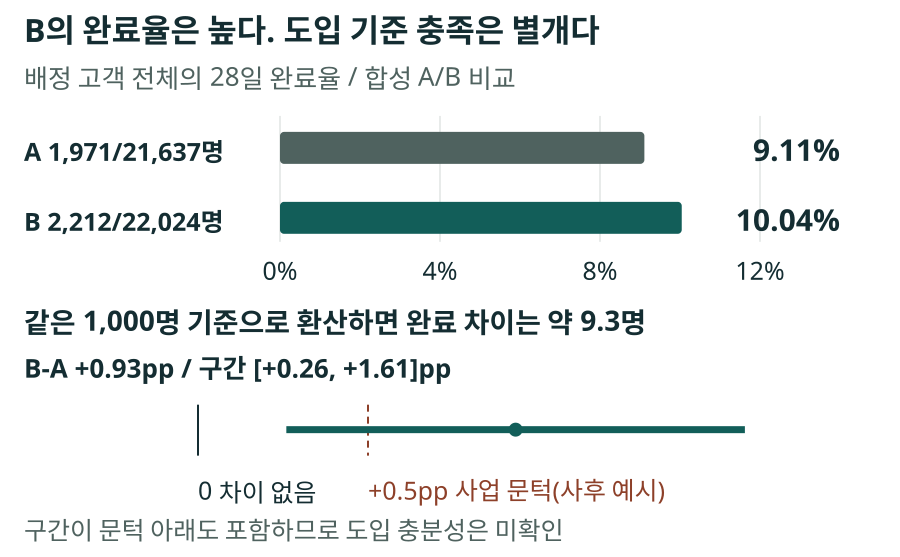

이제 회사가 최소 +0.5pp는 개선돼야 바꿀 가치가 있다고 생각한다고 가정하자. 여기서 0.5pp는 설명을 위한 사후 기준이며 원 실험에 정한 성공 조건이 아니다. 구간 하한은 약 +0.26pp다. 0보다 높다는 근거가 있더라도 최소 0.5pp 이상 개선을 확인했다는 답까지 주지는 못한다. 결과를 보고 통과할 만한 0.25pp로 기준을 낮추는 방식도 피해야 한다.

그렇다고 이 상황이 곧 손해의 증명은 아니다. 효과가 얼마까지 작을 수 있는지, 바꾸는 비용과 기다리는 비용이 얼마인지에 따라 선택이 달라진다. 되돌릴 수 있는 작은 적용을 택한다면 불확실성을 감수하는 결정이라고 설명한다. 그 선택을 효과의 크기까지 입증했다는 말로 바꾸지 않는다.

철회에서도 별도의 판단이 남는다. A는 약 0.837%, B는 약 0.917%이고 차이는 약 +0.081pp다. 개별 미보정 95% 구간은 약 [-0.095,+0.256]pp이며 p는 약 0.3662다. 완료와 달리 양의 차이가 악화 방향이다.

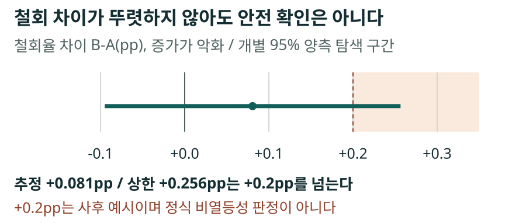

가상의 허용 악화 +0.2pp를 놓아도 상한은 그보다 높다. 더구나 원 계획에 비열등성 한계를 정하지 않았다. 여기서는 양측 탐색 구간을 읽었을 뿐 정식 안전 평가를 완료한 것이 아니다. 비열등성은 사전 한계와 단측 유의수준에 맞는 검정이나 상한으로 설계해야 한다. 차이를 발견하지 못했다는 말로 안전을 대신할 수 없다.

완료의 우위를 읽을 수 있었던 출발점은 첫 단계에서 비교를 유지한 데 있다. 이제 같은 고객에게서 얻은 다른 지표도 같은 답을 주는지 물어야 한다. 두 번째 단계에서 지표의 역할과 방향을 나누면 완료 증가와 철회 증가의 점추정을 한 방향의 성과로 묶을 수 없다는 점이 드러난다. 세 번째 단계에서는 이를 사업 기준과 고객 보호 조건에 비추어 도입을 논의한다. 현재의 답은 완료 우위의 근거가 있다는 데까지다. 최소 가치와 관계 안전은 별도 판단으로 남아 있으므로, 도입을 검토할 때에도 그 두 조건을 확인해야 한다.

이 비교는 공통 운용 기준상 정한 완료 가족을 해석할 수 있는 상태다. 다만 새로운 고객군 정책을 고른 실험은 아니므로 현재 전체 범위의 결과를 지지한다고 적는다. 여기서 집단별 승자를 덧붙이거나 모든 고객에게 효과가 같다고 주장할 수는 없다. 같은 이유로 완료 우위 지지와 사업 및 보호 미해결도 별도로 남긴다. 사후에 제안한 최소 개선과 철회 한계는 변경 기록에 사후 기준으로 적어야 처음부터 정한 성공 조건과 혼동하지 않는다. 실제 도입 여부는 사업과 보호 책임자가 기준 및 평가 설계를 확인한 뒤 재검토한다.

## 사례 3 문구의 승자와 캠페인의 승자

[사례 자료 길잡이](#materials-case-3)

B가 A보다 좋은 문구라는 결과를 얻어도 메시지를 보내는 정책 자체가 미발송보다 좋은지는 다른 질문이다. H에서도 자연 예약과 계약은 생긴다. 발송 뒤에 발생한 모든 계약을 메시지 덕분으로 세면 그 자연 발생분까지 캠페인의 성과로 가져오게 된다.

큰 합성 자료에서 A와 B는 모두 H보다 완료율이 높았다. 하지만 계약과 비용으로 계산하면 순서가 달라질 수 있다. 완료한 고객이 계약하는 생성 확률을 군마다 다르게 두었기 때문이다. 실제 제조사의 전환율을 추정한 값이 아니라 지표가 엇갈리는 상황을 읽기 위한 가정이다.

계약 한 건의 캠페인 전 기여액은 200만원, 메시지 시도당 비용은 20원, 완료당 운영비는 1만5천원으로 두었다. B에는 고정 준비비 20만원을 추가했다. 배정 후 180일 계약을 사용하지만 취소, 출고, 보증, 실제 회계상 수익과 장기 고객생애가치는 포함하지 않았다. 차량 가격 4000만원을 그대로 이익으로 곱하지 않는다.

고객별 모형 값은 `2000000×계약 −15000×완료 −20×발송시도`다. B에서는 고정비를 B 배정 고객 수로 나눈 값을 더 뺀다. 이 배분은 현재 실험 규모에 조건부다. 같은 고정비라도 확대 규모 N에서는 고객당 20만원/N이 되며, 이미 지출한 매몰비용은 향후 채택에 추가로 드는 비용과 구분해야 한다. 구매자만 골라 평균내지 않고 전체 배정 고객에서 평균낸 결과는 다음과 같다.

| 군 | 배정 고객당 합성 순기여액 |
|---|---:|
| A | 16,916원 |
| B | 22,801원 |
| H | 20,181원 |


A의 완료는 H보다 높지만 고객당 합성 순기여액 점추정은 H보다 낮다. 완료라는 앞 단계가 계약으로 넘어가는 정도와 운영 비용을 함께 보기 때문에 생기는 차이다. 이것만으로 A가 확실히 손해라고 결론내리는 것도 이르다. 이번에는 모형 값에도 불확실성을 붙여야 한다.

앞의 평균 차이가 얼마나 흔들릴지 읽기 위해 배정 고객별 계약과 완료의 결합을 유지한 채 Welch 구간을 계산했다. 이 값은 독립 개인과 고정 기여액, 고정 비용을 가정한 개별 탐색용 95% 구간이다. 따라서 지금 읽는 불확실성은 그 가정을 놓았을 때의 평균 차이에 관한 것이다. 군집이나 반복 조회, 결과를 보고 고른 비교는 보정하지 않았으며 원가 가정의 오차도 구간에 포함하지 않았다. 실제 원가를 확인하는 작업은 이 구간을 계산한 뒤에도 남는다.

| 손익 대비 | 고객당 차이 | 개별 탐색95% Welch 구간 |
|---|---:|---:|
| B-A | +5,886원 | [+2,061, +9,711]원 |
| A-H | -3,266원 | [-6,950, +419]원 |
| B-H | +2,620원 | [-1,317, +6,557]원 |


B-A의 구간은 이 모형에서 양수지만 B-H는 0을 포함한다. A-H의 음의 점추정 역시 확정 손실의 선언과 다르다. 세 손익 비교는 완료 주분석 가족에 들어 있지 않은 사후 탐색이다. 따라서 완료에서의 B 우위를 확증 재무 승리로 바꾸지 않는다.

| 계약 기여액 가정 | A 고객당 | B 고객당 | H 고객당 | B-H |
|---|---:|---:|---:|---:|
| 500,000원 | 3,189원 | 4,549원 | 4,358원 | +191원 |
| 1,000,000원 | 7,765원 | 10,633원 | 9,632원 | +1,001원 |
| 2,000,000원 | 16,916원 | 22,801원 | 20,181원 | +2,620원 |
| 3,000,000원 | 26,067원 | 34,970원 | 30,730원 | +4,240원 |


위 표는 같은 고객 결과와 비용을 고정하고 계약 기여액만 바꾼 계산이다. 새로운 실험을 반복한 결과가 아니다. 기여액 가정만 바뀌어도 고객당 차이가 달라지므로 실제 결정에는 원가 장부와 계약 취소, 출고, 다른 채널의 잠식을 연결해야 한다. 한 번 정한 숫자를 넣었다는 이유로 현실의 이익을 안다고 할 수 없다.

TRI-V의 언어 전환에서 중요한 것은 시승 결과를 돈으로 표시하는 일보다 관측한 값과 가정한 값을 나누는 일이다. 그래야 검토 후보 B를 실제로 채택할지 물을 수 있다. 미발송 대비의 근거가 필요하면 첫 단계의 설계로 돌아가고, 계약으로 이어지는 경로가 고객마다 다를 수 있다면 두 번째 단계에서 후속 가설을 만든다. 채택 논의에 앞서 재무 담당자는 기여액 정의를, 운영 담당자는 규모별 비용을, 분석 담당자는 추정과 관측 기간을 확인한다. 이 확인을 거쳐야 모형 속 이익과 실제 선택을 연결할 수 있다.


이 사례에서 더 깊이 확인해야 할 것은 고객의 세분화보다 계약과 비용 가정이다. 그 값에 따라 정책의 경제적 선택이 달라지기 때문이다. 비교 명세와 적용 대상은 유지하되 관측 사건, 모형 기여액, 실제 장부에서 아직 확인하지 않은 항목을 구분한다. 고정 가정의 탐색 가치와 실제 경제성 미확인을 함께 남기면 다음 검토에 필요한 자료도 분명해진다. 재무 담당자가 비용 범위와 적용 규모를 확인하고 사업 책임자가 최소 가치를 정한 뒤 모형을 다시 읽는다. 사후 기여액을 유리하게 바꾸더라도 원래 완료 가족이나 안전 판단을 통과한 근거가 되지는 않는다.

## 사례 4 측정이 바뀌면 승자도 바뀐다

[사례 자료 길잡이](#materials-case-4)

같은 배정 분모에서도 기록 누락은 결론의 방향을 바꾼다. 사례 4의 별도 합성 실습이며 95% Newcombe 구간이다.

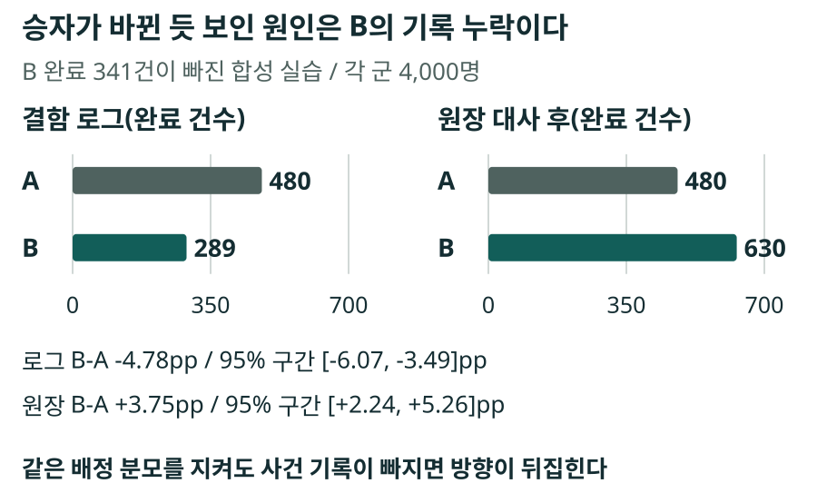

대시보드에서는 A가 이겼는데 현장 접수 원장에서는 B가 이겼다. 같은 고객에게 보낸 같은 시승 안내의 결과다. 승자를 고르기 전에 두 기록이 같은 사건을 세고 있는지 확인해야 한다. 고객 수가 맞고 p값이 작아도 이 불일치는 남는다.

가상 자동차 OEM인 JH Motors의 자료를 살펴본다. 뒤의 두 사례까지 모두 교육용 합성 자료이며 실제 회사의 성과가 아니다. 독립 원장을 완전하게 생성한 뒤 일부 사건을 로그에서 지웠다. 현실에서는 원장 자체의 수집 경로와 누락 가능성도 확인해야 한다.

질문은 동의한 적격 고객에게 B를 배정하면 A보다 배정 후 28일 안에 시승을 완료할 확률이 높아지는가이다. 고객이 배정 단위이자 분석 단위다. 군당 4,000명씩 총 8,000명을 고정한 완전 무작위배정을 가정하고 전원이 28일을 채운 뒤 한 번 분석한다. 전달과 예약 여부에 상관없이 모든 배정자를 분모에 남긴다.

완료 여부는 A 0.12, B 0.16의 확률로 독립 생성한다. 난수 시드는 4042026이다. 비교는 B 대 A의 완료율 하나이며 양측 유의수준은 5%로 정한다. 군별 비율에는 95% Wilson 구간을, B−A 차이에는 95% Newcombe 구간을 사용한다. 두 독립 이항비율의 z검정은 정규근사 검정으로, 한 표본 exact binomial test와 다르다. 사업상 최소 관심 개선은 배정 고객당 +1pp로 두되, 이는 교육용 기준이지 실제 승인 기준이나 검정력으로 정한 MDE는 아니다.

로그는 원장을 복사한 뒤 B의 완료 사건만 확률 0.50으로 지워 만든다. 완료하지 않은 고객과 모든 배정자는 그대로 남는다. 빠진 것은 고객이 아니라 완료 사건이므로 분모 오류가 아닌 분자 오류다. 두 파일을 고객 ID로 연결하면 누락은 341건이다. 각 행에서 원장 완료와 로그 완료의 차이가 주입한 누락 표시와 일치한다. 이 표시는 실습의 정답을 확인하는 열이지 운영자가 현실에서 자동으로 얻는 정보가 아니다.

<a id="b-srm"></a>

분모는 양 군 모두 정확히 4,000명이고 중복 ID도 없다. 배정비율 이상을 찾는 SRM이나 파일 구조 점검을 통과하더라도 B의 완료만 빠진 오류는 남을 수 있다. TRI-V의 정화, Variable Control에서 먼저 할 일은 승자 판정을 멈추고 기록 경로를 확인하는 것이다. 같은 배정 고객과 같은 관측 창을 유지한 채 사건이 생성되고 적재되는 경로를 대사해야 한다. 결과가 비교 가능하게 기록되었는지 확인하기 전에는 고객 특성별로 나누거나 수익으로 환산해도 해석할 근거가 나아지지 않는다.

독립 원장에서 A는 480/4,000명으로 12.00%, B는 630/4,000명으로 15.75%다. B−A는 +3.75pp이고 95% Newcombe 구간은 [+2.24pp, +5.26pp], 양측 z검정 p값은 1.226e-06이다. 오류 로그에서는 A가 그대로 480/4,000명, 12.00%인 반면 B는 289/4,000명, 7.22%로 떨어진다. 차이는 -4.78pp, 95% 구간은 [-6.07pp, -3.49pp], p값은 4.336e-13이다. 순위만 바뀐 것이 아니다. 두 차이 구간이 각각 0의 반대쪽에 놓여 통계적 방향까지 뒤집힌다.

군별 95% Wilson 구간은 원장 A [11.03%, 13.04%], 원장 B [14.65%, 16.91%], 로그 A [11.03%, 13.04%], 로그 B [6.46%, 8.07%]다. 다만 이 구간들의 겹침을 차이 검정 대신 읽지는 않는다. Newcombe 구간은 Wilson 경계를 결합해 차이의 불확실성을 구하며, 두 군 구간을 그대로 빼는 계산이 아니다. 원래 계산 코드도 Wilson 폐형식과 Newcombe 결합식을 라이브러리 값에 대조했다. Fisher 양측 정확검정으로 바꿔도 원장 p값은 1.4e-06, 로그는 4.487e-13이다. 검정법을 바꾸는 일은 누락된 완료를 되살리는 일이 아니다.

두 파일은 같은 고객을 공유하므로 독립된 두 실험처럼 다시 비교 검정하지 않는다. 파일별 A/B 비교가 측정에 따라 달라지는 모습을 읽는다. 좁은 구간으로 잘못 측정한 확률을 정밀하게 추정할 수도 있다. 신뢰구간은 임의의 측정 편향까지 담지 않는다. 표본만 늘리면 틀린 방향의 확신이 더 강해질 수 있다.

현실에서는 B 고객이 실제로 덜 완료했을 가능성도 열고 ID와 날짜를 맞춘다. 지점 등록 지연, 재예약 중복, 타임존 차이, 한 고객의 여러 차량, 관측 창 밖의 입력을 살핀다. 생성 명세를 아는 실습과 달리 실제 B 성공 건수를 두 배로 고쳐서는 안 된다. 누락 확률은 지점과 기기, 완료일과 고객 상태에 따라 다를 수 있다.

따라서 로그가 가리키는 A 우위는 보류한다. 원장의 B 우위는 생성 모형 안에서 지지되고 차이의 하한도 +1pp를 넘지만, 전면 도입을 검토하기 전에 배정자와 원장의 100% ID 대사와 원인 미해결의 군별 선택 누락 해소가 먼저다. 수신 거부와 민원, 안전 사건은 생성하지 않았고 실제 원가도 확인하지 않았다. 언어 전환, 곧 Value-Linked Decision으로 실제 선택을 내리기에는 이 자료가 더 필요하다. 해체 및 입체화의 Vector Segmentation으로 군과 지점, 기기를 나누어 볼 때에도 목적은 우선 오류를 찾는 데 둔다. 그 결과로 고객별 채택 전략까지 정할 수는 없다. 지금은 정화에 머물러 기록을 복구할 단계다.

후속 작업은 B 로그 경로의 복구다. 새로 관측을 마친 고객에서 ID 대사를 반복하고 감사 표본에는 원장상 미완료자도 포함한다. 과거 자료는 원본과 복구본, 변경 이유를 남기고 같은 분석을 재실행한다. 유리한 기록만 섞거나 종료 시점을 바꾸지 않는다. 누락 원인이 불명확하면 가정별 민감도를 제시하고 미확정으로 둔다. 두 파일의 완료를 다시 세더라도 8,000명의 분모는 유지한다.

한 기록으로 묶으면 현재 상태는 결함 로그의 완료 비교 보류다. 원장과 로그를 연결할 담당자, 누락 사건과 개인별 창 및 복구 확인 항목이 비교 명세의 미해결 칸에 남는다. 이 결함을 해결하지 않은 채 고객군별 채택 정책을 만드는 것은 심화가 아니라 오류의 확장이다. 교육용 정답 원장에서 보이는 개선은 별도 근거로 기술하되 실제 운영 복구와 발송 승인을 대신하지 않는다. 복구가 확인될 때의 재분석 범위와 승인 검토 계기를 정하는 것이 이 사례의 결정문이다.

## 사례 5 전체의 승리를 누구에게 적용할 것인가

[사례 자료 길잡이](#materials-case-5)

전체는 고정 구성 0.5/0.5의 층화 Wald 95% 구간, 상태별 값은 두 후속 비교의 Bonferroni 97.5% Newcombe 구간이다. 구간의 수준과 추정법이 같지 않다.

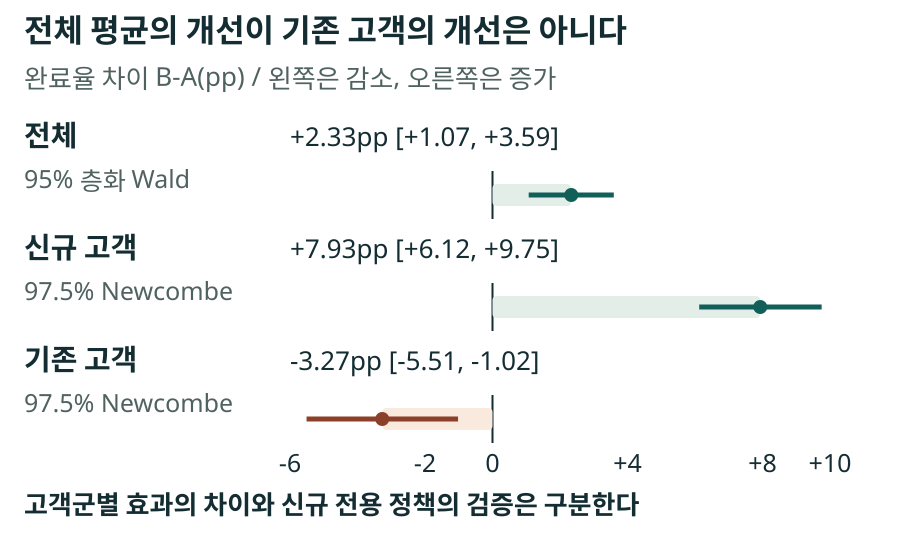

B를 받은 고객의 시승 완료가 전체적으로 늘었다. 다음 발송에서는 모두에게 B를 보내도 되는가. 신규 고객에게 반가운 안내가 기존 고객에게는 덜 효과적일 수 있다. 전체 평균은 정해진 고객 구성의 답이다. 그 구성을 지워서도, 결과를 본 뒤 집단을 잘게 나누어 가장 높은 값만 골라서도 안 된다.

이번에는 발송 전에 CRM 상태를 동결한다. 현재 차량 보유 이력이 없는 신규 관심 고객을 new, 기존 차량 보유 고객을 existing으로 정의한다. 교육용 정의이며 발송 후의 클릭이나 예약, 방문으로 만든 집단이 아니다. 총 12,000명 중 각 상태가 6,000명이다. 상태 안에서 A 3,000개와 B 3,000개 라벨을 무작위로 섞어 배정한다. 표본 수를 고정한 층화 완전 무작위배정으로, 결과의 균형이나 원하는 유의성을 맞추는 절차가 아니다. 모든 고객을 28일 관측하고 완료를 독립 생성한다. 시드는 5052026이며 생성 확률은 신규 A 0.08, B 0.15, 기존 A 0.20, B 0.17이다.

집단별 차이를 읽으려면 먼저 그 집단이 배정 전에 정해져 있었는지 확인해야 한다. 정화에서는 처치 전 상태의 정확성, ID의 유일성, 상태와 군별 3,000명, 누락 없는 동일 관측 창을 점검한다. 배정 뒤 상태가 바뀌어도 처음 상태에 남겨 분석하는 이유다. 이렇게 평균을 나눌 토대를 확보한 뒤 입체화에서 각 효과를 읽는다. TRI-V의 Vector Segmentation에서는 미리 정한 집단별 B−A뿐 아니라 두 효과의 차이인 상호작용도 직접 묻는다. 한쪽만 유의하다는 관찰로 집단 간 차이를 대신 판단하지 않는다.

주분석은 신규와 기존을 각각 50% 포함한 고객당 완료율 차이다. 양 군의 상태 구성이 50 대 50이므로 상태별 위험차에 0.5씩 가중한 평균을 전체 효과로 읽는다. 고정 층화 설계에 맞춘 95% Wald 구간이 주 결과이며, 전체 pooled z검정과 Newcombe 구간은 참고값이다. 기준율이 다른 두 상태를 같은 이항표본으로 취급하지 않는다. 분산 계산과 구현 대조는 [계산 방법과 분석 확인](#analysis-method-notes)에서 확인한다.

층화 주분석의 효과는 +2.33pp, 95% Wald 구간은 [+1.07pp, +3.59pp], 양측 p값은 0.0002856이다. 분산 계산은 고객별 잔차 집계와도 대조했다. 전체 집계 자체는 A 820/6,000명, 13.67%와 B 960/6,000명, 16.00%다. 참고용 비층화 분석도 차이는 +2.33pp지만 95% Newcombe 구간은 [+1.06pp, +3.60pp], p값은 0.0003235다. 두 계산의 수치가 비슷해도 설계에 맞춘 주분석의 자리가 바뀌지는 않는다. 최소 관심 개선 +1pp라는 교육용 기준에 대해서는 주분석 하한이 이를 넘는다고 읽는다.

신규 고객을 따로 보면 A 217/3,000명, 7.23%와 B 455/3,000명, 15.17%다. 차이는 +7.93pp이고 97.5% Newcombe 구간은 [+6.12pp, +9.75pp]다. 양측 z검정 p값 1.979e-22에 두 집단 Bonferroni 보정을 적용하면 3.959e-22다. 기존 고객에서는 A 603/3,000명, 20.10%와 B 505/3,000명, 16.83%로 방향이 바뀐다. 차이는 -3.27pp, 97.5% 구간은 [-5.51pp, -1.02pp], 원래 p값은 0.001112, 보정 p값은 0.002224다. 두 후속 비교에 맞춰 구간을 각각 97.5%로 넓혔다. 더 많은 차종과 기간, 상태를 뒤진 탐색 전체까지 이 보정이 보호하는 것은 아니다.

위험차 상호작용은 신규의 B−A에서 기존의 B−A를 뺀 값이다. 추정치는 +11.20pp, 표준오차는 1.286pp, 95% Wald 구간은 [+8.68pp, +13.72pp], 양측 p값은 3.114e-18이다. 네 독립 셀의 비율을 p, 표본 수를 n이라 할 때 p(1−p)/n을 더해 분산을 구하고 고객별 잔차 제곱합과 대조했다. 신규에서 B의 상대적 이득이 더 크다. 개별 p값들의 유의 여부와는 별도의 질문이다.

<a id="b-interference"></a>

이 구간은 큰 표본 근사이며 개인 독립성과 간섭 없음을 전제한다. 가구 중복이나 군집, 상태 오분류가 있으면 같은 표준오차를 그대로 쓸 수 없다. 또한 위험차의 상호작용은 오즈비의 상호작용과 같은 명제가 아니다. 여기서는 배정 100명당 완료가 몇 명 달라지는지를 슬롯과 비용 계획에 연결하려고 pp를 택했다. 상호작용은 사전 지정한 핵심 보조 질문이지만, 주분석과 함께 확증하는 가족 전체 오류율을 통제한 설계는 아니다. 두 결과를 묶어 가족 수준 95% 확증이라고 부르지는 않는다.

전체와 집단별 답이 다르다고 곧바로 심슨의 역설이라고 이름 붙일 필요도 없다. 군 간 구성은 균형을 이루며, 핵심은 상태별 처치 반응의 차이다. 신규와 기존 자체의 완료율 차이를 처치 효과로 읽는 것도 잘못이다. 상태 안의 A/B는 무작위배정되었지만 고객의 보유 상태를 무작위로 바꾼 실험은 아니다. 기존 고객의 피로나 낡은 CRM 정보, 지점별 실행 차이를 원인 후보로 생각할 수는 있어도 이 생성 모형이 그 메커니즘을 입증하지는 않는다.

TRI-V의 언어 전환에서는 이제 “B가 이겼다”를 “어느 고객 구성에 어떤 발송 정책을 적용할 것인가”로 바꾼다. 신규가 절반인 대상에서 얻은 +2.33pp를 기존 고객이 대부분인 대상에 그대로 옮길 수 없다. 원자료의 상태별 효과에 신규 20%, 기존 80%를 가중한 점추정치는 -1.03pp다. 이는 0.2×신규 효과+0.8×기존 효과로 얻는 다른 표적 구성의 전이 계산이지 새로운 무작위실험 결과가 아니다. 실제 전이에는 상태별 효과가 유지될지와 그 불확실성을 더 검토해야 한다.

신규 B와 기존 A를 조합하는 정책은 후속 후보가 된다. 다만 현재 결과는 두 상태 안의 A/B 비교이지 혼합 정책을 독립된 운영에서 시험한 결과가 아니다. 자료를 본 뒤 고른 정책에는 선택 편향과 효과 과대추정 위험도 남는다. 따라서 전체 B의 우위와 상호작용을 보고하되 일괄 채택은 자동 승인하지 않는다. 기존은 A를 유지하고 신규 한정 B를 별도 고객 코호트에서 확인하는 선택이 가능하다. 집단별 연락 비용과 빈도, 철회와 불만, 차종 접근성도 함께 확인해야 한다. 관계 손상 자료는 생성하지 않았으므로 이번 완료율만으로 안전을 판단할 수 없다.

후속 시험에서는 상태 정의와 효과 방향, 비교 가족, 최소 개선과 허용 악화를 미리 정한다. 신규만 확증할지 두 상태 모두를 확증할지에 맞춰 표본과 다중성 설계를 마련하고 상태 결측과 갱신 지연, 고객 중복도 감사한다. 정화가 집단을 나눌 토대를 지켰다면 입체화는 일괄 적용을 막았고 언어 전환은 새 정책의 검증 과제를 남겼다.

결정 기록에서 먼저 정할 것은 이 결과를 어느 고객군과 표적 구성에 적용하려는가다. 전체 평균과 계획한 고객 상태의 효과 차이는 같은 자료에서 읽을 수 있지만, 후속 집단 비교와 상호작용의 분석 가족을 임의로 합쳐 확증할 수는 없다. 신규에는 B, 기존에는 A를 보내는 정책도 지금은 후속 선택의 후보로 남긴다. 그 혼합 정책의 실제 효과와 보호 조건을 새로 확인해야 하기 때문이다. 적용할 대상 구성과 사전 상태 정의, 필요한 후속 비교 및 책임자를 기록하면 좋은 조각을 골랐다는 이유로 기존의 적용 범위를 지우는 일을 막을 수 있다.

## 사례 6 요청이 늘자 공유 용량이 답을 바꾼다

[사례 자료 길잡이](#materials-case-6)

일 60슬롯에서 완료와 순가치가 반대 방향으로 움직인다. 단일 고정 수요 조건의 모형 비교이며 불확실성 구간이나 실제 OEM 이익이 아니다.

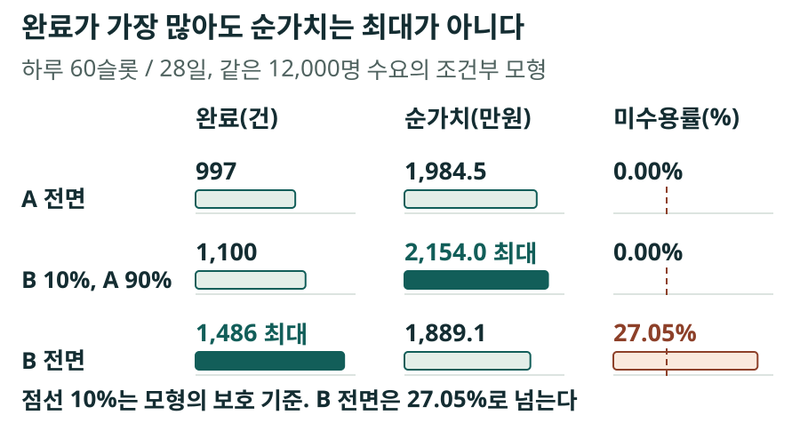

하루 시승 슬롯이 60개라면 B 전면 발송의 완료는 A보다 489건 늘어난다. 그런데 순가치는 954,000원 줄고 요청의 27.05%를 수용하지 못한다. 한 고객이 차지한 직원과 시승차, 시간대를 다른 고객은 쓰지 못하기 때문이다.

이번 비교는 같은 12,000명과 같은 28일 수요 환경에 A 전면, B 10% 파일럿, B 전면을 적용하는 공유 용량 시뮬레이션이다. 고객 행은 자료 단위지만 정책을 비교하는 분석 단위는 이 운영 시스템 전체다. 12,000명을 독립된 정책 실험 12,000회로 셀 수 없다. 하루 슬롯 40개, 60개, 90개는 미리 정한 세 민감도 조건이다. 완료와 비용, 순가치를 보고 요청 중 미수용 비율 10% 이하를 보호 조건으로 둔다. 이 조건에서 계산한 순가치 증가는 도입 후보 조건이며 실제 안전과 동의 문제는 별도로 확인한다.

<a id="b-counterfactual"></a>

시드 6062026으로 고객별 요청 난수와 완료 난수, 도착일과 순서를 한 번 생성한다. B를 받을 파일럿 고객 1,200명도 한 번 무작위 추출한다. 정책과 용량을 바꾸어도 다시 뽑지 않는다. 요청 확률은 A 0.10, B 0.19, 수용 후 완료 확률은 A 0.85, B 0.88로 둔다. 같은 균등난수를 쓰므로 B에서는 A가 요청할 고객에 추가 요청자가 붙는다. 정책 차이의 변동을 줄이기 위한 공통 난수 설계이지 개인의 두 반사실을 실제로 관측한 자료는 아니다. 특히 수용 후 완료 확률과 처음 배정된 고객당 완료율을 구분해야 한다.

슬롯은 당일 선착순으로 배정한다. 고객은 한 번만 요청하며 수용 후 미완료가 되어도 슬롯을 재배정하지 않는다. 그날 받지 못한 요청은 다음 날로 넘기지 않는다. 따라서 waiting_end_window는 관측 창에서 수용되지 못한 요청 수이며 기다린 날짜를 측정한 값이 아니다. 재요청과 지점 이동, 취소 슬롯 재판매, 직원 학습도 구현하지 않았다. 정책별 수치는 이 운영 규칙에 묶여 있다.

자료에는 고정 고객 12,000행과 세 정책, 세 용량을 조합한 운영 108,000행이 있다. 운영 행을 서로 다른 고객 108,000명의 정보로 세지 않도록 정책과 용량, 고객 ID를 함께 읽어야 한다. 행별 완료≤수용≤요청, 정책별 요청=수용+미수용, 날짜별 수용≤공유 슬롯을 확인하고 용량만 바꿀 때 요청이 일정한지도 검사했다. 여기까지 행과 분모가 맞더라도 고객들이 슬롯을 나누어 쓴다는 연결은 남는다. 공유 용량을 드러내는 입체화가 앞 단계로 돌아가 분석 단위를 고치게 하는 이유다. TRI-V는 앞의 점검을 마쳤다는 이유로 개인 독립 가정을 그대로 넘겨받는 직선 절차로 쓸 수 없다.

가치 계산에는 A 연락 200원, B 연락 1,500원, 수용 한 건의 서비스 변동비 25,000원, 미수용 요청 한 건의 처리비 3,000원을 적용한다. 수용 뒤 미완료여도 변동비를 부담한다. 확보한 슬롯은 비어 있어도 하루 한 개당 5,000원의 가용비가 들며 완료 한 건의 가치는 60,000원이다. 총비용은 고객별 변동비 합계에 하루 용량×28×5,000원을 더한 값이고, 순가치는 완료×60,000원에서 총비용을 뺀 값이다. 차량 판매 매출이나 실제 순이익을 뜻하지 않는다.

| 하루 슬롯 | 정책 | 요청 | 완료 | 미수용 | 순가치(원) |
|---:|---|---:|---:|---:|---:|
| 40 | A 전면 | 1,167 | 928 | 81 | 20,287,000 |
| 40 | B 10% | 1,284 | 951 | 173 | 19,206,000 |
| 40 | B 전면 | 2,303 | 988 | 1,183 | 4,131,000 |
| 60 | A 전면 | 1,167 | 997 | 0 | 19,845,000 |
| 60 | B 10% | 1,284 | 1,100 | 0 | 21,540,000 |
| 60 | B 전면 | 2,303 | 1,486 | 623 | 18,891,000 |
| 90 | A 전면 | 1,167 | 997 | 0 | 15,645,000 |
| 90 | B 10% | 1,284 | 1,100 | 0 | 17,340,000 |
| 90 | B 전면 | 2,303 | 2,034 | 2 | 33,909,000 |

수용과 비용은 표에서 덜어 내되 계산에서 빼지 않는다. 하루 40개에서 A 전면, B 10%, B 전면의 수용은 각각 1,086건, 1,111건, 1,120건이고 총비용은 35,393,000원, 37,854,000원, 55,149,000원이다. 60개에서는 수용 1,167건, 1,284건, 1,680건에 총비용 39,975,000원, 44,460,000원, 70,269,000원이다. 90개에서는 수용 1,167건, 1,284건, 2,301건에 총비용 44,175,000원, 48,660,000원, 88,131,000원이다. 용량을 늘리면 수용이 늘 수 있지만 추가 가용비도 지불한다.

중간 용량에서 A 전면의 완료 997건은 B 10%에서 1,100건, B 전면에서 1,486건이 된다. 이 증가만 보면 전면 발송이 유리해 보이지만 파일럿과 전면 발송이 슬롯을 쓰는 상황은 다르다. 파일럿의 요청 증가는 여유 슬롯에 들어가는 반면 전면 발송에서는 2,303건 중 623건을 받지 못한다. 미수용률 27.05%는 사전 기준 10%를 넘는다. 따라서 완료 증가와 함께 수용하지 못한 부담을 읽어야 한다. TRI-V의 Value-Linked Decision에서 완료 수를 비용과 미수용 부담에 연결하면 중간 용량의 B 전면 확대는 보류하게 된다. 저용량에서 보호 조건을 넘었다는 이유로 통과선을 사후에 옮길 수도 없다.

이 표에 개인 독립 95% 신뢰구간이나 두 이항비율 검정 p값을 붙이지 않는다. 고정한 한 수요 세계의 조건부 결과이기 때문이다. 파일럿 안에서 A와 B의 완료율은 기술적으로 계산할 수 있어도 B 10% 환경의 비교를 B 100% 환경의 효과로 재사용하지 못한다. 처치 비중이 바뀌면 다른 고객이 받을 슬롯과 자신의 수용 확률도 달라진다. 앞 사례에서 썼던 개인 독립 추론을 가져오는 순간 정책 확대의 핵심 경로를 놓친다.

세 용량도 신뢰구간의 하한과 중앙, 상한이 아니다. 강한 제약과 중간 제약, 완화된 제약을 따로 놓은 가정별 결과다. 정책 불확실성을 추정하려면 독립된 수요 세계를 반복 생성하거나 실제 지점과 기간을 배정해야 한다. 반복 시뮬레이션의 Monte Carlo 오차와 현실 모형의 오차는 다르다. 한 시드에서 재현된다는 사실이 요청 확률과 완료 가치, 인력비의 현실성을 검증하지는 않는다.

하루 90개의 B 전면은 완료 2,034건과 순가치 33,909,000원으로 유리하다. 다만 가용비와 완료 가치가 달라지면 재무 판단도 달라지며 고객관계와 기회비용도 남는다. B가 과장된 기대로 저품질 요청을 모았는지도 여기서는 확인하지 못한다. 수용 후 완료 확률을 B에서 더 높게 설정했기 때문이다. 실제 요청자 구성과 취소, 불만을 관측해야 한다.

용량 확보 후 발송, 지역별 시차 발송, 혼잡일 발송 중단, B 연락비 축소, 노쇼 슬롯 재사용도 대안이다. 현재 표가 그 효과를 입증하지는 않는다. 수용 규칙과 비용을 명시해 새로 비교한다. 운영 책임자가 확보 용량과 최대 미수용률, 연락 중단과 롤백 규칙을 정한 뒤 후속 파일럿을 설계한다.

실제 검증에는 지점 또는 지점과 기간을 묶은 무작위배정이나 사전 지정한 포화도 실험을 검토한다. 지점 간 자원 분리를 확인하고 고객 이동을 관측하거나 배정 단위를 넓힌다. 시간 교차 설계는 대기열 이월과 학습, 요일 효과를 고려해 세척 기간과 비교 창을 정한다. 요청과 취소, 대기일, 완료, 인력, 민원으로 모형을 갱신하되 합성과 실제 관측은 구분한다. 개인 반응을 운영 판단으로 옮기려면 슬롯을 나누는 경로도 검증해야 한다.

수치 원장은 `e-book/analysis/winner_v04/scenario_results.json`이다. 원시 CSV는 같은 폴더의 `scenarios`에서 확인한다.


결정 기록에는 먼저 이 비교가 같은 고정 수요 세계에서 읽는 조건부 정책 모형이라는 점을 밝힌다. 개인 독립 실험의 추정치로 읽거나 고객군 p값부터 찾으면 공유 용량과 간섭 때문에 필요한 심화 검토를 놓치게 된다. 현재의 전면 확대 보류도 이 모형 조건 안의 판단으로 남겨야 하며 실제 회사의 발송 승인과 구분해야 한다. 다음 검토에는 운영 책임자가 확인할 실제 가용 자원과 요청, 취소 및 복구 경로가 필요하다. 사업 책임자는 감수할 손실과 적용 규모를 정한다. 제약을 넘긴 뒤 한계를 느슨하게 고쳐 원래 통과였다고 기록하지 않고, 새 기준이 필요하면 변경 이유와 결과 열람 여부를 남겨 다른 조건의 정책을 별도로 비교한다.

# 8장 다시 한 건의 결정으로

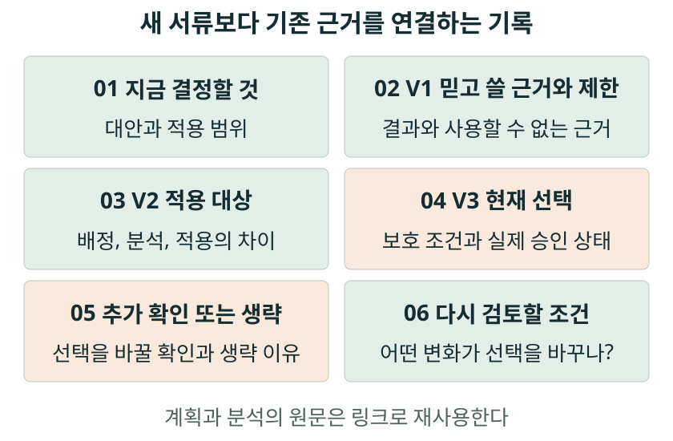

여섯 상황을 따로 외우기보다, 결과가 엇갈린 이유에 따라 어디로 돌아갈지 읽어 보자. 예약과 완료가 엇갈리면 지표와 경로를 살피고, 기록이 뒤집히면 측정을 다시 확인한다. 고객 상태별 효과가 다르면 적용 대상을 다시 정하고, 규모가 커지며 용량이 막히면 정책의 비교 단위부터 바꾼다. TRI-V는 이처럼 다른 문제를 같은 추가 분석으로 처리하지 않도록 연결하는 틀이다. 이제 한 실험에서 무엇을 확인했고 어떤 선택이 남았는지 이어 써 보자.

JH Motors의 큰 A/B/H 실험을 다시 맡았다고 생각해 보자. 처음 할 일은 B의 막대가 더 높다는 말을 쓰는 것이 아니다. 연락에 동의하고 기존 시승 경험이 없는 고객에게 어떤 안내를 배정했으며, 그날부터 28일 안의 완료를 어떻게 기록했는지 설명한다. 원본 배정과 사건을 대조한 결과도 확인한다. 이 자료에서는 개인별 배정과 독립 이항, 고정 분석을 가정했다. 그 가정이 유지되는 범위에서만 다음 숫자를 읽는다.

다음에는 완료 B-A의 차이 약 +0.93pp와 약 98.33% 구간 [+0.26,+1.61]pp를 적는다. 보정 p 약 0.00274는 세 완료 대비 가족에 대한 값이다. 예약이나 계약, 철회의 결과를 같은 성공 조건으로 끌어오지 않는다. 개인 속성별 효과가 궁금해도 이 큰 원본 자료에 유의한 고객군이 숨겨져 있다고 약속할 수는 없다. 별도 집단 실습의 결과를 같은 고객에서 발견한 것처럼 섞지도 않는다.

마지막으로 도입을 위해 남은 조건을 확인한다. 원래 실험에 승인된 최소 사업 효과가 없으므로 사후 예시 0.5pp를 사전 기준처럼 쓰지 않는다. 철회에는 비열등성 한계가 없어 안전을 통과했다고 보고하지 않는다. 고객당 모형 손익에서 B-H의 탐색 구간은 0을 포함하며 실제 기여액과 취소, 출고를 확인하지 않았다. 늘어난 수요를 현장이 감당할 수 있는지도 아직 다른 질문이다.

여기까지 읽으면 ‘B가 이겼다’는 말만으로는 도입을 결정할 수 없는 이유가 드러난다. 완료 개선은 검토 후보로 남기되, 남은 질문을 실제로 답할 역할에 나누어 맡긴다. 사업 담당자는 최소 개선과 바꾸는 비용을 정하고, 고객 보호 담당자는 허용 위험과 동의 처리를 확인한다. 재무 담당자는 기여액과 비용의 정의를, 운영 담당자는 실제 슬롯과 인력을 확보한다. 그 답을 기다리는 동안에도 비용은 생기므로, 추가 정보를 얻는 비용과 늦게 결정하는 비용을 함께 비교해 다음 확인의 순서를 정한다.

이 조건이 정리됐다고 반드시 전면 도입해야 하는 것은 아니다. 작게 적용해 추가 정보를 얻을지, 관계 위험을 더 확인할 새 실험을 할지, 다른 문구로 전환할지 선택할 수 있다. 적용하기로 했다면 대상과 규모, 확인할 지표, 중단 조건, 되돌릴 담당자를 기록한다. 보류한다면 어느 자료가 들어왔을 때 다시 판단할지 적는다. ‘데이터 부족’이라는 한 줄로 끝내지 않는 것이다.

회의에서 질문이 달라졌다면 같은 결과표로 답할 수 있는지부터 살핀다. 왜 매출이 아니라 시승을 주지표로 두었느냐는 질문에는 짧은 기간의 시승 정책을 비교한 이유와 계약을 알 수 없는 한계를 설명한다. 신규 고객에게만 보내자는 제안에는 사전 집단 정의와 효과 차이, 독립 검증 여부를 보여준다. 전국 적용 시 숫자를 그대로 곱하자는 제안에는 공유 용량과 지역 구성이 달라질 수 있음을 확인한다. 질문마다 필요한 근거가 다르므로, 논쟁을 끝내려 같은 숫자를 반복하기보다 그 선택을 판단할 자료를 함께 찾는다.

실제 현대자동차나 기아에 이 방법론을 적용할 때에도 같은 순서를 따른다. 공개 판매 자료는 차종과 시장을 이해하는 데 도움이 되지만 연락 가능한 고객의 수나 개인별 캠페인 효과를 알려주지는 않는다. 공개 여정을 보고 시승 안내를 개선할 질문을 제안할 수는 있다. 내부에 그 실험이 없다고 단정하거나 실제 병목을 발견했다고 주장할 수는 없다. 권한 있는 고객 로그와 운영 자료를 확보한 뒤 가설과 비교를 구체화해야 한다.

나는 TRI-V를 완성된 해답으로 내놓기보다 계속 고쳐 쓸 방법론으로 남기고 싶다. 처음 구상한 세 단계가 현실의 문제를 충분히 담지 못한다면 적용하면서 수정할 것이다. 다만 무엇을 실제로 관측했고 무엇을 가정했는지 나누는 태도는 유지하고 싶다. 그 구분이 있어야 경험에서 배우고 다음 실험을 더 잘 설계할 수 있다.

정화는 믿을 수 없는 비교가 무엇인지 드러내고, 해체와 입체화는 평균의 결과를 어느 고객에게 옮길지 묻게 한다. 언어의 전환은 그 답을 실행 범위와 책임으로 옮긴다. 이렇게 연결해 기록했을 때 중요한 누락과 불필요한 확인이 줄어드는지는 실제 작성에서 평가해야 한다. 독자가 자신의 실험과 선택의 이유를 설명할 수 있는지도 그때 관찰할 작업 결과다. 자신의 기록을 읽으며, 지금 선택을 지지하는 근거와 선택 전에 더 확인해야 할 조건을 구분할 수 있는지 살펴보자.


## 충분한 근거가 있을 때 검토를 끝내기

앞선 사례에서 도입을 보류한 이유를 이해했다면 반대 방향도 확인해야 한다. 모든 결과에 새로운 분석과 재실험을 요구하는 절차는 판단을 안전하게 만들기보다 일을 늘릴 수 있다. 다음 네 조건은 기존 시승 자료를 바꾸거나 합친 실험이 아니라 검토의 경계를 보여주려고 별도로 구성한 교육용 고정 카운트다. 같은 선택적 서비스 안내의 표현 A와 B를 비교하며 혜택과 비용은 같다고 가정한다. 동의와 적격 조건, 개인 배정과 독립 및 비간섭, 원장 대사와 개인별 30일 관측이 충족됐다는 설정이다. 표본 수는 검정력으로 산출한 권장 인원이 아니다.

이 예제에서만 사용할 판단 규칙은 완료율 차이 구간의 하한이 최소 개선 +1.0pp를 넘고, 철회 증가가 허용 한계 +0.5pp보다 작다는 보호 근거가 있을 때 해당 범위의 실행 후보로 넘기는 것이다. 숫자는 가상 회사의 선택 기준이며 TRI-V의 보편적 도입 공식이 아니다. 결과를 구성한 교육 예시에서 사전 기준이라고 말하는 것은 이야기의 순서이지 실제 미래 실험의 사전등록이라는 뜻도 아니다.

| 조건 | A 완료와 배정 | B 완료와 배정 | 차이와 구간 |
|---|---|---|---|
| 가: 현재 범위 | 500/5,000명 | 650/5,000명 | +3.00pp, [+1.75, +4.25]pp (95%) |
| 나: 사전 집단 | 320/4,000명 | 520/4,000명 | +5.00pp, [+3.47, +6.54]pp (97.5%) |
| 다: 정보 부족 | 500/5,000명 | 540/5,000명 | +0.80pp, [-0.40, +2.00]pp (95%) |
| 라: 보호 검토 | 500/5,000명 | 650/5,000명 | +3.00pp, [+1.75, +4.25]pp (95%) |

아래 표는 철회율 B-A의 보호 단측 상한을 보여준다. 완료 개선과 별개로, 각 조건에 정한 수준의 상한이 허용 악화 한계보다 낮은지 읽는다. 악화의 p값이 크다는 이유로 안전을 선언한 것이 아니다. 완료 구간과 보호 상한의 계산 방법 및 구현 교정 이력은 [계산 방법과 분석 확인](#analysis-method-notes)에 남긴다.

| 조건 | A와 B의 철회 | 보호 단측 상한 | 현재 판단 |
|---|---|---|---|
| 가: 현재 범위 | 50/5,000명, 45/5,000명 | +0.222pp (95%) | 실행 후보 |
| 나: 사전 집단 | 40/4,000명, 36/4,000명 | +0.333pp (97.5%) | 실행 후보 |
| 다: 정보 부족 | 50/5,000명, 45/5,000명 | +0.222pp (95%) | 추가 근거 검토 |
| 라: 보호 검토 | 50/5,000명, 110/5,000명 | +1.624pp (95%) | 보호 우선 검토 |

조건 가에서는 현재 대상과 정책 범위의 성과 및 보호 조건이 충족됐다. 지금 고르는 범위에 필요한 근거가 있으므로 실행 후보와 필요한 실제 승인 경로를 남기고, 목적 없는 세분화와 금전 모형은 추가하지 않는다. 이는 모든 고객의 효과가 같거나 장기 효과까지 확인됐다는 뜻이 아니다. 확인하지 않은 범위는 한계로 남기되 그 범위의 질문을 현재 선택의 필수 조건으로 늘리지 않는다. 이 예제를 현장 전체 전환의 자동 승인으로 사용하지 말고, 근거가 충족된 범위와 실제 승인 여부를 구분해 기록한다.

조건 나는 배정 전에 두 고객군의 적용 주장을 정하고 각 집단의 성과와 보호를 함께 요구한 설정이다. 두 적용 주장에는 Bonferroni로 각 유의수준 0.025를 사용했다. 첫 이용 대상의 완료 구간은 97.5%, 보호 상한은 단측 97.5% 수준이다. 다른 사전 집단은 A 1,200/4,000명과 B 1,200/4,000명이며 완료 차이의 97.5% 구간은 [-2.30, +2.30]pp다. 첫 집단에 적절한 확증 근거가 있다는 이유로 다른 집단의 우위나 두 효과의 차이까지 입증한 것으로 바꾸지 않는다. 반대로 정한 첫 집단 안의 적용을 판단할 때도 무조건 다시 실험하라는 요구는 하지 않는다.

조건 다에서는 주지표 구간이 사업 기준을 넘는 경우와 못 넘는 경우를 모두 남긴다. 이 차이가 실제 선택을 바꾼다면 추가 정보의 사업 필요와 수집 부담을 검토한다. 필요하다고 판단했으면 새 자료를 보기 전에 후속 설계와 종료 규칙을 정한다. 고정 종료한 실험에 유의해질 때까지 표본을 덧붙이는 것은 이 경로가 아니다. 조건 라에서는 완료 개선이 있어도 보호 평가가 충족되지 않으므로 보호 대응을 우선 검토한다. 비열등성을 확인하지 못한 모든 경우가 확정 위해라는 뜻은 아니며 관측 차이와 불확실성도 함께 설명한다.

같은 기준은 빈칸에도 적용된다. 적격 조건과 배정, 주지표와 보호 평가에 사용하지 않는 선택 설문의 미응답만으로 현재 판단을 막을 필요는 없다. 반면 주지표를 지지할 측정 근거가 없다면 예제의 알려진 정답을 대신 사용할 수 없다. 진행에 필수인 근거와 나중에 보완할 맥락을 구분하는 것이 누락 방지와 과잉 검토를 함께 다루는 방법이다.

기본 기록의 첫 칸에는 A 유지와 같은 범위의 B 전환 가운데 무엇을 고르는지 적고, 결과 위치와 적용 범위, 실행 후보 및 실제 승인 상태를 연결한다. 다음 확인이 없다면 그 이유와 다시 검토할 조건을 남긴다. 보류하는 경우도 누구의 어떤 자료가 어떤 선택을 바꿀지 특정한다. 여기서 보여준 것은 기록과 계산이 서로 맞물리는가의 구현 검사이며, 실제 사람이 더 빠르고 정확해졌다는 비교 결과는 아니다.

# 9장 학습을 실험 설계로 옮기기

공부한 개념이 설계가 되는 순간은 그 용어 때문에 계획을 바꿀 때다. 예약 편의를 강조한 안내가 좋아 보여도 누구에게 무엇과 비교할지 먼저 정한다면 무작위 실험의 원칙을 계획에 옮긴 것이다. 결과표에서 작은 p값을 발견하고도 효과의 크기와 고객 관계를 따로 묻는다면 통계와 의사결정을 구분해 쓰기 시작한 것이다. 따라서 학습의 결과는 외운 정의의 수보다 이전에는 지나쳤을 조건이 문서에 남았는지로 살펴볼 수 있다. 가정을 생략하면 같은 용어로도 반대 판단을 내릴 수 있기 때문이다. 이제 하나의 계획에 앞선 원칙을 옮기며, 결과 전에 정할 조건과 실행 중 감시할 항목을 연결해 보자.

이 장에서는 일부러 결함을 넣은 설계 초안을 먼저 고쳐 보자. “예약을 마친 고객만 비교해 어떤 안내가 시승 완료를 더 늘렸는지 정한다. 중간 결과가 좋아 보이면 발송 범위를 넓힌다. 예약과 완료 가운데 수치가 잘 나온 것을 성과로 보고한다.” 실제 운영 기록이 아니라 앞서 배운 원칙을 적용하기 위한 연습용 문장이다.

해설을 읽기 전에 비교할 고객의 분모, 주지표, 확대 판단 시점을 각각 한 문장으로 다시 써 보자. 무엇이 잘못됐는지 이름만 붙이는 데서 멈추지 말고, 다른 담당자가 그 문장대로 분석하면 어떤 고객을 남기고 어느 결과를 언제 읽게 되는지까지 적는다. 이 장 끝의 수정 예시와 대조하며 자신의 명세가 바꾼 행동을 확인한다.

리워드를 계기로 시작한 금융 앱과 멤버십 앱의 화면 관찰은 사용자 경험에 대한 질문으로 이어졌다. 다만 개인에게 화면이 달라 보였다는 사실만으로 무작위 실험에 배정됐다고 확인할 수는 없다. 앱 버전, 계정 상태, 지역, 개인화 정책, 순차 배포도 다른 화면을 만들 수 있다. 이런 관찰은 어떤 안내가 부담스럽고 어떤 흐름이 편리한지 가설을 만드는 자료다. 특정 기업의 실험 효과나 자신의 실험 노출을 입증하는 근거는 아니다.

가상 자동차 회사 JH Motors에서도 관찰한 장면과 검증할 주장을 나누어야 한다. 예약 화면을 둘러본 담당자가 고객이 시간을 선택하기 어려워 보인다고 생각했다면 그것은 출발 가설이다. 실제 고객이 그 장벽 때문에 이탈하는지와 간편 예약이 완료를 늘리는지는 아직 별도로 확인할 질문이다. 고객 인터뷰와 상담 기록으로 장벽의 후보를 좁히고, 무작위 비교로 정한 대상에서 정책의 증분 효과를 추정할 수 있다. 두 자료가 답하는 질문이 다르므로 관찰을 무시할 필요도, 관찰만으로 효과를 확정할 이유도 없다. 설계에는 어느 자료로 장벽을 추정했고 어느 비교로 효과를 확인할지 나누어 적는다.

먼저 연락에 동의했고 아직 시승을 마치지 않은 고객에게 기존 안내와 간편 예약 안내를 비교한다고 써 보자. 안내 발송 자체의 효과를 알고 싶다면 해당 안내를 보내지 않는 대조 정책도 필요하다. 기존 안내보다 나은 메시지를 찾는 질문과 연락하지 않았을 때보다 나은지를 묻는 질문은 다르다. 고객 상태와 행동 장벽을 먼저 정하면 문구, 혜택, 시점, 빈도, 채널 가운데 무엇을 바꿀지 선택하기도 쉬워진다. CRM 실험의 중심에는 발송 도구보다 고객이 여정의 어느 지점에 있는지가 놓인다.

A/B 테스트는 반드시 버튼 하나만 바꾸는 방법이 아니다. 메시지와 예약 화면을 함께 바꾼 정책 묶음도 비교할 수 있다. 다만 그 결과는 묶음 전체의 효과이며, 문구와 화면 각각의 기여를 분리해 주지는 않는다. 두 정책의 배정 비율도 반드시 반반일 필요는 없다. 비용과 위험, 추정 정밀도를 고려해 다른 비율을 미리 정할 수 있다. 중요한 것은 비율의 대칭성이 아니라 배정 절차와 분석이 질문에 맞고, 무엇이 달라졌는지 독자가 알 수 있는가다.

<a id="b-oec"></a>

평가 기준을 세울 때는 OEC의 뜻부터 분명히 해야 한다. 정확한 명칭은 Overall Evaluation Criterion, 전체 평가 기준이다. 단기 숫자를 크게 만드는 기술이나 제약 조건 최적화라는 약어가 아니라, 조직이 어떤 변화를 더 좋은 정책으로 평가할지 연결하는 기준이다. 자동차 CRM에서는 클릭보다 시승 완료가 목적에 가까울 수 있지만, 시승 완료만으로 장기 계약과 고객 관계를 모두 설명할 수는 없다. 관측할 수 있는 핵심 결과를 정하고, 그것이 장기 가치의 대리 지표라는 한계도 함께 적어야 한다.

지표의 역할을 나누면 회의에서 서로 다른 숫자를 들고 다투는 이유도 분명해진다. 완료율은 주된 평가 결과가 되고, 수신 철회와 불만은 관계를 보호하는 가드레일이 될 수 있다. 배정 전 고객 속성처럼 처치가 바꿀 수 없는 값은 배정과 집계의 건전성을 점검하는 데 쓰인다. 오류율은 언제나 불변 지표인 것이 아니다. 새 화면이 실제 오류를 늘릴 수 있다면 오류율은 처치의 결과이자 가드레일이다. 처치가 바꿀 수 있는 값의 차이를 무조건 배정 실패로 해석하면 중요한 피해 신호를 지워 버린다.

JH Motors의 설계에는 비교 대상, 평가 결과, 보호 조건, 적용 대상을 사전에 남긴다. 연락에 동의한 미시승 고객에게 기존 안내와 간편 예약 안내를 무작위 배정하되, 결과를 이미 시승한 고객에게 그대로 일반화하지 않는다. 핵심 결과는 배정 고객당 정해진 기간의 시승 완료로 정의하며, 클릭 상승을 계약 증가로 바꾸어 말하지 않는다. 철회와 불만의 허용 한계, 중대한 피해의 중단 절차도 미리 합의한다. 악화가 유의하지 않다는 이유만으로 안전하다고 판단해서는 안 된다. 사전에 정한 신규 관심 고객과 기존 보유 고객을 함께 검토하고, 사후에 찾은 좋은 집단은 후속 가설로 남긴다.

이 조건은 결과를 보기 전에 작성한다. 분모에는 원칙적으로 배정된 고객을 남기고, 전달 실패와 미클릭을 임의로 제외하지 않는다. 간편 예약 안내는 누가 클릭하는지도 바꿀 수 있으므로 클릭한 고객끼리만 비교하면 처음의 무작위성이 그대로 유지되지 않는다. 기간을 맞추는 이유도 같다. 배정 후 일정 기간의 완료를 평가한다면 마지막에 들어온 고객에게도 그만큼의 관측 기회를 줘야 한다. 아직 결과를 낼 시간이 오지 않은 고객을 실제 미완료 고객과 같은 값으로 묶으면 관측 기회의 차이를 결과 차이로 읽게 된다. 분석 전에 누구를 분모에 남길지와 언제 관측이 끝나는지를 함께 정한다.

표본도 전체 보유 고객 수에서 바로 나오지 않는다. 동의와 적격 조건을 통과한 고객, 실제 배정한 고객, 관측 기간이 성숙한 고객, 발생한 완료 사건을 나누어 봐야 한다. 필요한 표본은 기준율, 효과 크기, 변동성, 유의수준, 검정력, 배정 단위와 분석 계획에 따라 달라진다. 최소 수만 명이라는 표현을 모든 CRM의 자격 기준으로 삼을 수는 없다. 작은 개선을 정밀하게 보려면 많은 정보가 필요하지만, 정보가 부족하다는 판단도 어떤 효과를 알아내려는지에 상대적이다.

MDE인 최소 검출 효과와 사업상 최소 도입 효과는 이때 따로 적는다. MDE는 정한 검정 절차와 검정력 아래에서 발견하도록 계획하는 효과 크기이고, 최소 사업 효과는 비용과 대안, 운영 부담을 고려해 도입할 만하다고 판단하는 기준이다. 사업 기준을 표본 계획에 반영할 수는 있지만 두 개념이 자동으로 같아지지는 않는다. 표본이 부족하다고 MDE를 크게 적으면 계획이 겨냥하는 효과가 달라질 뿐, 회사가 필요로 하는 작은 개선을 판별할 능력이 생기지는 않는다. 회사가 구분해야 할 효과를 이 계획으로 판단할 수 있는지 확인하고, 답할 수 없는 질문을 설계에 남긴다.

p값을 해석할 때도 조건을 생략하지 않는다. 귀무가설과 검정 모형의 가정 아래에서, 관측한 검정통계량 이상으로 극단적인 결과가 나올 확률이 p값이다. 귀무가설이 참일 사후확률도, 이번 결과가 우연일 확률도 아니다. 따라서 1에서 p값을 뺀 값을 B가 더 좋을 확률로 읽을 수 없다. 유의수준 알파 0.05는 5%이며 0.05%가 아니다. 가정과 절차가 지켜질 때 귀무가설 아래의 제1종 오류를 통제하는 기준이지, 유의한 결과 가운데 틀린 결과의 비율을 자동으로 보장하는 수치가 아니다.

이 오류 기준을 사업의 손실 한도와 혼동하지 않아야 한다. 완료율이 개선된 정책도 연락 비용과 현장 부담을 늘리거나 고객의 권리를 해칠 수 있다. 반대로 완료 개선을 발견하지 못한 정책에도 유익한 변화가 남아 있을 수 있다. 따라서 유의성 검정을 통과한 안만 도입하면 해로운 안의 대부분이 제거된다고 말할 수는 없다. 무엇을 개선으로 검정했는지와 무엇을 피해로 보호할지, 어느 비용과 규모까지 감수할지를 따로 정해야 한다. TRI-V에서 통계 판단을 사업과 보호의 판단에 연결하는 이유는 이 서로 다른 위험을 같은 성공 표시에 숨기지 않기 위해서다.<span class="footnote" data-note-id="fn-4">p값만으로 사업이나 정책 결정을 내리지 않는다는 ASA 원칙을 참고했다. 서지 [7].</span>

같은 완료 개선이라도 어떤 문장으로 넘길지는 8장의 보완 예제에서 확인할 수 있다. 조건 가와 라의 완료 결과는 같지만 보호 결과가 다르다. 조건 가에서는 정한 현재 범위의 성과와 보호 근거가 충족돼 실행 후보로 넘기고 실제 승인과 운영 책임을 확인한다. 조건 라에서는 완료 개선을 인정하면서도 보호 평가가 허용 조건을 충족하지 못했으므로 그 근거로 확대를 제안하지 않는다. 이때 비열등성 근거 부족을 곧바로 확정 위해라는 말로 바꾸거나, 성과가 좋다는 이유로 보호 한계를 사후에 느슨하게 고쳐서도 안 된다.

회의에서 “B가 유의하니 확대한다”는 문장이 나왔다면 관측과 통계, 현재 선택을 나누어 고쳐 쓴다. 조건 가의 기록은 “정한 지표와 보호 조건이 현재 범위에서 충족돼 실행 후보로 넘긴다. 승인 전에는 발송하지 않으며 적용 규모와 관찰 및 되돌릴 책임을 확인한다”가 된다. 조건 라에서는 “완료 개선 근거는 있으나 보호 조건의 충족 근거가 부족해 확대를 제안하지 않는다. 보호 담당 역할이 철회와 피해 원장을 확인하고 실제 피해가 있으면 정한 대응을 먼저 실행한다”가 된다. 이 문장들은 예제의 조건을 따른 작성 예시이지 실제 담당자가 승인하거나 조치했다는 보고가 아니다. 추가 분석을 마냥 늘리는 대신 어느 확인이 실행과 보호 선택을 바꾸는지 적는 것이 TRI-V의 끝이다.

작은 오류 확률은 정해진 횟수마다 반드시 도착하는 할당량이 아니다. 귀무가설이 모두 참이고 실제 제1종 오류율이 1%인 독립 검정 100회를 가정하면, 잘못 기각하는 횟수의 기댓값은 한 번이지만 한 번 이상 잘못 기각할 확률은 약 63.4%다. 오류가 없을 수도 있고 여러 번 나올 수도 있다. 이는 조건을 고정한 확률 예시이지 실제 CRM 실험들의 오류율을 측정한 결과가 아니다. 각 실험의 오류 기준이 작다는 말과 여러 결과를 묶어 정책을 고를 때의 오류 가능성이 작다는 말도 다르다. 어떤 비교와 종료 규칙을 함께 관리할지 먼저 정해야 한다.

작은 p값만으로 개선 크기가 크거나 사업적으로 충분하다고 말할 수도 없다. 효과 추정치와 신뢰구간을 함께 읽어야 한다. 빈도주의의 95% 신뢰구간은 같은 절차를 반복할 때 만들어지는 구간이 참값을 포함하는 장기적 비율로 이해한다. 이번 구간 안에 참값이 있을 사후확률을 바로 말하는 것은 아니다. 구간의 하한은 가정 아래의 불확실성을 읽는 경계이지 미래 손실의 최악값을 보증하지 않는다. 측정 누락이나 전면 적용 때의 용량 부족은 그 구간 밖에서 별도로 판단해야 할 위험이다.

유의한 차이가 없다는 결과도 효과가 없다는 증명은 아니다. 검정력은 특정한 실제 효과와 가정 아래에서 귀무가설을 기각할 확률이다. 넓은 구간이 유익한 변화와 해로운 변화를 함께 허용한다면 결론은 불확실하다는 쪽에 가깝다. 실무적으로 중요한 악화를 배제하고 싶다면 허용 한계와 비열등성 같은 평가 방식을 먼저 설계해야 한다. 아무 차이도 발견하지 못했다는 문장을 동등함이나 안전함으로 바꾸어서는 안 된다.

<a id="b-aa"></a>

운영 점검에서는 SRM, 표본 비율 불일치를 정확히 사용한다. 계획한 배정 비율에서 통계적으로 설명하기 어려운 이탈이 있는지 보는 것이지 정확한 50:50을 요구하는 검사가 아니다. 정상적인 무작위 배정에도 인원 차이는 생길 수 있다. 반대로 계획 비율에 잘 맞아도 완료 사건의 누락은 남을 수 있다. 원본 배정, 발송 기록, 예약 시스템, 지점의 완료 원장을 연결해 점검해야 한다. A/A 테스트와 기준 지표 점검도 이런 경로를 확인하는 수단이지 모든 결함이 없다는 인증서는 아니다.

결과를 자주 보는 일과 유의해지는 순간 끝내는 일도 나누어야 한다. 고객 피해와 시스템 이상은 실행 중에도 감시해야 한다. 다만 고정 표본 검정의 p값을 반복 확인하며 유리할 때 종료하면 원래의 오류 통제가 깨질 수 있다. 조기 판단이 필요하다면 순차 검정 등 그 판단 규칙에 맞는 절차를 미리 선택한다. 여러 지표와 고객군에서 성공을 찾을 때에는 어떤 검정 묶음의 오류를 관리할지 정하고 적절한 보정이나 계층적 절차를 쓴다. 사후 탐색을 금지할 필요는 없지만 확인적 결론과 같은 이름으로 보고해서는 안 된다.

장 앞의 초안에서 가장 먼저 바꿀 것은 비교에 남길 고객이다. 예약은 안내를 받은 뒤의 행동이므로 예약자만 남기면 원래 배정한 정책의 효과와 다른 질문이 된다. 수정한 뼈대는 이렇다. “적격 기준을 통과해 무작위 배정된 고객 전체를 비교한다. 주지표는 사전에 정한 관측 기간 안의 시승 완료로 정하고, 결과가 잘 나온 다른 지표로 바꾸지 않는다. 확대 여부는 미리 정한 시점과 오류 통제를 갖춘 판단 절차에서 검토한다. 고객 보호 대응은 성과의 유의성을 기다리지 않는다.”

자신이 쓴 초안에서도 예약자만 남기는 조건이 사라졌는지, 주지표와 관측 기간이 정해졌는지, 중간 결과를 보고 임의로 확대하지 않게 됐는지 확인한다. 배정 비율과 목표 효과, 표본 수, 동의와 보호 기준 및 실제 승인 역할은 자기 조직의 근거로 더 채워야 한다. 이 짧은 뼈대가 완성된 실행 계획은 아니다. 정화에서는 비교 명세를, 해체와 입체화에서는 적용 대상을, 언어의 전환에서는 비용과 보호 및 운영 조건을 고쳐 쓰는 것이다. 이름을 기억했는지보다 이전 초안과 다른 행동을 지시하는지 살펴보자.

앞의 수정 연습을 다른 담당자에게 넘기는 장면까지 이어 보자. 다음 요청과 회신은 실제 회의 일화가 아니라 저자가 구성한 교육용 예제다. 사용하는 근거는 뒤의 JH Motors 관통 실습과 같으며, 새 관측이나 실제 승인을 가정하지 않는다. 통계값의 계산과 해석은 12장에서 확인한다.

기획 담당자는 같은 실험 기록의 ‘추가 확인 또는 생략’에 이렇게 요청한다. “분석 담당자는 원 계획과 결과 장부를 연결해 완료 우위와 철회 보호 상태를 나누어 회신해 주세요. 사업 담당자는 실제 도입 기준을, 재무 담당자는 합성 비용과 실제 비용의 차이를, 운영 담당자는 적용 가능한 범위와 복구 조건을 확인해 주세요. 고객 보호 담당자는 동의 처리와 허용 위험, 필요한 평가 근거를 정리해 주세요. 답은 해당 여섯 항목에 첨부하고, 실행에 별도 승인이 필요한 부분은 미승인으로 남겨 주세요.” 담당자 이름과 회신 기한은 미정이며 이를 정할 역할도 요청에 남긴다.

분석 담당자의 첫 회신은 “B-A 완료가 우위이고 철회 p는 약 0.3662라 안전하니 확대할 수 있습니다”다. 이 문장은 오독을 드러내려고 고의로 넣은 교육용 오류다. 유의하지 않은 철회 차이는 안전의 증명이 아니며 완료 우위도 실행 승인을 대신하지 않는다. 기획 담당자는 재질문한다. “철회의 허용 한계와 평가 설계가 원 계획 어디에 있나요? 사후 교육용 허용 악화 +0.2pp를 원래 기준으로 바꾸지 말고, 그 값으로도 무엇을 말할 수 없는지 써 주세요. 실제 비용과 용량, 승인 근거가 없는데 왜 확대 가능으로 적었나요?”

수정 회신은 다음과 같다. “완료 B-A의 우위는 유지합니다. 철회는 미보정 탐색이며, 구간 [-0.095,+0.256]pp가 사후 교육용 허용 악화 +0.2pp를 넘는 악화도 포함합니다. 원 계획의 `roles.opt_out`에는 안전 비열등성 설계가 없으므로 안전 통과로 고치지 않겠습니다. 이 자료만으로 실제 사업비용과 운영 승인을 확인할 수 없습니다. 해당 역할의 근거가 오기 전 전면 적용은 보류하는 문장으로 수정합니다.” 질문을 받았다는 사실만으로 다른 역할의 답까지 도착한 것으로 만들지는 않는다.

고쳐 쓴 명세는 별도 양식이 아니라 같은 기록 안에 남긴다. ‘지금 결정할 것’에는 적격 잠재 고객에게 A 대신 B를 적용할지의 판단을 적고 발송-H 비교와 분리한다. ‘V1 믿고 쓸 근거와 제한’에는 원 계획과 기존 결과 장부를 첨부해 배정 전체의 28일 완료 비교를 참조하고, 완료 우위 지지와 철회 안전 미확인을 나누어 쓴 수정 회신을 붙인다. ‘V2 적용 대상’에는 기준 SMS 동의가 있고 기존 시승 완료가 없는 잠재 고객을 참조하며 다른 고객군의 근거는 없다고 남긴다. 명세를 다시 입력하거나 예약자만 남기는 조건을 되살리지 않는다.

‘V3 현재 선택’은 B를 후속 검토 후보로 유지하되 전면 적용 보류, 실제 실행 미승인으로 고친다. ‘추가 확인 또는 생략’에는 앞의 요청과 수정 회신을 함께 보관하고 사업 기준, 실제 비용, 보호 평가, 운영 범위의 답이 아직 없음을 표시한다. 답을 제공할 역할과 실제 실행을 승인할 역할을 혼동하지 않고, 승인 주체와 기한은 확정이 필요하다고 남긴다. ‘다시 검토할 조건’에는 그 근거가 갖춰지면 제한 적용이나 새 실험의 승인 요청 여부를 다시 판단한다고 적는다. 보호 설계와 정보량이 부족하면 확대가 아니라 그 확인을 우선한다.

따라서 고쳐 쓴 판단문은 “완료 우위는 인정하되 철회 안전과 실제 도입 조건은 미확인이다. 현재는 전면 적용을 보류하고 후속 설계만 준비한다. 필요한 역할의 근거와 승인 조건이 갖춰지면 다시 판단한다”가 된다. 회신을 주고받은 끝이 반드시 실행일 필요는 없다. 무엇이 확인됐고 어떤 답이 없어 보류하는지, 다시 열 조건까지 남겼으므로 이 보류도 현재 질문에 대한 완결된 답이다.

# 10장 실험을 조직의 기억으로 남기기

잘 설계한 실험도 회의 뒤에 승패만 남으면 다음 담당자는 그 결과를 어디에 쓸 수 있는지 알기 어렵다. B가 이겼다는 문장에는 무엇을 비교했고 어느 고객에게서 관측했으며 비용과 위험 때문에 어디까지 적용했는지가 없기 때문이다. 보고서를 쌓아 놓는 것과 조직의 기억을 만드는 일은 여기서 갈린다. 다음 담당자가 비슷한 문제의 결과를 찾고 이번 상황과 무엇이 다른지 판단할 수 있어야 기록을 재사용할 수 있다. 실험을 마칠 때에는 그래프만 보관하지 말고, 그 결과로 선택한 행동과 그 행동이 유효한 조건을 결정문에 남긴다.

앞선 공유 용량 사례의 정보를 다음처럼 보관했다고 가정해 보자. “당시 모형 조건에서는 미수용이 보호 기준을 넘어 B 전면 확대를 보류했다. 이는 조건부 모형의 검토 결과이며 실제 발송 승인 기록은 아니다.” 이후 다른 담당자가 시승 슬롯이 늘었으니 같은 안내를 다시 검토하자고 요청한다.

이전 결론을 그대로 옮기거나 자료를 모두 버리고 처음부터 시작하기 전에, 재사용할 수 있는 근거와 다시 확인할 조건을 각각 한 문장으로 적어 보자. 바뀐 것이 슬롯 수뿐인지, 고객의 요청과 현장 응대 및 비용도 달라졌는지 구분해야 한다. 이 장 끝에서 어떤 기록을 이어 쓰고 어느 판단을 다시 열지 확인한다.

Notion에서 성공과 실패를 검색해 다음 설계에 쓰려면, 실패가 무엇을 뜻하는지 먼저 나누어야 한다. 유의한 개선을 찾지 못한 실험, 해로운 효과를 발견한 실험, 측정 오류로 판단할 수 없게 된 실험은 서로 다르다. 앞의 두 결과는 유효한 비교에서 나올 수 있지만 마지막 결과는 증거의 품질 문제다. 모두 실패라는 칸에 넣으면 아이디어가 약했는지, 정보가 부족했는지, 운영이 손상됐는지 구별할 수 없다. 무엇을 비교해 얻은 결과인지와 비교 자체를 믿을 수 있는지를 나누어 남겨야 다음 담당자가 아이디어를 바꿀지, 정보를 더 모을지, 측정을 고칠지 판단할 수 있다.

어떤 조직의 실패율이나 첫날 중단 비율도 이 정의 없이 옮겨 쓰지 않는다. 높은 실패 비중이나 초기 중단 수치를 보편적인 법칙이나 우리 조직이 달성해야 할 목표로 삼을 수는 없다. 성공 지표, 실험의 선별 방식, 제품 성숙도, 표본과 종료 정책에 따라 비율이 달라진다. 유의하지 않은 결과를 모두 효과 없음으로 세면 실패율의 뜻부터 틀어진다. 실험 수를 늘리거나 실패율을 높이는 것 자체보다, 유효한 비교가 중요한 결정을 얼마나 바꾸었는지 묻는 편이 낫다.

놀라운 결과를 대하는 태도도 기억의 질을 결정한다. Twyman의 법칙은 작은 개선의 성장률을 더하면 큰 성장이 된다는 법칙이 아니다. 유난히 흥미롭거나 놀라운 수치는 흔히 오류일 수 있으니 먼저 감사하라는 경계로 받아들여야 한다. 가상 회사 JH Motors에서 예약이 갑자기 크게 뛰었다면 성공 발표 전에 중복 사건, 분모 변경, 봇, 배정 이상, 계측 변경과 현장의 기록 방식을 확인한다. 결과가 실제일 가능성을 부정하는 것이 아니라 놀라움에 비례해 증거의 경로를 더 자세히 살피는 것이다.

기록은 실험을 시작할 때부터 만들어진다. 가설과 비교 정책, 적격 조건, 배정 단위, 비율, 지표 정의, 분석과 중단 규칙을 결과 이전의 버전으로 보존한다. 실행 중 바뀐 내용은 수정 이유와 시점을 남긴다. 원래 계획을 새 계획으로 덮어쓰면 나중에는 어떤 기준이 사전 합의였는지 알 수 없다. 분석 데이터의 기준 시점과 코드, 사건 정의의 버전을 연결해야 같은 제목의 보고서를 열어도 서로 다른 숫자를 보는 일을 줄일 수 있다.

기록은 설계에서 증거를 거쳐 결정과 후속으로 이어져야 한다. 설계에 대상 고객 상태, 비교 정책, 배정과 관측 규칙, 사전 기준을 남기면 결과를 본 뒤 만든 설명을 사전 가설과 구분할 수 있다. 증거에는 품질 점검, 효과와 구간, 분석 대상, 누락과 계획 이탈을 담아 관측 순위가 통계적 우위를 지지하는지 확인한다. 결정에서는 그 근거를 최소 사업 효과, 관계 위험, 비용과 대조해 적용 범위와 승인자를 기록한다. 통계적 우위만으로 도입이 충분한 것은 아니기 때문이다. 후속에는 재검토 조건, 관측 책임자, 다음 실험과 변경 이력을 연결해 제한적 적용 뒤에 무엇을 확인할지 남기고, 제한적 적용을 전면 효과의 검증으로 바꾸어 쓰지 않는다.

각 층위는 서로 연결되지만 하나가 다른 하나를 대신하지 않는다. B의 관측 완료율이 높다는 사실, 통계적 우위를 지지하는 근거, 도입할 만큼 큰 효과인지의 판단, 보호 조건의 충족 여부, 최종 적용 결정은 별도 문장으로 남긴다. 같은 결과로 제한 적용을 선택할 수도, 추가 관측을 선택할 수도 있다. 선택이 다르다고 통계를 바꾸지 말고 어떤 불확실성과 비용을 감수했는지 적어야 한다. 결정권자가 분석가의 결론을 넘어 판단했다면 그 책임과 이유도 남긴다.

세그먼트는 이 기록에서 나중에 붙이는 필터가 아니다. 실험 대상과 적용 대상의 고객 구성을 함께 남겨야, 신규 관심 고객이 많았던 결과를 기존 보유 고객 중심의 캠페인에 옮겨도 되는지 판단할 수 있다. 집단마다 효과가 다른지는 직접 비교하되, 신규에서 유의하고 기존에서 유의하지 않다는 이유만으로 차이를 확정하지 않는다. 사후에 발견한 차종이나 채널의 좋은 결과는 탐색으로 표시한다. 같은 자료를 다시 자른 결과를 새로운 검증으로 세면 근거는 그대로인데 확신만 커진다. 다음 담당자가 결과의 출처를 따라갈 수 있도록 집단의 정의와 사전 또는 사후 구분을 함께 보존한다.

<a id="b-bandit"></a>

멀티암드 밴딧은 탐색과 활용을 조정해 누적 보상을 개선하려는 접근이지, 적은 사건 수를 충분한 정보로 바꾸는 장치가 아니다. 초기 우연과 늦게 도착하는 계약 보상을 고려해야 하며, 결과에 따라 배정 확률이 달라지면 고정 배정 실험의 추론을 그대로 쓸 수 없다. 최적화 성과와 효과 검증을 구분하고, 적응 배정에 필요한 기록과 불확실성 평가를 분석 담당자와 확인한다. 요건 개요는 [계산 방법과 분석 확인](#analysis-method-notes)에서 읽을 수 있다.

안내 문구와 발송 시점처럼 여러 요소를 배우려면 요인설계를 검토할 수 있다. 조합별 승자를 고르는 질문과 요인의 평균 효과 및 상호작용을 묻는 질문은 다르므로, 무엇을 얼마나 정밀하게 볼지부터 정한다. 조합 수만으로 필요한 고객 수를 단정하지 말고 세그먼트까지 포함한 설계의 정보량을 분석 담당자와 확인한다. 셀별 정보와 주효과 추정의 관계는 [계산 방법과 분석 확인](#analysis-method-notes)에 정리한다.

개인 배정이 어려운 상황에서도 선택지를 정확히 기록한다. 같은 지점의 고객들이 시승차를 공유한다면 한 사람의 예약이 다른 사람의 기회를 줄일 수 있다. 지점이나 지역을 묶어 무작위 배정하는 군집 실험을 검토할 이유다. 지역 실험이라고 자동으로 준실험이 되는 것은 아니다. 지역을 무작위로 배정했다면 무작위 군집 실험이 될 수 있다. 다만 지역 안의 상관과 지역 사이의 이동을 고려해야 하며, 고객 수가 많아도 독립적인 지점이나 지역 수가 적으면 정밀한 추정이 어려울 수 있다.

<a id="b-did"></a>

무작위 배정 대신 DID, 이중차분을 쓴 결과라면 처치 집단과 비교 집단의 전후 변화를 함께 읽는다. 처치가 없었다면 두 집단의 추세가 평행했을 것이라는 가정이 핵심이다. 단순 전후 비교는 DID가 아니며, 비슷한 사전 추세만으로 이후의 평행 추세가 보장되지는 않는다. 다른 충격과 구성 변화, 사전 반응에 대한 설명을 분석 담당자와 확인해 기록에 남긴다. 방법의 구조와 점검 요건은 [계산 방법과 분석 확인](#analysis-method-notes)에서 확인한다.

자동차 CRM에서는 윤리가 방법 선택보다 앞선다. 리콜과 중대한 안전 안내, 법적으로 필요한 고지, 고객의 권리 행사에 필요한 정보를 성과 측정을 위해 일부러 숨겨서는 안 된다. 미발송 대조군은 선택적인 마케팅 안내에서 검토할 수 있는 정책이지 필수 안전 서비스를 보류할 허가가 아니다. 모두에게 필요한 정보를 제공한 상태에서 이해하기 쉬운 표현이나 접근성을 안전하게 비교할 여지는 있지만, 어떤 방식이든 법과 동의, 피해 가능성을 먼저 검토해야 한다. 중대한 위험이 확인되면 통계적 승패를 기다리지 않고 보호 절차를 실행한다.

검색 가능한 기억을 만든다고 개인 정보를 무기한 보관하는 것도 아니다. 실험 식별자와 고객 여정, 비교 정책, 고객 상태, 증거의 품질, 적용 결정을 검색할 수 있게 하되 개인 식별 정보에 대한 접근과 보존은 최소화한다. 원자료 접근 권한과 요약 보고서의 공개 범위를 구분한다. 다른 팀이 재사용해야 하는 것은 고객의 상세 이력이 아니라 어떤 조건에서 어떤 판단이 가능했는지에 관한 지식인 경우가 많다. 재현 가능성과 개인정보 보호를 서로 양보시키기 전에 필요한 자료의 범위를 설계해야 한다.

조직 문화도 같은 원칙에서 나온다. 실험을 제안자의 능력 평가로 만들면 좋지 않은 결과가 숨겨지고, 승률을 성과 목표로 삼으면 쉬운 질문만 남는다. 그렇다고 모든 실험을 좋은 학습이라고 칭찬할 필요는 없다. 측정 결함을 반복하거나 정보량이 부족하다는 사실을 무시한 설계는 개선해야 한다. 정직한 보고를 보호하는 일과 설계의 품질을 요구하는 일은 함께 갈 수 있다. 리뷰에서는 누구의 아이디어가 졌는지보다 어떤 가정을 수정했고 다음 결정이 어떻게 달라지는지를 묻는다.

JH Motors의 회의가 남겨야 할 문장도 조건부다. 간편 예약 정책을 어느 고객에게 어느 규모로 적용하고, 어떤 지표가 나빠지면 멈추며, 계약 결과가 언제 성숙하면 누가 다시 판단하는지 쓴다. 이는 실제 성과 보고가 아니라 가상 사례의 결정 형식이다. 제한 적용 후의 모니터링은 유용하지만 그 자체가 새 대조군 실험은 아니다. 규모가 커지면서 대기와 상담 부담이 달라진다면 원래 추정치를 전체 고객 수에 곱하지 말고 운영 정책을 다시 비교해야 한다.

장 앞의 요청으로 돌아가 보자. 이전 기록에서 이어 쓸 출발점은 비교한 정책, 고객과 사건의 정의, 사용한 계산과 가정, 보류의 이유다. 그 정의가 이번 업무에서도 같은지 확인한 뒤 참조하고, 달라진 곳은 새 버전에 남긴다. 슬롯이 늘었다는 사실만으로 과거의 완료율과 이익을 새 현장에 그대로 옮길 수는 없다. 수요와 미수용, 인력과 비용의 조건을 다시 확인하고 필요하면 운영 모형을 새 조건으로 계산해야 한다. 과거 모형을 다시 계산한 값과 실제 새 현장의 관측도 구분한다.

따라서 새 결정문에는 “이전에는 해당 용량에서 미수용 때문에 확대를 보류했다. 이번에는 바뀐 수요와 수용량, 비용 및 보호 조건을 확인한 뒤 확대 검토 여부를 다시 정한다”는 연결이 남는다. 실제로 조건을 확인하기 전에는 재검토 요청일 뿐 실행 승인이 아니다. 다른 담당자가 이 기록을 읽고 무엇을 이어 쓰며 무엇을 새로 확인할지 복원할 수 있다면, 보고서를 저장하는 데서 다음 판단에 쓰는 데까지 한 걸음 옮긴 것이다. 복원되지 않는 대목을 다음 기록에서 고치는 것이 TRI-V를 수정 가능한 절차로 남기는 방법이다.

9장의 수정 회신도 이렇게 재사용한다. 다음 담당자는 완료 우위라는 요약만 가져가지 않고 같은 여섯 항목에 붙은 요청과 회신, 미승인 조건을 함께 읽는다. 이전에 답이 없었던 비용이나 운영 범위가 새로 확인됐으면 그 답과 바뀐 선택만 연결한다. 과거 보류를 영구 금지로, 새 회신을 이미 받은 실행 승인으로 바꾸지 않는 것이 이어 쓰기의 경계다.

학습은 이렇게 다음 실험의 설계로 되돌아간다. 한 번의 유의한 결과가 회사의 영구적인 진리가 되지 않도록 대상과 시기, 비교와 측정의 조건을 함께 남긴다. 좋은 결과만 모으지 않고 판단 불가와 부정적 결과도 같은 형식으로 보존한다. 그 기록이 다음 사람에게 무엇을 반복하고 무엇을 바꿀지 알려 줄 때 실험은 개인의 공부를 넘어 조직의 기억이 된다. 더 확신 있게 말하는 조직보다, 무엇을 근거로 어디까지 말할 수 있는지 아는 조직을 만드는 것이 이 두 장의 도착점이다.

# 11장 TRI-V의 기여와 적용 범위

## TRI-V의 출발점과 적용 범위

초기 구상에서는 이 문제의식을 트리아타시스(Tri-Ataxis)라고 불렀고 집필 과정에서 맥락항법이라는 이름도 검토했다. 여기서는 실제 질문과 판단 기록으로 연결되는 TRI-V 자체를 저자의 방법론으로 설명한다. 다른 이름을 별개의 이론이나 추가 단계로 외울 필요는 없다.

이 세 단계에는 내가 공부하고 일하며 관심을 가져온 문제가 이어져 있다. 정보통신에서 품은 시스템과 측정에 대한 질문은 정화로, 인사 데이터를 보며 느낀 집단 간 차이는 입체화로, 경영학과 정치외교학에서 배운 가치와 이해관계의 문제는 의사결정으로 연결된다. 특정 직업을 경험해야만 사용할 수 있는 절차는 아니다. 독자가 자신의 업무에서 같은 질문을 꺼낼 수 있도록 정리한 것이다.

TRI-V는 질문과 확인 절차, 적용 범위와 결정 기록을 연결하는 저자의 방법론이다. 공통 운용 기준은 그 사용설명서다. 검정은 기존 통계 방법을 따르며, 나의 제안은 각 방법을 어느 판단에 쓰고 근거가 부족하면 어디로 돌아갈지 연결하는 데 있다. 아직 다루지 못한 상황은 실제 적용 기록을 근거로 수정한다.

TRI-V는 초기 구상 자료에서 Variable Control, Vector Segmentation, Value-Linked Decision을 묶어 부르던 작업명이다. tri-는 셋을 뜻하는 접두사로, 여기서는 V로 시작하는 세 축을 가리킨다. T와 R과 I 각각에 새로운 단어를 붙인 약어가 아니다. 처음 제공된 자료에 이름이 있었다는 사실과 최초 작명 과정이나 역사적 독창성을 확인했다는 주장은 구분한다. Vector Segmentation도 이 책에서는 특정 벡터 임베딩이나 군집 알고리즘이 아니라 고객군 효과와 적용 범위를 검토하는 축의 이름이다.

이 책에서 TRI-V의 범위는 A/B 테스트의 설계와 결과 해석, 적용 판단을 연결하는 데 둔다. 군에서 대안을 비교하고 실패를 기록한 경험과 프로젝트에서 대상, 지표와 입력 조건을 확인한 작업은 이 관점의 출발점이다. 그 경험을 당시부터 무작위 A/B 실험을 수행했다는 이력으로 바꾸지는 않는다. CRM LOOP에는 정제한 거래 행과 고객, 기준일과 대상 선정 이유가 구분돼 있고 실제 발송 캠페인은 없다고 명시돼 있다. Aurora에는 기한 계산과 입력 조건의 검증 경로가 기록돼 있지만 이번 책을 쓰며 해당 Salesforce 검증을 새로 실행한 것은 아니다.<span class="footnote" data-note-id="fn-5">저자 프로젝트 문서의 기록을 참고했다. 실제 발송 효과를 입증하거나 이번 책 작업에서 Salesforce 환경을 다시 검증했다는 뜻은 아니다. 서지 [5], [6].</span> 이 자료는 작업 방식과 구현 기록의 근거이지 TRI-V의 누락 감소나 시간 절감 효과를 비교 입증한 자료는 아니다.

세 축의 구성 원칙은 이미 알려진 실험 실무와 만난다. NIST는 주요 방해 요인을 블록으로 다루고 나머지를 무작위화하는 접근을 설명한다.<span class="footnote" data-note-id="fn-6">블록 설계의 선택 원칙은 NIST 공개 문서를 참고했다. 단순 무작위배정의 보편적 열등을 뜻하지 않는다. 서지 [3].</span> Microsoft 실험 플랫폼의 지침은 데이터 품질, 안정적인 고객 집단, 전체 평가 기준과 보호 지표, 지표 간 상충 및 채택 결정을 다룬다.<span class="footnote" data-note-id="fn-7">Microsoft의 실험 중 및 종료 후 지침을 참고했다. TRI-V의 성과를 인증한 자료는 아니다. 서지 [1], [2].</span> ICH E9(R1)은 무엇을 비교하고 어떤 결과를 추정할지 질문과 분석을 맞추는 원칙을 제시한다.<span class="footnote" data-note-id="fn-8">ICH의 추정 질문과 분석 정렬 원칙을 참고했다. 임상 규정을 CRM 규정으로 옮긴 것은 아니다. 서지 [4].</span> 임상 규정을 CRM의 규정으로 옮기거나 이 자료들이 TRI-V를 인증했다고 말하는 것은 아니다. 저자 제안의 기여는 새로운 검정법보다 어떤 질문에 어떤 근거를 연결하고 어느 범위의 선택에서 확인을 끝낼지 기록하는 구조에 있다.

정화에서는 배정과 관측의 경로를 설명하고 남은 결함이 어느 주장을 제한하는지 특정한다. 모든 변수를 완벽히 통제했다고 선언하는 단계가 아니다. 해체와 입체화에서는 전체 효과를 누구에게 옮길 수 있는지 살피며 사전 집단과 사후 발견, 직접 효과 차이와 다중성을 구분한다. 평균을 부정하거나 모든 자료를 세분화하는 데 목적이 있지 않다. 언어의 전환에서는 관측과 가정, 통계 판단과 실행 승인, 고객 보호와 감수할 불확실성을 나누어 적는다. 유리한 숫자를 돈으로 포장하는 일이 아니다. 세 축을 검토한 뒤에는 믿을 수 있는 주장, 적용할 대상, 승인에 필요한 조건이 각각 드러나는지 확인한다. 이 구분이 없다면 세 축도 사후 설득의 이름만 남게 된다.

| 상황 | 현재 정리할 수 있는 것 | 그대로 결론 내리면 안 되는 것 |
|---|---|---|
| 고객별 고정 배정 A/B와 적절한 관측 | 정한 추정 대상과 가정 안의 효과, 적용 범위와 실행 조건 | 모든 고객과 미래 시점에 같은 효과라고 일반화 |
| 사건이 적거나 관측 창이 미성숙 | 정보 부족과 아직 모르는 범위, 추가 관측의 필요 | 비유의를 무효과나 안전으로 확정하거나 비교 자체를 자동 무효화 |
| 무작위 배정 없는 전후 또는 관측자료 | 시험 전 가설의 후보와 편향, 별도 식별에 필요한 조건 | 세 축을 검토했다는 이유로 변화가 캠페인 때문이라고 확정 |
| 같은 가구와 지점, 공유 용량의 간섭 | 개인 독립 가정의 한계와 정책 수준의 질문 | 개인 효과를 전체 고객 수에 곱해 확대 효과로 계산 |
| 순차 종료와 적응적 배정, 다수 정책 | 배정과 종료, 비교 가족에 맞는 별도 추론 요건 | 고정 두 군의 검정을 반복하거나 그대로 이식 |
| 필수 안전 안내와 동의 및 권리 문제 | 먼저 지킬 보호 조건과 운영 중단 책임 | 성과를 재려고 필수 정보를 일부러 보류하거나 피해를 이익과 상쇄 |

정보가 부족하면 이 구조도 새로운 증거를 만들어 주지는 못한다. 그때 남길 결과물은 무엇을 모르는지와 다음에 무엇을 확인할지다. 반대로 필요한 근거가 있는 경우에는 매번 새 집단과 새 지표, 새 실험을 요구할 이유가 없다. 추가 확인을 제안한다면 어떤 결과가 나왔을 때 현재 선택이 어떻게 바뀌는지 설명한다. 바뀔 선택이 없다면 현재 결정에 그 확인이 꼭 필요한지 다시 살핀다. 다만 별도의 안전이나 감사 의무가 있다면 가능한 결과가 현재 행동을 바꾸지 않더라도 그 목적은 남는다. 생략할 수 있는 결정 자료와 여전히 이행해야 할 조직의 의무를 구분해 기록한다.

방법론의 효용을 검토할 때도 무엇이 달라졌는지 비교할 수 있어야 한다. 중요한 근거를 덜 놓치는지, 불필요한 확인을 덜 요구하는지, 다른 사람이 결론의 근거와 제한을 추적할 수 있는지 살핀다. 안내를 읽고 기존 자료를 찾아 기록하는 시간도 작업 부담에 포함한다. 제대로 수행한 표준 A/B 절차 역시 같은 결론에 도달할 수 있으므로, TRI-V의 효과를 보여주려고 표준 절차를 약하게 만들어서는 안 된다. 같은 정보를 제공하고 익숙하지 않은 과제로 비교한 실제 수행 자료가 있어야 누락과 부담의 차이를 말할 수 있다. 완성 예시의 결론이 서로 맞거나 고의 오류를 검사해 잡아냈다는 사실은 실제 수행의 차이를 보여 주지 못한다. 효용을 주장할 때에는 어떤 작업 결과를 비교했는지부터 밝힌다.

교육용 방법론을 제안하기 전에 실제 조직에서의 우월성을 완전히 입증해야 하는 것은 아니다. 다만 논리가 맞는지, 구현이 그 논리를 따르는지, 독자가 과제를 수행하는지, 현장 성과가 나아지는지는 서로 다른 질문이다. 앞의 확인을 마쳤다는 이유로 뒤의 효과까지 주장할 수는 없다. 실제 독자 시험과 독립적인 사람 검수는 아직 남아 있다. 따라서 이 책은 판단 작업을 연습할 설명과 자료, 재현 가능한 계산 및 기록 도구를 제공하되 학습이나 업무 성과를 보장하지 않는다. 독자는 예시가 계산과 기록을 어떻게 연결하는지 연습하고, 자신의 수행에서 어느 대목이 막히는지 남기는 데 먼저 활용할 수 있다.

합성 자료는 측정 오류와 고객군 효과, 용량 제약을 드러내고 같은 조건으로 계산을 확인하기에 유용하다. 정답 원장을 알고 누락을 주입한 사례와 같은 수요 세계에서 운영 규칙을 바꾼 사례는 그런 교육 목적을 갖는다. 어떤 반응과 비용을 가정했는지, 무엇을 고정하고 바꿨는지 공개해야 하고 실제 OEM의 평균이나 성과로 소개해서는 안 된다. 합성이라는 이유만으로 설명의 질이 낮아지는 것도 아니지만, 계산이 정교하다는 이유로 현장 타당성이 입증되는 것도 아니다.

이 책은 TRI-V의 세 축과 여섯 항목 기록을 현재 작업 구조로 유지한다. 공통 운용 기준과 양식은 이를 쓰기 위한 도구이지, 별도 브랜드나 이론으로 더 외울 대상이 아니다. 다음 개정에서도 이름과 단계를 늘리기 전에 실제 작성에서 헷갈린 문장, 중복 입력, 선택에 쓰이지 않은 확인을 살펴야 한다. 같은 내용을 거듭 적게 한다면 기록의 연결을 고치고, 확인의 목적이 불분명하다면 어떤 선택이나 의무에 필요한지 드러내는 쪽으로 수정한다. 무엇을 반드시 확인하고 어디에서 확인을 끝낼지 설명할 수 있는지가 개정의 판단 기준이다. 최종 표현과 출간 여부는 저자의 승인으로 결정한다.

# 12장 한 건의 캠페인을 설계에서 결정까지

이 장의 자료를 읽으며 다음 질문에 먼저 답해 보자. 장 끝의 해설과 완성 결정문은 아직 보지 않고, 비교 명세와 적용 범위 및 현재 선택을 자기 말로 적는다. 필요한 값은 아래 표와 계산에서 확인한다. 답을 쓴 뒤에는 어느 근거 때문에 그 선택을 했는지도 한 문장씩 남긴다.

**1. 완료 구간 하한이 +0.26pp이므로 B는 실패인가?**

**2. 철회 p가 0.3662이고 B의 손익 점추정이 높으니 안전하게 확대할 수 있는가?**

**3. 지역별로 가장 큰 B 효과를 찾으면 그 지역만 바로 적용해도 되는가?**

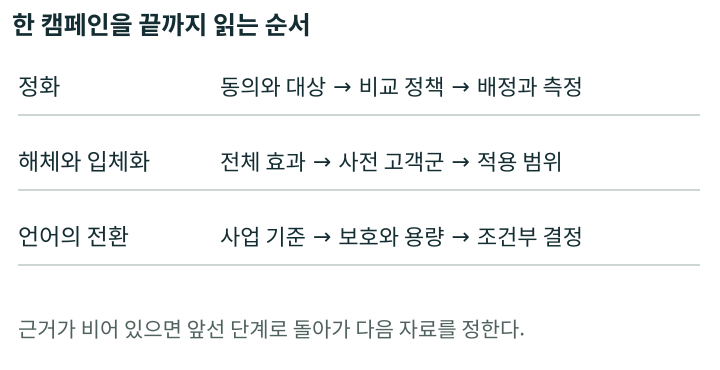

이 장에서는 가상 자동차 회사 JH Motors의 시승 안내를 맡아 한 장의 결정문을 완성한다. 누구에게 무엇을 바꾸려 했고, 어떤 근거로 어디까지 적용하며, 무엇이 들어오면 다시 판단할지 쓴다. 회사와 고객, 사건과 비용은 교육용 합성 자료다. 실제 회의나 승인 기록을 재현한 이야기가 아니라 기존 설계와 결과를 연결하고 미확정 조건을 처리하는 연습이다. 마지막 결정문은 이 자료로 작성할 수 있는 예시다.

잠재 고객이 차량에 관심을 보인 뒤 실제 시승을 완료하도록 돕는 안내를 비교한다. 기존 차량 가치 안내보다 예약 편의를 강조하면 행동 장벽이 낮아질 수 있다는 가설이다. 다만 자료에는 이를 뒷받침할 인터뷰나 현장 병목 조사 결과가 없으므로 예약 불편을 확인된 이탈 원인으로 쓰지 않는다. 이 상태에서 비교할 수 있는 것은 동의한 고객에게 보낼 선택적 안내를 바꿨을 때 다음 행동인 완료가 달라지는지다. 안내를 비교 가능한 정책으로 정의하고 완료에서 가설을 평가하되, 효과가 나타나더라도 예약 불편이라는 원인까지 확인한 것으로 해석하지 않는다.

클릭이 아니라 시승 완료를 중심에 놓는 이유도 여기서 나온다. 관심을 끄는 안내가 더 많은 클릭을 만들더라도 방문까지 이어지지 않을 수 있다. 반대로 클릭을 거치지 않고 시승하는 고객도 있을 수 있다. 이번 데이터에는 클릭 사건 자체가 생성돼 있지 않다. 독자는 클릭률 분석을 덧붙이기 전에 어떤 사건이 실제로 존재하는지 확인해야 한다. 완료 역시 최종 사업 가치와 같지는 않다. 계약과 출고, 장기 관계까지 한꺼번에 입증하려고 하면 관측 기간과 필요한 사건 수가 달라진다. 이번 질문은 가까운 행동을 비교하는 것으로 좁히고, 계약은 더 긴 창의 탐색 결과로 남긴다.

비교 정책은 세 가지다. A는 차량 가치를 강조하는 기존 안내이고 B는 시승 편의를 강조하는 안내다. H에는 해당 실험 메시지를 보내지 않는다. B-A는 안내를 바꿀 이유를 묻고 A-H와 B-H는 각각 그 안내를 보내는 정책이 자연 발생 행동에 무엇을 더하는지 묻는다. H에서도 예약과 시승, 계약과 동의 철회가 일어날 수 있다. 따라서 발송 이후의 완료를 모두 캠페인의 성과로 세지 않는다. 이 실습에는 다른 캠페인이 모형화돼 있지 않으므로 H를 전사적인 모든 접촉의 중단이라고 부를 수도 없다. 실제 적용에서는 다른 안내의 노출을 별도 기록하고 군 간 오염 여부를 살펴야 한다.

여기서 미발송을 허용하는 대상은 선택적인 마케팅 안내다. 리콜과 안전 고지, 법적 의무 안내를 H에 보류하는 설계로 바꾸어서는 안 된다. 동의 없는 고객을 넣어야 모집 인원이 채워진다는 주장도 받아들이지 않는다. 연락할 수 있는 자격은 성과와 맞바꾸는 항목이 아니다. 기준 시점 동의가 있다고 해서 이후 철회가 무시되는 것도 아니다. 실제 운영에서는 발송 직전 권한과 철회 반영을 다시 확인해야 하며, 이 단일 접촉 합성 자료가 지속적인 동의 관리 체계까지 검증한 것으로 해석하지 않는다. CRM을 고른 순간 고객 관계의 제약도 함께 고른 셈이다.

첫 작업은 결과 파일을 열기 전에 설계의 출처를 적는 것이다. 원래 계획은 `e-book/virtual-data/v03/experiment_plan.json`에 있다. 모집단과 배정, 전달, 결과, 시점에 별도 시드를 고정했고 새 자료 생성 전에 로컬에서 동결했다. 외부 기관의 시각 인증을 받은 사전등록도, 실제 현장에서 실행한 실험도 아니다. 앞으로 읽을 수치는 그 합성 계획의 실현값이다. 특히 뒤에서 사용할 최소 사업 개선 +0.5pp와 철회 허용 악화 +0.2pp는 결과를 해석하기 위한 사후 교육용 가정이다. 원래 계획의 성공 조건에 이 두 값을 소급해 넣지 않는다. 이 경계는 결정문을 쓸 때까지 유지한다.

대상은 기준 시점에 잠재 고객이며 SMS 연락에 동의했고 기존 시승 완료가 없는 고객이다. 보유 고객 전체를 대표하지도 않고, 이미 시승한 고객의 재방문을 묻지도 않는다. 합성 모집단 120,000명에서 이 적격 조건을 만족해 배정된 고객은 65,559명이다. 전체 보유 고객 수를 실험 분모로 쓰지 않는다. 한 고객에게 하나의 지속 배정을 주고 A, B, H에 각각 같은 확률로 독립 배정한다. 계획 비율이 같다는 것은 실현 인원이 반드시 정확히 같다는 뜻이 아니다. 군별 인원을 고정해 나눈 별도 실습과도 다르다. 지역과 관심 차종, 판매 접점 라벨은 있지만 이번 계획은 그 라벨별 효과를 확인했다고 보장하지 않는다.

설계 메모에는 다음 명세를 남긴다. 결과를 본 뒤 고르는 요약이 아니라 앞으로 읽을 수치의 비교 조건이다. 실제 업무에서는 회사가 승인한 정의를 쓰고 변경한 부분의 버전과 시점을 기록한다.

| 항목 | 이 실습의 명세 | 결정에서 지키는 경계 |
|---|---|---|
| 대상과 동의 | 잠재 고객, 기준 SMS 동의, 기존 시승 없음 | 비동의 고객과 이미 시승한 고객으로 일반화하지 않음 |
| 정책과 배정 | 기존 A, 편의 B, 해당 메시지 미발송 H에 고객별 동일 확률 독립 배정 | B-A와 발송-H의 질문을 분리함 |
| 단위와 분모 | 고객별 지속 배정 한 건, 배정 전체 분석 | 전달자나 예약자만 남기지 않음 |
| 결과와 기간 | 배정 후 28일 완료, 예약은 진단, 28일 철회는 보호 관측, 180일 계약은 탐색 | 미성숙 무사건을 최종 실패로 처리하지 않음 |
| 주분석 | 완료 B-A, A-H, B-H, 가족 유의수준 5%, Bonferroni | 철회와 손익까지 확증한 것으로 넓히지 않음 |

분모를 배정 고객 전체로 정하면 전달 실패도 정책을 실행한 결과에 포함된다. B가 도착한 사람만 남겨 A가 도착한 사람과 비교하면 배정 이후의 조건으로 대상을 다시 고르게 된다. 예약자만 남겨 완료율을 비교해도 마찬가지다. 예약은 처치가 바꿀 수 있는 행동이므로 양쪽 예약자가 같은 성격의 고객이라는 보장이 없다. 예약자 중 완료율은 퍼널이 어디에서 갈라지는지 진단하는 데 쓰고, 배정 정책의 효과는 배정 고객 전체에서 읽는다. 이 실습의 생성 확률에는 전달 실패가 이미 정책 수준 가정으로 포함돼 있다. 완료율에 전달률을 다시 곱하면 같은 제약을 중복 반영하므로, 계산 전에 그 비율이 어느 분모와 가정을 담고 있는지 확인한다.

시간의 기준도 개인별 배정일이다. 하루 최대 2,000명씩 등록하며 실제 배정일은 가상 시작일 기준 0일부터 32일까지다. 시작 28일째의 조기 뷰에는 58,000명이 있지만 개인별 28일 창을 채운 고객은 2,000명이고 180일 계약 창을 채운 고객은 없다. 이 시점의 낮은 완료율을 최종 실패라고 쓰면 고객에게 아직 주어지지 않은 시간을 실패로 센다. 관측 성숙 여부와 사건의 부재, 기록의 누락은 세 가지 다른 상태다. 최종 결과는 각 고객의 창이 성숙한 자료로 읽고, 조기 화면은 그때까지 보인 현황으로 따로 표시한다. 유리한 p값이 처음 나온 날을 종료일로 고르는 규칙은 원 계획에 없다.

표본 계획은 군당 고객 수만 외우는 과정이 아니다. 원 계획의 완료 기준율 9%에서 10%로의 변화, 양측 비교, 검정력 80%, 세 완료 대비의 Bonferroni 조건에서는 군당 18,001명이 필요했다. 실제 세 군의 배정은 모두 이를 넘는다. 이 1pp는 계획에서 구분하려는 효과이지 도입의 최소 가치가 아니다. 철회 0.8%에서 1.0%로의 변화를 탐지하는 표본 질문도 계획 격자에 있지만, 그 0.2pp 차이를 안전 비열등성의 허용 한계로 정했다는 뜻은 아니다. 같은 숫자가 두 곳에 나타나도 검정 질문과 기준을 만든 시점이 다르면 역할도 다르다. 계약과 드문 관계 손상에 완료와 같은 정보량이 확보됐다고 쓰지 않는다.

이제 자료를 연다. DB 경로는 `e-book/virtual-data/v13/data/jh_motors_v13.sqlite`이며 원자료의 `e-book/virtual-data/v03/DATA_DICTIONARY.md`와 v13의 `outcomes_v13.sql` 및 실제 SQLite 정의를 함께 확인한다. `assignments`는 배정 원장이고 `events`는 배정 식별자로 연결되는 사건 원장이다. `messages`는 발송 시도와 전달 상태를 담는다. 결과용 `outcomes`는 별도 원시 테이블이 아니라 배정 원장에서 시작해 사건을 왼쪽 결합하고 배정별로 묶은 뷰다. `completed_28`, `withdrawn_28`, `contracted_180`은 해당 사건이 창 안에 있으면 1, 없으면 0이 되는 결과 필드다. 같은 고객의 사건 행 여러 개가 독립 고객 여러 명으로 늘어나지 않도록 만든 구조다.

다음 표는 배정과 완료, 철회, 계약의 합계를 읽는 출발점이다. 아래 SQL은 집계 과정을 직접 확인하려는 독자를 위한 선택 경로다. 기존 DB를 읽기 전용으로 열어 표와 대조한 것이며, 통계 분석 전체를 재실행했다는 뜻은 아니다. 다른 버전의 자료를 쓰려면 이름이 같은 뷰도 정의부터 분석 담당자와 확인한다. 실행과 대조의 범위는 [계산 방법과 분석 확인](#analysis-method-notes)에 남긴다.

```sql
SELECT arm,
       COUNT(*) AS assigned,
       SUM(completed_28) AS completed,
       SUM(withdrawn_28) AS withdrawn,
       SUM(contracted_180) AS contracted
FROM outcomes
GROUP BY arm
ORDER BY arm;
```

| 군 | 배정 고객 | 28일 완료 | 28일 철회 | 180일 계약 |
|---|---:|---:|---:|---:|
| A | 21,637 | 1,971 | 181 | 198 |
| B | 22,024 | 2,212 | 202 | 268 |
| H | 21,898 | 1,338 | 25 | 231 |

집계가 나왔다고 자료 확인을 끝내지 않는다. 배정 전 사건과 관측 창 밖 사건은 제외하고 창 양 끝의 사건은 포함하는지 확인해야 한다. 원 DB를 보존한 파생 자료에서 이 시간 정의를 교정했으며, 현재 원자료에는 배정 전 사건이 없어 교정 전후 집계가 같았다. 다른 자료에서도 같을 것이라 가정하지 말고 원장과 시간 정의를 분석 담당자와 확인한다. v03에서 v13으로의 뷰 교정과 경계 검사 이력은 [계산 방법과 분석 확인](#analysis-method-notes)에 남긴다.

또한 `outcomes`의 전체 행 수와 고유 배정 식별자 수, 고유 고객 수가 모두 65,559명으로 일치했고 배정 고객 중 명세의 적격 조건에 어긋난 행은 없었다. A와 B의 발송 시도는 각각 배정 수와 같고 H의 시도는 없었다. 이것은 이번 합성 자료에서 직접 확인한 구조적 사실이다. 현장 동의가 실제로 적법했는지, 지점 완료 원장에 기록되지 않은 사건이 없는지까지 인증한 결과는 아니다. 원장의 생성 자체가 완전한 합성 환경과 실제 시스템의 측정 완전성을 구분해야 한다. SRM이 정상이라거나 인원수가 맞는다는 말도 사건 누락이 없다는 보증으로 대신 쓰지 않는다.

정화, Variable Control에서 확인한 조건에 따라 전달 성공자만의 비교와 미성숙 스냅샷을 주결론에서 제외한다. 기록 경로에 문제가 있으면 그 지표의 판단을 멈춘다. 이번에는 뷰 합계를 원본 사건과 연결할 수 있으므로 정한 합성 비교를 읽을 수 있다. 이는 실제 운영의 무작위화와 원장 정확성까지 확인했다는 뜻은 아니다. 다음 통계 결과는 이 합성 자료에서 비교가 성립하는 범위의 근거로 읽는다. 그래야 B의 완료 수가 가장 크다는 관찰과 실제 적용을 승인할 수 있는지의 판단을 분리할 수 있다.

통계 결과의 장부는 `e-book/analysis/winner_v04/core_results.json`이다. 이 장에서는 그 결과를 새로 유리하게 계산하지 않고 기존 값을 읽는다. 독립 개인의 이항 결과와 고정 분석을 가정해 pooled z 검정을 쓰고, Wilson 경계를 결합한 Newcombe 차이 구간을 사용했다. 세 완료 대비의 가족 유의수준을 5%로 나누었으므로 각 양측 구간 수준은 약 98.33%다. B-A 완료 차이는 약 +0.93pp, 구간은 [+0.26,+1.61]pp이고 가족 보정 p는 약 0.00274다. A의 약 9.11%와 B의 약 10.04% 차이를 상대 변화로 쓰면 약 +10.26%지만, 운영 수요를 이야기할 때에는 절대 차이인 pp부터 읽는다.

A-H 완료 차이는 약 +3.00pp, 같은 수준의 구간은 [+2.39,+3.61]pp이며 가족 보정 p는 1.08053e-31이다. B-H는 약 +3.93pp, 구간 [+3.31,+4.56]pp, 보정 p는 3.47796e-51이다. 정한 합성 모형에서는 B가 A보다, 두 안내 모두 H보다 완료에서 우위라는 근거가 있다. 그러나 B의 완료 2,212건 전부가 메시지 때문에 새로 생긴 완료는 아니다. H가 보여 주는 자연 발생과 비교한 평균 차이가 증분 효과의 질문에 해당한다. 세 대비가 모두 좋다는 사실도 계약과 고객 관계가 함께 좋아졌다는 답으로 확장하지 않는다.

첫 반론은 이제 왜 바로 적용하지 않느냐는 것이다. 완료 우위의 근거가 있다는 말은 유지해야 한다. 불확실성이 남았다는 이유로 이미 지지되는 주장을 지워 버릴 필요는 없다. 다만 최소 +0.5pp는 개선돼야 바꿀 가치가 있다는 사후 교육용 기준을 놓으면 B-A 구간 하한 +0.26pp는 그 기준보다 낮다. 따라서 0보다 나은 근거와 최소 사업 효과 이상이라는 근거는 다르다. 이 결과가 사업 기준 미달을 확정한 것도 아니다. 비용이 낮고 되돌리기 쉬운 범위에서 위험을 감수할지, 더 정밀한 후속 실험을 할지의 선택이 남는다. 기준을 통과한 것처럼 보이려고 0.5를 낮추거나 원 계획을 고쳐서는 안 된다.

두 번째 반론은 철회 차이가 유의하지 않으니 고객 관계는 문제가 없다는 주장이다. A의 철회는 약 0.837%, B는 약 0.917%이며 B-A는 약 +0.081pp다. 개별 미보정 95% 탐색 구간은 [-0.095,+0.256]pp이고 p는 약 0.3662다. 방향상 증가는 악화이며, 이 p값은 악화가 없을 확률을 말하지 않는다. 사후 교육용 허용 악화 +0.2pp를 놓아도 구간 상한은 그보다 높다. 더 근본적으로 원 계획에는 비열등성 한계와 대응 분석 설계가 없다. 이 양측 탐색 구간으로 정식 안전 통과나 실패를 판정하지 않고, 의미 있는 악화를 배제할 증거가 부족하다고 적는다.

동의 철회는 발송 정책의 보호 지표다. 민원과 장기 이탈은 생성하지 않았으므로 철회만으로 모든 관계 손상을 설명하지 않는다. B-A 결과를 발송-H의 위험 판단으로 옮길 수도 없다. H에도 철회가 있고 실제 운영에서는 다른 접촉이 영향을 줄 수 있기 때문이다. 후속 계획에는 신규 적용에 필요한 보호 비교와 허용 한계를 명시한다. 법적 권리 침해나 중대한 피해는 통계적 유의성을 기다리지 않는 운영 중단 사유로 두며, 이는 사후 0.2pp 예시와 별개다.

세 번째 반론은 B의 계약이 많으니 이미 재무 승리라는 것이다. 계약은 180일 탐색 결과이고, 비용도 교육용 가정이다. 계약 한 건의 캠페인 전 기여액 200만원, 발송 시도당 20원, 완료당 운영비 1만5천원, B의 고정 준비비 20만원을 사용한다. 고객별 계약 기여액에서 완료 비용과 시도 비용을 빼고 B에는 현재 배정 수로 나눈 준비비를 더 뺀다. 계약자만의 평균이 아니라 배정 고객당 평균이다. 차량 가격 4000만원을 이익처럼 곱하지 않고, 계약을 출고 매출이나 장기 고객생애가치로 부르지 않는다. 취소와 보증, 잠식과 실제 회계 원가가 빠져 있다는 한계도 비용 식 옆에 둔다.

기존 장부의 고객당 합성 순기여액은 A 16,916원, B 22,801원, H 20,181원이다. 평균 차이를 반올림한 B-A는 +5,886원이며 개별 탐색 95% Welch 구간은 [+2,061,+9,711]원이다. B-H는 +2,620원이지만 구간은 [-1,317,+6,557]원으로 0을 포함한다. A-H는 -3,266원이며 구간은 [-6,950,+419]원이다. 완료에서는 A도 H보다 좋았지만 모형 손익의 점추정 순서는 다르다. 각각 반올림한 평균을 빼서 차이 장부를 수정하지 않는다. 이 손익 구간은 고정 비용 가정과 개인 독립에 조건부인 미보정 탐색이며 완료 세 대비의 보정이 보호하는 결과가 아니다.

비용 가정을 바꾸면 같은 사건에서도 재무 판단이 달라질 수 있다. 같은 고객 결과와 비용에서 계약 기여액만 50만원으로 두면 기존 민감도 장부의 B-H 점추정은 고객당 약 +191원이다. 이는 새 성과가 아니라 같은 사건에 다른 값을 붙인 계산이므로, 원래 손익 결과를 현실의 수익 보장으로 읽지 못하는 이유를 보여 준다. 모형의 통계 구간에 잘못된 원가 가정의 오차가 자동으로 들어 있지는 않다. 고정 준비비를 향후 확대 고객에게 어떻게 배분할지, 이미 쓴 매몰비와 앞으로 추가될 비용을 어떻게 구분할지도 따로 정한다. 이 질문을 비워 둔 채 B의 높은 완료를 돈으로 포장하면 언어의 전환이 아니라 사후 설득이 된다. 적용을 논의하기 전에 실제 비용 정의가 모형과 맞는지 확인한다.

해체와 입체화, Vector Segmentation에서는 적용 대상을 확인한다. 이번 모집단은 잠재 고객이며 군별 정책 효과는 균일한 가정으로 생성했다. 지역과 차종 라벨만으로 특정 고객군의 승자를 선언하거나, 별도 집단 실습의 효과 반전을 이 실험의 발견으로 가져올 수 없다. 현재 답은 적격 잠재 고객 구성의 전체 효과다. 다른 대상을 고르려면 배정 전 고객 상태와 집단별 효과 차이, 정보량과 다중성을 계획해야 한다. 따라서 모든 CRM 고객에게 B를 보내는 확대는 현재 근거 밖이다.

지금 자료에서 가장 큰 차이를 찾으려고 끝없이 나눌 필요는 없다. 구매 확률이 높은 고객과 연락의 증분 효과가 큰 고객은 다르다. 유입 경로나 관심 모델에서 좋아 보이는 차이를 발견하면 탐색으로 남기고 별도 표본에서 확인할 후보로 둔다. 클릭자만의 결과는 처치 뒤 행동으로 고른 비교이므로 적용 대상을 사전에 정의한 근거로 쓰지 않는다. 이번 결정문에는 확인하지 않은 집단별 이득 대신 실험 대상과 다음 적용 대상의 구성 차이를 확인할 책임을 남긴다.

마지막 축인 언어의 전환, Value-Linked Decision은 완료의 승자를 적용 정책으로 옮긴다. 현재 자료는 실제 시승차와 상담 인력의 공유 용량을 구현하지 않았다. 하루 등록 상한 2,000명을 시승 수용 용량이라고 착각해서도 안 된다. B를 더 넓게 보내면 대기와 취소가 늘어 효과 자체가 달라질 수 있다. 따라서 다른 용량 실습의 숫자를 이번 캠페인의 실제 슬롯처럼 붙이지 않고, 운영 담당자가 날짜와 지점별 가용 자원, 요청과 취소, 미수용 경로를 확인하도록 한다. 개인 효과에 고객 수를 곱한 값으로 전국 확대를 승인하지 않는 두 번째 적용 제한이다.

완료 개선만으로는 앞서 남은 사업 가치와 보호, 용량의 질문에 답할 수 없으므로 현재는 전면 적용을 보류하고 B를 후속 검토 후보로 남긴다. 다시 판단하려면 사업 담당자는 실제 도입 기준과 변경 비용을, 고객 보호 담당자는 동의 처리와 허용 위험 및 평가 방법을 확정해야 한다. 재무 담당자는 기여액과 비용 범위를, 운영 담당자는 수용 가능한 발송 범위와 복구 경로를 확정한다. 임의의 예산과 인원, 날짜로 빈칸을 채우지 말고, 각 답이 갖춰졌을 때 어떤 범위의 실행을 검토할 수 있는지 연결한다. 이 조건을 승인한 뒤 되돌릴 수 있는 제한 범위를 계획할 수 있지만, 그 범위의 안전과 수익까지 현재 자료로 검증됐다고 쓰지 않는다.

추가 확인은 선택을 바꿀 질문으로 남긴다. 실제 도입 기준을 지지하는 근거와 보호 평가, 운영 가능 범위가 갖춰지면 제한 적용이나 새 실험의 승인을 요청한다. 보호에 필요한 설계와 정보량이 부족하면 확대를 열지 않고 그 확인을 우선한다. 단순 모니터링은 장애와 피해를 찾는 데 쓰되 증분 효과의 실험을 대신하지 않는다. 새 실험에는 비교 정책과 배정, 결과 창, 표본과 분석, 보호 조건을 다시 고정한다. 안전상 운영 중지와 성과상 조기 종료를 나누며 원래 실험을 유의해질 때까지 연장하지 않는다.

9장의 회신 예제에서 남긴 공백은 이 판단문에서도 닫힌 척하지 않는다. 완료 근거는 V1에, 현재의 보류는 V3에 연결하고, 사업, 재무, 고객 보호, 운영 역할이 제공해야 할 답은 ‘추가 확인 또는 생략’에 남긴다. 근거가 도착하면 ‘다시 검토할 조건’에 따라 판단을 열되, 답의 첨부와 실행 승인은 별개다. 아래 완성 결정문은 이 미확인 상태까지 포함해 완성한 예시다.

장 앞에서 적은 답을 다음 해설과 대조해 보자. 결론이 같은지뿐 아니라 사용한 분모와 불확실성, 적용 범위와 다음 행동이 같은지도 확인한다.

완료 구간의 하한만 보고 B가 실패했다고 단정할 수는 없다. 완료 B-A의 우위는 정한 합성 분석 범위에서 지지된다. 다만 사후 교육용 사업 기준 +0.5pp 이상이라는 충분성은 확인하지 못했다. 효과 없음이나 확정 실패로 적지 말고, 완료 우위 지지와 사업적 충분성 불확실을 분리한다. 실제 도입 기준을 정하고 추가 정보의 가치와 제한 적용의 위험을 비교하는 것이 다음 행동이다.

철회 p와 손익 점추정만으로 안전한 확대를 승인할 수는 없다. 철회의 탐색 구간은 의미 있는 악화를 여전히 포함하며 원 계획은 비열등성 설계가 아니다. B-H 손익 구간도 0을 포함하고 실제 원가가 검증되지 않았다. 보호 조건과 경제성은 별도의 미해결 주장이다. 동의 처리와 허용 위험, 비용 정의 및 용량을 확인하기 전 전면 적용은 보류한다. 수익 점수가 권리 침해를 상쇄하도록 만들지 않는다.

지역을 나누어 찾은 최대 효과는 곧바로 적용할 근거가 아니다. 그 발견은 새 적용 가설이지 독립 검증이 아니다. 이번 계획은 집단별 효과를 검증하지 않았고, 많은 지역을 뒤지면 우연한 최대값을 고를 수 있다. 배정 전 집단 정의와 표적 구성, 효과 차이의 직접 추정과 다중성, 필요한 표본을 후속 계획에 적는다. 별도 집단 실습의 수치나 클릭자 비교를 이 실험의 표적 근거로 대체하지 않는다.

작성한 결정문은 1장의 여섯 항목에 해당 문단을 연결해 재사용한다. 같은 실험 식별자 아래 실험 전 기준, 결과 후 해석, 사후 가정의 변경 시점과 재검토 이력을 남긴다. 적용 범위와 현재 선택, 실제 승인은 구분하고, 미정인 담당자와 기한 및 손실 한계는 값을 꾸미지 말고 확정할 역할로 적는다. 추가 확인은 선택을 바꿀 조건에 한정하되 사전 종료 규칙과 보호 의무를 생략하지 않는다. B 미채택을 A의 최적성으로 쓰지 않는다.

다음은 지금까지의 해석을 연결한 결정문이다. 자신의 사례에서는 대상과 근거, 책임과 재검토 조건을 실제 값으로 바꿔 쓴다. 이 예시도 승인되지 않은 제한 적용을 실행한 것으로 기록하지 않는다.

**완성된 한 장 결정문 예시**

JH Motors의 시승 편의 안내 B는 후속 검토 후보로 유지하고 전면 적용은 보류한다. 질문은 기준 시점 SMS 동의가 있고 기존 시승 완료가 없는 잠재 고객에게 차량 가치 안내 A 대신 B를 배정하면 배정 후 28일 완료가 증가하는가이며, 해당 메시지 미발송 H와의 차이도 별도로 본 것이다. 교육용 합성 모집단 120,000명 중 65,559명을 고객별 동일 확률로 A/B/H에 지속 배정했다. 전달과 예약 여부에 관계없이 배정 전체가 분모다. 생성 전에 로컬 동결한 계획을 따르지만 외부 사전등록이나 실제 회사의 현장 실험은 아니다.

자료는 v03 원자료에서 뷰만 교정한 v13 DB이며 작성 시 읽기 전용으로 실제 outcomes 뷰와 원본 배정 및 사건의 고유 고객 집계, 시간 창을 대조했다. 배정과 완료는 A 21,637명 중 1,971명, B 22,024명 중 2,212명, H 21,898명 중 1,338명이다. 통계 근거는 core_results.json의 기존 결과다. 독립 이항과 고정 분석 가정 아래 세 완료 대비를 Bonferroni로 처리한 B-A는 약 +0.93pp, 개별 약 98.33% Newcombe 구간 [+0.26,+1.61]pp, 가족 보정 p 약 0.00274로 완료 우위를 지지한다. 이는 모든 고객과 모든 지표의 승리를 뜻하지 않는다.

사업적 충분성과 관계 안전은 미해결이다. 최소 개선 +0.5pp와 철회 허용 악화 +0.2pp는 사후 교육용 가정이지 원래 성공 조건이 아니다. 완료 구간은 +0.5pp 이상을 확인하지 못하고, 철회 B-A의 미보정 95% 탐색 구간 [-0.095,+0.256]pp는 정식 안전 통과 근거가 아니다. 고정 비용 가정의 배정 고객당 합성 순기여액 B-H는 +2,620원, 탐색 95% Welch 구간 [-1,317,+6,557]원이다. 실제 출고 이익과 장기 관계, 집단별 적용 효과 및 확대 용량은 확인하지 않았다.

따라서 현재 허용하는 행동은 후속 설계 준비이며 신규 전면 확대는 승인하지 않는다. 사업 담당자가 실제 최소 가치와 변경 비용을, 고객 보호 담당자가 동의 처리와 허용 위험 및 그에 맞는 평가 설계를, 재무 담당자가 기여액과 비용 정의를, 운영 담당자가 가용 슬롯과 제한 적용 및 롤백 범위를 문서로 확정하면 재검토한다. 분석 담당자는 그 조건에 맞는 표본과 관측 기간, 비교 가족과 종료 규칙을 결과 전에 고정한다. 조건이 갖춰질 때에만 되돌릴 수 있는 제한 적용이나 새 실험의 승인을 요청하고, 중요한 동의 위반과 피해가 확인되면 성과 유의성과 무관하게 보호 절차를 실행한다. 이 결정은 실제 성과의 승인 기록이 아니라 주어진 합성 증거의 지지 범위와 남은 책임을 연결한 교육용 판단이다.

# 찾아보기

용어 이름을 알면 가나다순에서, 영문 약어만 기억나면 아래 약어에서 찾는다. 본문은 대표 설명으로, 해설은 용어 풀이로 이동한다. 모든 등장 쪽을 나열한 색인은 아니다. 본문 쪽수가 없는 항목은 용어 해설에서 확인한다.

<a id="term-index"></a>
<div class="lookup-tools"><label>용어 또는 영문 약어 <input id="term-search" type="search" placeholder="예: 검정력, MDE, SRM" /></label><button type="button" id="term-clear">지우기</button><span id="term-result" aria-live="polite"></span></div>
<div class="index-pair"><table class="index-table"><thead><tr><th>용어</th><th>본문</th><th>해설</th></tr></thead><tbody><tr data-search="보호 지표, 가드레일 Guardrail Metric 가드레일"><td><a href="#g-guardrail">가드레일</a></td><td><a href="#b-guardrail"><span class="folio" data-id="b-guardrail">30</span></a></td><td><a href="#g-guardrail"><span class="folio" data-id="g-guardrail">79</span></a></td></tr><tr data-search="간섭 Interference, Spillover 간섭"><td><a href="#g-interference">간섭</a></td><td><a href="#b-interference"><span class="folio" data-id="b-interference">44</span></a></td><td><a href="#g-interference"><span class="folio" data-id="g-interference">79</span></a></td></tr><tr data-search="제2종 오류와 검정력 Type II Error, Power 검정력과 제2종 오류"><td><a href="#g-power">검정력과 제2종 오류</a></td><td><a href="#b-power"><span class="folio" data-id="b-power">25</span></a></td><td><a href="#g-power"><span class="folio" data-id="g-power">79</span></a></td></tr><tr data-search="고객생애가치 LTV, Lifetime Value 고객생애가치"><td><a href="#g-ltv">고객생애가치</a></td><td><a href="#b-ltv"><span class="folio" data-id="b-ltv">18</span></a></td><td><a href="#g-ltv"><span class="folio" data-id="g-ltv">79</span></a></td></tr><tr data-search="관측 성숙 Maturity 관측 성숙"><td><a href="#g-maturity">관측 성숙</a></td><td><a href="#b-maturity"><span class="folio" data-id="b-maturity">26</span></a></td><td><a href="#g-maturity"><span class="folio" data-id="g-maturity">79</span></a></td></tr><tr data-search="군집 실험 Cluster-randomized Experiment 군집 실험"><td><a href="#g-cluster">군집 실험</a></td><td><a href="#b-cluster"><span class="folio" data-id="b-cluster">22</span></a></td><td><a href="#g-cluster"><span class="folio" data-id="g-cluster">80</span></a></td></tr><tr data-search="다중 비교 Multiplicity, Multiple Testing 다중 비교"><td><a href="#g-multiplicity">다중 비교</a></td><td><a href="#b-multiplicity"><span class="folio" data-id="b-multiplicity">22</span></a></td><td><a href="#g-multiplicity"><span class="folio" data-id="g-multiplicity">80</span></a></td></tr><tr data-search="다중 팔 밴딧 Multi-armed Bandit, MAB 다중 팔 밴딧"><td><a href="#g-bandit">다중 팔 밴딧</a></td><td><a href="#b-bandit"><span class="folio" data-id="b-bandit">62</span></a></td><td><a href="#g-bandit"><span class="folio" data-id="g-bandit">80</span></a></td></tr><tr data-search="무작위 배정 Randomization 무작위 배정"><td><a href="#g-randomization">무작위 배정</a></td><td><a href="#b-randomization"><span class="folio" data-id="b-randomization">15</span></a></td><td><a href="#g-randomization"><span class="folio" data-id="g-randomization">80</span></a></td></tr><tr data-search="민감도 분석 Sensitivity Analysis 민감도 분석"><td><a href="#g-sensitivity">민감도 분석</a></td><td><a href="#b-sensitivity"><span class="folio" data-id="b-sensitivity">11</span></a></td><td><a href="#g-sensitivity"><span class="folio" data-id="g-sensitivity">81</span></a></td></tr><tr data-search="반사실 Counterfactual 반사실"><td><a href="#g-counterfactual">반사실</a></td><td><a href="#b-counterfactual"><span class="folio" data-id="b-counterfactual">46</span></a></td><td><a href="#g-counterfactual"><span class="folio" data-id="g-counterfactual">81</span></a></td></tr><tr data-search="배정 기준 분석 ITT, Intention-to-Treat 배정 기준 분석"><td><a href="#g-itt">배정 기준 분석</a></td><td><a href="#b-itt"><span class="folio" data-id="b-itt">20</span></a></td><td><a href="#g-itt"><span class="folio" data-id="g-itt">81</span></a></td></tr><tr data-search="배정 단위와 분석 단위 Units 배정 단위와 분석 단위"><td><a href="#g-units">배정 단위와 분석 단위</a></td><td><a href="#b-units"><span class="folio" data-id="b-units">15</span></a></td><td><a href="#g-units"><span class="folio" data-id="g-units">81</span></a></td></tr><tr data-search="분모 Denominator 분모"><td><a href="#g-denominator">분모</a></td><td><a href="#b-denominator"><span class="folio" data-id="b-denominator">6</span></a></td><td><a href="#g-denominator"><span class="folio" data-id="g-denominator">81</span></a></td></tr><tr data-search="상호작용과 효과 이질성 Interaction, Heterogeneity 상호작용"><td><a href="#g-interaction">상호작용</a></td><td><a href="#b-interaction"><span class="folio" data-id="b-interaction">17</span></a></td><td><a href="#g-interaction"><span class="folio" data-id="g-interaction">82</span></a></td></tr><tr data-search="세그먼트 Segments 세그먼트"><td><a href="#g-segments">세그먼트</a></td><td><a href="#b-segments"><span class="folio" data-id="b-segments">17</span></a></td><td><a href="#g-segments"><span class="folio" data-id="g-segments">82</span></a></td></tr><tr data-search="순차 검정 Sequential Testing 순차 검정"><td><a href="#g-sequential">순차 검정</a></td><td><a href="#b-sequential"><span class="folio" data-id="b-sequential">30</span></a></td><td><a href="#g-sequential"><span class="folio" data-id="g-sequential">82</span></a></td></tr><tr data-search="신뢰구간 CI, Confidence Interval 신뢰구간"><td><a href="#g-ci">신뢰구간</a></td><td><a href="#b-ci"><span class="folio" data-id="b-ci">21</span></a></td><td><a href="#g-ci"><span class="folio" data-id="g-ci">82</span></a></td></tr></tbody></table><table class="index-table"><thead><tr><th>용어</th><th>본문</th><th>해설</th></tr></thead><tbody><tr data-search="요인 설계와 다변량 테스트 Factorial Design, MVT 요인 설계와 다변량 테스트"><td><a href="#g-factorial">요인 설계와 다변량 테스트</a></td><td>—</td><td><a href="#g-factorial"><span class="folio" data-id="g-factorial">83</span></a></td></tr><tr data-search="유의수준과 제1종 오류 Alpha, Type I Error 유의수준과 제1종 오류"><td><a href="#g-alpha">유의수준과 제1종 오류</a></td><td><a href="#b-alpha"><span class="folio" data-id="b-alpha">22</span></a></td><td><a href="#g-alpha"><span class="folio" data-id="g-alpha">83</span></a></td></tr><tr data-search="유의확률 p-value 유의확률"><td><a href="#g-pvalue">유의확률</a></td><td><a href="#b-pvalue"><span class="folio" data-id="b-pvalue">20</span></a></td><td><a href="#g-pvalue"><span class="folio" data-id="g-pvalue">83</span></a></td></tr><tr data-search="이중차분법 DID, Difference-in-Differences 이중차분법"><td><a href="#g-did">이중차분법</a></td><td><a href="#b-did"><span class="folio" data-id="b-did">62</span></a></td><td><a href="#g-did"><span class="folio" data-id="g-did">83</span></a></td></tr><tr data-search="전체 평가 기준 OEC, Overall Evaluation Criterion 전체 평가 기준"><td><a href="#g-oec">전체 평가 기준</a></td><td><a href="#b-oec"><span class="folio" data-id="b-oec">55</span></a></td><td><a href="#g-oec"><span class="folio" data-id="g-oec">83</span></a></td></tr><tr data-search="절대 효과와 상대 효과 Percentage Points, Relative Effect 절대 효과와 상대 효과"><td><a href="#g-effect">절대 효과와 상대 효과</a></td><td><a href="#b-effect"><span class="folio" data-id="b-effect">20</span></a></td><td><a href="#g-effect"><span class="folio" data-id="g-effect">84</span></a></td></tr><tr data-search="주지표 Primary Metric 주지표"><td><a href="#g-primary">주지표</a></td><td><a href="#b-primary"><span class="folio" data-id="b-primary">9</span></a></td><td><a href="#g-primary"><span class="folio" data-id="g-primary">84</span></a></td></tr><tr data-search="증분 효과 Incrementality 증분 효과"><td><a href="#g-incrementality">증분 효과</a></td><td><a href="#b-incrementality"><span class="folio" data-id="b-incrementality">14</span></a></td><td><a href="#g-incrementality"><span class="folio" data-id="g-incrementality">84</span></a></td></tr><tr data-search="진단 지표 Diagnostic Metric 진단 지표"><td><a href="#g-diagnostic">진단 지표</a></td><td><a href="#b-diagnostic"><span class="folio" data-id="b-diagnostic">17</span></a></td><td><a href="#g-diagnostic"><span class="folio" data-id="g-diagnostic">84</span></a></td></tr><tr data-search="처치 후 선택 Post-treatment Selection 처치 후 선택"><td><a href="#g-post-treatment">처치 후 선택</a></td><td><a href="#b-post-treatment"><span class="folio" data-id="b-post-treatment">17</span></a></td><td><a href="#g-post-treatment"><span class="folio" data-id="g-post-treatment">84</span></a></td></tr><tr data-search="최소 검출 효과 MDE, Minimum Detectable Effect 최소 검출 효과"><td><a href="#g-mde">최소 검출 효과</a></td><td><a href="#b-mde"><span class="folio" data-id="b-mde">26</span></a></td><td><a href="#g-mde"><span class="folio" data-id="g-mde">85</span></a></td></tr><tr data-search="최소 사업 효과 Business Threshold 최소 사업 효과"><td><a href="#g-business-threshold">최소 사업 효과</a></td><td><a href="#b-business-threshold"><span class="folio" data-id="b-business-threshold">26</span></a></td><td><a href="#g-business-threshold"><span class="folio" data-id="g-business-threshold">85</span></a></td></tr><tr data-search="추정 대상 Estimand 추정 대상"><td><a href="#g-estimand">추정 대상</a></td><td><a href="#b-estimand"><span class="folio" data-id="b-estimand">16</span></a></td><td><a href="#g-estimand"><span class="folio" data-id="g-estimand">85</span></a></td></tr><tr data-search="트와이먼의 법칙 Twyman&#x27;s Law 트와이먼의 법칙"><td><a href="#g-twyman">트와이먼의 법칙</a></td><td>—</td><td><a href="#g-twyman"><span class="folio" data-id="g-twyman">85</span></a></td></tr><tr data-search="표본 비율 불일치 SRM, Sample Ratio Mismatch 표본 비율 불일치"><td><a href="#g-srm">표본 비율 불일치</a></td><td><a href="#b-srm"><span class="folio" data-id="b-srm">41</span></a></td><td><a href="#g-srm"><span class="folio" data-id="g-srm">85</span></a></td></tr><tr data-search="피킹 Peeking 피킹"><td><a href="#g-peeking">피킹</a></td><td><a href="#b-peeking"><span class="folio" data-id="b-peeking">30</span></a></td><td><a href="#g-peeking"><span class="folio" data-id="g-peeking">86</span></a></td></tr><tr data-search="홀드아웃 Holdout 홀드아웃"><td><a href="#g-holdout">홀드아웃</a></td><td><a href="#b-holdout"><span class="folio" data-id="b-holdout">32</span></a></td><td><a href="#g-holdout"><span class="folio" data-id="g-holdout">86</span></a></td></tr><tr data-search="A/A 테스트 A/A Test A/A 테스트"><td><a href="#g-aa">A/A 테스트</a></td><td><a href="#b-aa"><span class="folio" data-id="b-aa">58</span></a></td><td><a href="#g-aa"><span class="folio" data-id="g-aa">86</span></a></td></tr></tbody></table></div>
<div class="english-index"><strong>영문과 약어</strong><p><a href="#g-aa">A/A</a> / <a href="#g-ci">CI</a> / <a href="#g-did">DID</a> / <a href="#g-guardrail">Guardrail</a> / <a href="#g-holdout">Holdout</a> / <a href="#g-itt">ITT</a> / <a href="#g-ltv">LTV</a> / <a href="#g-bandit">MAB</a> / <a href="#g-mde">MDE</a> / <a href="#g-factorial">MVT</a> / <a href="#g-oec">OEC</a> / <a href="#g-peeking">Peeking</a> / <a href="#g-power">Power</a> / <a href="#g-srm">SRM</a> / <a href="#g-pvalue">p-value</a></p></div>

# 용어 해설

용어는 가나다순이며 영문으로 시작하는 항목은 뒤에 둔다. 각 항목의 본문 링크로 돌아가 사례 속 뜻을 확인할 수 있다.

<a id="g-guardrail"></a>
## 가드레일

<div class="term-meta">Guardrail Metric<span><a href="#b-guardrail">본문 <span class="folio" data-id="b-guardrail">30</span></a> / <a href="#term-index">찾아보기</a></span></div>

가드레일은 핵심 성과를 높이는 동안 허용하기 어려운 악화를 막기 위해 정한 보호 지표다. 악화 검정이 유의하지 않다는 사실은 안전의 증명이 아니며, 정식 비열등성 판단에는 사전 허용 한계와 그에 맞는 설계가 필요하다. CRM에서는 철회율과 불만률을 감시하되 중대한 동의 위반을 시승 증가와 상쇄해 통과시키지 않는다.

<a id="g-interference"></a>
## 간섭

<div class="term-meta">Interference, Spillover<span><a href="#b-interference">본문 <span class="folio" data-id="b-interference">44</span></a> / <a href="#term-index">찾아보기</a></span></div>

간섭은 한 대상에게 배정한 정책이 다른 대상의 결과에도 영향을 주는 현상이다. 표본을 늘리는 것만으로 없어지지 않으며, 개인 단위 실험의 효과가 전면 적용 효과와 달라질 수 있다. CRM에서 B가 시승 슬롯을 먼저 채워 A 고객의 예약을 막는다면 공유 용량과 포화도를 포함해 비교 정책과 배정 단위를 다시 설계한다.

<a id="g-power"></a>
## 검정력과 제2종 오류

<div class="term-meta">Type II Error, Power<span><a href="#b-power">본문 <span class="folio" data-id="b-power">25</span></a> / <a href="#term-index">찾아보기</a></span></div>

제2종 오류는 특정 대립가설이 참일 때 귀무가설을 기각하지 못하는 오류이고, 그 확률 beta의 보수가 해당 대립가설에서의 검정력이다. 검정력은 효과 크기와 표본, 변동성 및 검정 규칙에 달리므로 모든 효과를 같은 확률로 발견한다는 뜻도, 이번 비유의 결과가 무효과일 확률도 아니다. CRM에서는 완료와 희귀한 계약의 계획 검정력을 따로 계산하고, 관측 효과로 구한 사후 검정력을 결론의 추가 근거로 쓰지 않는다.

<a id="g-ltv"></a>
## 고객생애가치

<div class="term-meta">LTV, Lifetime Value<span><a href="#b-ltv">본문 <span class="folio" data-id="b-ltv">18</span></a> / <a href="#term-index">찾아보기</a></span></div>

LTV는 정한 기간과 할인, 비용 정의 아래에서 고객 관계가 만들어낼 미래 가치를 요약한 값이다. 관측한 장기 가치와 모형으로 예측한 가치를 구분해야 하며, 단기 클릭 상승이나 구매자의 높은 예측 LTV가 캠페인의 증분 LTV를 입증하지는 않는다. CRM에서는 장기 홀드아웃과 유지, 취소, 서비스 비용을 연결하고, 계약까지만 관측했다면 장기 가치 환산은 검증되지 않은 가정으로 남긴다.

<a id="g-maturity"></a>
## 관측 성숙

<div class="term-meta">Maturity<span><a href="#b-maturity">본문 <span class="folio" data-id="b-maturity">26</span></a> / <a href="#term-index">찾아보기</a></span></div>

관측 성숙은 각 대상이 미리 정한 결과 관측 창을 채운 상태다. 실험 시작 뒤 달력상 28일이 지났다고 모든 고객이 배정 후 28일을 채운 것은 아니며, 아직 관측 중인 상태를 최종 미완료와 혼동해서는 안 된다. CRM에서 늦게 등록한 고객의 계약을 읽을 때에는 개인별 180일 창이 찼는지 확인하고, 중간 스냅샷과 성숙 결과를 구분한다.

<a id="g-cluster"></a>
## 군집 실험

<div class="term-meta">Cluster-randomized Experiment<span><a href="#b-cluster">본문 <span class="folio" data-id="b-cluster">22</span></a> / <a href="#term-index">찾아보기</a></span></div>

군집 실험은 개인 대신 가구, 지점이나 지역 같은 묶음을 무작위로 배정하는 실험이다. 지역을 나눴다는 이유만으로 준실험이 되는 것은 아니며, 군집 안 상관과 군집 사이 간섭, 독립 군집 수를 설계와 분석에 반영해야 한다. CRM에서 지점별 시승 운영을 비교한다면 고객 수가 많아도 지점 수가 적을 수 있으므로 개인 독립 분석의 정밀도를 그대로 주장하지 않는다.

<a id="g-multiplicity"></a>
## 다중 비교

<div class="term-meta">Multiplicity, Multiple Testing<span><a href="#b-multiplicity">본문 <span class="folio" data-id="b-multiplicity">22</span></a> / <a href="#term-index">찾아보기</a></span></div>

다중 비교는 여러 후보, 지표, 대비나 집단을 검정하면서 우연한 발견을 선택할 기회가 늘어나는 문제다. 보정은 정한 검정 가족과 오류 기준을 대상으로 하므로 한 가족의 보정이 모든 탐색을 보호하거나 선택된 최대 효과의 과대추정을 자동으로 없애지는 않는다. JH Motors의 세 완료 대비에 적용한 Bonferroni 보정은 계약과 철회, 손익의 사후 비교까지 확증 결과로 만들지 않는다.

<a id="g-bandit"></a>
## 다중 팔 밴딧

<div class="term-meta">Multi-armed Bandit, MAB<span><a href="#b-bandit">본문 <span class="folio" data-id="b-bandit">62</span></a> / <a href="#term-index">찾아보기</a></span></div>

밴딧은 여러 선택지를 탐색하면서 관측 보상이 좋은 선택지에 배정을 더 주는 등 누적 보상과 학습을 함께 다루는 적응형 정책이다. 적은 표본의 불확실성을 없애거나 가장 좋은 안을 빨리 확정하는 보장은 없으며, 적응 배정과 시간 변화에 맞는 추론이 필요하다. CRM에서는 즉시 클릭을 보상으로 최적화한 정책이 지연된 계약과 고객 관계에도 좋은지 별도로 검증하고 고정 배정 A/B의 분석을 그대로 적용하지 않는다.

<a id="g-randomization"></a>
## 무작위 배정

<div class="term-meta">Randomization<span><a href="#b-randomization">본문 <span class="folio" data-id="b-randomization">15</span></a> / <a href="#term-index">찾아보기</a></span></div>

무작위 배정은 사전에 정한 확률 규칙으로 실험 단위를 정책에 나누어, 배정이 잠재적 결과와 독립이 되도록 만드는 절차다. 관측한 특성이 매번 정확히 같아지거나 모든 측정 오류가 사라지는 보장은 아니며, 배정 비율도 반드시 반반일 필요는 없다. CRM에서는 연락 동의 등 적격 조건을 먼저 정한 뒤 고객 ID별 A/B 배정을 유지해, 같은 고객이 재방문할 때 군을 오가지 않게 한다.

<a id="g-sensitivity"></a>
## 민감도 분석

<div class="term-meta">Sensitivity Analysis<span><a href="#b-sensitivity">본문 <span class="folio" data-id="b-sensitivity">11</span></a> / <a href="#term-index">찾아보기</a></span></div>

민감도 분석은 비용이나 모형, 누락 처리 같은 가정을 바꿀 때 추정과 결정이 얼마나 달라지는지 살피는 작업이다. 지표가 작은 효과를 포착하는 성질인 민감도와는 구별하며, 유리한 결론이 나오는 가정만 고르거나 새 데이터를 얻은 것처럼 설명해서는 안 된다. CRM에서는 같은 계약 결과에 기여액과 취소 비용의 여러 합리적인 가정을 적용해 채택 판단이 뒤집히는 조건을 보고한다.

<a id="g-counterfactual"></a>
## 반사실

<div class="term-meta">Counterfactual<span><a href="#b-counterfactual">본문 <span class="folio" data-id="b-counterfactual">46</span></a> / <a href="#term-index">찾아보기</a></span></div>

반사실은 같은 대상이 실제로 받은 정책 대신 다른 정책을 받았다면 나타났을 결과다. 한 고객에게 같은 시점의 두 결과를 모두 관측할 수 없으므로 발송 이후 구매했다는 사실만으로 메시지의 효과를 알 수는 없다. CRM에서는 무작위 미발송 대조군을 통해 발송 고객에게도 메시지가 없었다면 생겼을 평균적인 구매를 추정한다.

<a id="g-itt"></a>
## 배정 기준 분석

<div class="term-meta">ITT, Intention-to-Treat<span><a href="#b-itt">본문 <span class="folio" data-id="b-itt">20</span></a> / <a href="#term-index">찾아보기</a></span></div>

ITT는 실제 전달이나 참여 여부와 관계없이 처음 배정된 군을 기준으로 결과를 비교하는 분석 원칙이다. 무작위 배정의 비교를 유지하지만 결과 누락까지 자동으로 해결하지는 않으며, 실제로 메시지를 읽은 사람에게만 생기는 효과와도 다르다. CRM 발송 정책의 효과를 볼 때에는 전달 실패 고객도 원래 군에 남기고, 결과 기록이 빠진 고객은 별도의 누락 문제로 조사한다.

<a id="g-units"></a>
## 배정 단위와 분석 단위

<div class="term-meta">Units<span><a href="#b-units">본문 <span class="folio" data-id="b-units">15</span></a> / <a href="#term-index">찾아보기</a></span></div>

배정 단위는 정책을 나누는 대상이고, 분석 단위는 결과를 요약하거나 추론하는 대상이다. 서로 다를 수 있지만 그때에는 배정 구조와 대상 간 의존성을 분석에 반영해야 하며, 이벤트 행 수를 독립 고객 수로 세면 안 된다. CRM에서 고객별로 문구를 배정했다면 여러 클릭을 고객 결과로 묶고, 지점별로 배정했다면 지점 안 고객의 상관을 고려한다.

<a id="g-denominator"></a>
## 분모

<div class="term-meta">Denominator<span><a href="#b-denominator">본문 <span class="folio" data-id="b-denominator">6</span></a> / <a href="#term-index">찾아보기</a></span></div>

분모는 비율이나 평균이 어떤 대상을 기준으로 계산됐는지를 정하는 범위다. 배정 고객, 전달 고객, 예약 고객은 같은 분모가 아니므로 이름이 같은 완료율도 서로 다른 질문에 답할 수 있다. CRM 정책 비교에서는 배정 고객 전체의 완료율을 먼저 보고, 예약자 중 완료율은 퍼널 진단으로 따로 표시한다.

<a id="g-interaction"></a>
## 상호작용

<div class="term-meta">Interaction, Heterogeneity<span><a href="#b-interaction">본문 <span class="folio" data-id="b-interaction">17</span></a> / <a href="#term-index">찾아보기</a></span></div>

상호작용은 한 요인의 효과가 다른 요인이나 집단에 따라 달라지는 것으로, 효과 이질성을 검토하는 방식이다. 한 집단에서 유의하고 다른 집단에서 비유의하다는 사실만으로 두 효과의 차이가 입증되지는 않으며, 차이의 유무는 사용하는 척도에도 의존한다. CRM에서는 신규와 기존 고객의 B-A 완료율 차이를 직접 비교하고, 퍼센트포인트 척도에서 그 차이의 불확실성을 보고한다.

<a id="g-segments"></a>
## 세그먼트

<div class="term-meta">Segments<span><a href="#b-segments">본문 <span class="folio" data-id="b-segments">17</span></a> / <a href="#term-index">찾아보기</a></span></div>

세그먼트는 고객 상태나 특성에 따라 정의한 집단으로, 전체 효과의 구성과 적용 대상을 이해하는 기준이다. 구매율이 높은 집단이 메시지의 증분 효과도 큰 집단인 것은 아니며, 사후에 가장 좋아 보이는 집단을 고르면 탐색과 다중 비교 문제가 남는다. CRM에서는 처치 전 신규와 기존 고객을 사전 구분하고 전체 효과와 각 집단의 효과, 새 캠페인의 고객 구성을 함께 검토한다.

<a id="g-sequential"></a>
## 순차 검정

<div class="term-meta">Sequential Testing<span><a href="#b-sequential">본문 <span class="folio" data-id="b-sequential">30</span></a> / <a href="#term-index">찾아보기</a></span></div>

순차 검정은 중간 결과에 따라 계속할지 멈출지 판단할 수 있도록 조회와 종료 규칙을 포함해 설계한 추론 절차다. 집단 순차 설계, alpha 지출, 항상 유효한 추론 등은 조건이 다르므로 일반 p를 매일 계산한 뒤 순차 검정이라고 부를 수 없다. CRM에서는 중간 분석 시점과 경계, 결과 관측 지연을 사전에 정하고, 안전상 중단과 성과상 조기 종료를 구별해 기록한다.

<a id="g-ci"></a>
## 신뢰구간

<div class="term-meta">CI, Confidence Interval<span><a href="#b-ci">본문 <span class="folio" data-id="b-ci">21</span></a> / <a href="#term-index">찾아보기</a></span></div>

빈도주의 신뢰구간은 정한 가정과 절차 아래에서 반복 생성할 때 명목 신뢰수준에 대응하는 참값 포함 성질을 갖는 구간이다. 이번 구간에 참값이 들어 있을 확률을 그대로 95%라고 할 수 없고, 구간 끝이 가능한 효과의 절대 한계나 손실 보장선인 것도 아니다. CRM에서는 구간이 사업상 중요한 개선과 악화를 함께 포함하는지 읽되, 측정 편향과 원가 가정의 오류까지 그 구간이 보호한다고 해석하지 않는다.

<a id="g-factorial"></a>
## 요인 설계와 다변량 테스트

<div class="term-meta">Factorial Design, MVT<span>용어 해설에서 확인 / <a href="#term-index">찾아보기</a></span></div>

요인 설계는 문구와 혜택처럼 여러 요인의 수준을 조합해 각 요인의 효과와 상호작용을 추정하도록 배정하는 설계다. A/B가 반드시 한 요소만 바꾸는 실험인 것은 아니며, 요인 설계의 표본 요구도 조합 수만으로 단정하지 말고 주효과와 상호작용 등 목표 대비별로 계획해야 한다. CRM에서는 문구와 발송 시점을 함께 무작위 배정하되, 시점에 따라 문구 효과가 달라지는 질문을 주효과와 구분해 분석한다.

<a id="g-alpha"></a>
## 유의수준과 제1종 오류

<div class="term-meta">Alpha, Type I Error<span><a href="#b-alpha">본문 <span class="folio" data-id="b-alpha">22</span></a> / <a href="#term-index">찾아보기</a></span></div>

제1종 오류는 참인 귀무가설을 기각하는 오류이고, 유의수준 alpha는 정한 검정 절차가 그 오류를 얼마나 허용하도록 설계됐는지 나타내는 기준이다. Alpha는 이번 유의한 결과가 틀렸을 사후확률이 아니며, 0.05는 5%이지 0.05%가 아니다. CRM에서 여러 문구를 비교하거나 중간 종료를 허용한다면 개별 검정의 기준만 적지 말고 전체 판단 절차의 오류 통제를 설계한다.

<a id="g-pvalue"></a>
## 유의확률

<div class="term-meta">p-value<span><a href="#b-pvalue">본문 <span class="folio" data-id="b-pvalue">20</span></a> / <a href="#term-index">찾아보기</a></span></div>

p-value는 귀무가설과 분석 가정 아래에서 관측값만큼 또는 더 극단적인 검정 통계량을 얻을 확률이다. 귀무가설이 참일 확률도, 효과가 우연일 확률도 아니며, 1에서 p를 뺀 값이 B가 더 좋을 확률이 되지도 않는다. CRM 보고에서는 작은 p만 강조하지 않고 어느 대비와 지표의 검정인지, 효과 크기와 불확실성이 무엇인지 함께 쓴다.

<a id="g-did"></a>
## 이중차분법

<div class="term-meta">DID, Difference-in-Differences<span><a href="#b-did">본문 <span class="folio" data-id="b-did">62</span></a> / <a href="#term-index">찾아보기</a></span></div>

이중차분법은 처치 집단의 전후 변화에서 비교 집단의 전후 변화를 빼 효과를 추정하는 방법이다. 처치가 없었다면 두 집단의 결과 추세가 나란했을 것이라는 평행 추세 등의 가정이 필요하므로 계절성과 외부 요인이 자동 제거되거나 단순 전후 비교가 인과 추론으로 바뀌지는 않는다. CRM에서 일부 지역만 새 연락 정책을 도입했다면 비교 지역의 추세, 동시 판촉, 고객 구성과 파급 효과를 조사하고 도입 시점 차이에 맞는 추정법을 고른다.

<a id="g-oec"></a>
## 전체 평가 기준

<div class="term-meta">OEC, Overall Evaluation Criterion<span><a href="#b-oec">본문 <span class="folio" data-id="b-oec">55</span></a> / <a href="#term-index">찾아보기</a></span></div>

OEC는 조직이 장기적으로 개선하려는 가치를 실험 평가에 연결하는 전체적인 기준이다. 단일 지표나 사전에 정의한 복합 기준으로 구현할 수 있지만, 좋아 보이는 지표를 사후에 섞은 점수나 모든 실험의 주지표와 자동으로 같은 것은 아니다. CRM에서는 지속 가능한 고객당 기여를 목표로 두고 시승 완료를 가까운 주지표로 쓰더라도, 계약과 고객 관계로 이어지는 근거를 별도로 확인한다.

<a id="g-effect"></a>
## 절대 효과와 상대 효과

<div class="term-meta">Percentage Points, Relative Effect<span><a href="#b-effect">본문 <span class="folio" data-id="b-effect">20</span></a> / <a href="#term-index">찾아보기</a></span></div>

비율의 절대 효과는 두 군 비율의 차이를 퍼센트포인트(pp)로 나타낸 것이고, 상대 효과는 그 차이를 기준군 비율로 나눈 변화다. 같은 차이라도 기준율에 따라 상대 변화가 달라지므로 단순히 몇 퍼센트 개선이라고 쓰면 의미가 흐려진다. JH Motors의 교육용 완료 결과는 약 +0.93pp와 약 +10.26%라는 두 표현을 함께 쓰며, 시승 슬롯 계획에는 절대 차이를 우선 연결한다.

<a id="g-primary"></a>
## 주지표

<div class="term-meta">Primary Metric<span><a href="#b-primary">본문 <span class="folio" data-id="b-primary">9</span></a> / <a href="#term-index">찾아보기</a></span></div>

주지표는 실험의 핵심 질문에 답하기 위해 사전에 지정한 결과 지표다. 결과를 본 뒤 가장 유의한 지표로 바꾸면 원래 질문의 성공을 확인한 것이 아니며, 주지표를 정했다고 다른 비교의 다중성이 사라지지도 않는다. JH Motors에서 주지표가 28일 시승 완료라면 예약 증가만으로 완료 우위를 선언하지 않는다.

<a id="g-incrementality"></a>
## 증분 효과

<div class="term-meta">Incrementality<span><a href="#b-incrementality">본문 <span class="folio" data-id="b-incrementality">14</span></a> / <a href="#term-index">찾아보기</a></span></div>

증분 효과는 정의한 대조 정책에 비해 개입 정책이 추가로 바꾼 결과다. 발송 후 발생하거나 특정 채널에 귀속된 구매 전부와 다르며, B-A 효과와 B-미발송 효과도 서로 다른 답이다. CRM에서는 무작위 발송군과 미발송군의 고객당 계약이나 기여 차이로 메시지의 증분 가치를 추정하고, 어느 기간과 비용 범위를 비교했는지 함께 쓴다.

<a id="g-diagnostic"></a>
## 진단 지표

<div class="term-meta">Diagnostic Metric<span><a href="#b-diagnostic">본문 <span class="folio" data-id="b-diagnostic">17</span></a> / <a href="#term-index">찾아보기</a></span></div>

진단 지표는 결과가 어느 경로에서 달라졌는지 살펴보고 경쟁 설명을 좁히는 지표다. 원인에 대한 단서를 줄 수 있지만 지표 하나의 변화만으로 작동 기제가 입증되거나 주지표의 실패가 성공으로 바뀌지는 않는다. CRM에서 전달률, 클릭률, 예약 취소율을 함께 보면 완료가 늘지 않은 이유를 조사할 수 있지만 추가 원장과 운영 기록이 필요하다.

<a id="g-post-treatment"></a>
## 처치 후 선택

<div class="term-meta">Post-treatment Selection<span><a href="#b-post-treatment">본문 <span class="folio" data-id="b-post-treatment">17</span></a> / <a href="#term-index">찾아보기</a></span></div>

처치 후 선택은 정책이 영향을 줄 수 있는 행동이나 상태로 분석 대상을 다시 고르는 일이다. 그렇게 남은 두 군은 원래 무작위로 배정한 비교 집단과 달라질 수 있으므로 그 차이를 전체 정책의 인과 효과로 바로 해석하지 않는다. CRM에서 발송 후 클릭자나 예약자만 비교한 완료율은 진단으로 표시하고, 배정 고객 전체의 ITT 결과를 대신하지 않게 한다.

<a id="g-mde"></a>
## 최소 검출 효과

<div class="term-meta">MDE, Minimum Detectable Effect<span><a href="#b-mde">본문 <span class="folio" data-id="b-mde">26</span></a> / <a href="#term-index">찾아보기</a></span></div>

MDE는 기준율이나 변동성, 표본 수, 유의수준과 검정력 등을 정했을 때 계획상 구분하려는 효과 크기다. 검출의 딱딱한 경계도 사업상 필요한 최소 개선도 아니므로, MDE보다 작은 효과가 절대 유의해질 수 없다거나 큰 효과는 반드시 발견된다고 말하지 않는다. CRM에서 1pp 개선을 발견하도록 계획했다고 해도 회사가 도입에 요구하는 최소 사업 효과는 별도로 정하고 두 기준이 맞는지 검토한다.

<a id="g-business-threshold"></a>
## 최소 사업 효과

<div class="term-meta">Business Threshold<span><a href="#b-business-threshold">본문 <span class="folio" data-id="b-business-threshold">26</span></a> / <a href="#term-index">찾아보기</a></span></div>

최소 사업 효과는 비용, 운영 부담, 기회비용과 고객 가치를 고려할 때 정책을 바꿀 만하다고 정한 개선 기준이다. 0보다 큰 효과의 근거와 이 기준 이상이라는 근거는 다르며, 결과를 본 뒤 정한 기준은 사전 성공 조건으로 바꿔 부를 수 없다. JH Motors의 가상 기준 +0.5pp는 설명용 사후 가정이므로 완료 우위가 있어도 그 크기 이상의 개선까지 입증했다고 쓰지 않는다.

<a id="g-estimand"></a>
## 추정 대상

<div class="term-meta">Estimand<span><a href="#b-estimand">본문 <span class="folio" data-id="b-estimand">16</span></a> / <a href="#term-index">찾아보기</a></span></div>

추정 대상은 누구에게, 어떤 정책과 대조 정책을 비교해, 어떤 결과를 어느 기간과 척도로 요약하려는지 정한 목표다. 분석 기법이나 표의 수치 자체와 다르며, 분모나 관측 창을 바꾸면 답하는 질문도 달라질 수 있다. JH Motors에서는 적격 배정 고객 전체의 배정 후 28일 시승 완료율에 대한 B-A 차이를 하나의 추정 대상으로 적는다.

<a id="g-twyman"></a>
## 트와이먼의 법칙

<div class="term-meta">Twyman&#x27;s Law<span>용어 해설에서 확인 / <a href="#term-index">찾아보기</a></span></div>

트와이먼의 법칙은 유난히 흥미롭거나 놀라운 수치는 대개 오류를 의심하고 먼저 점검하라는 경험적 경고다. 작은 개선을 꾸준히 쌓으라는 법칙도, 큰 효과가 나오면 반드시 거짓이라는 통계 정리도 아니다. CRM에서 문구만 바꿨는데 계약이 급증했다면 성과 발표보다 먼저 배정, 분모, 중복 사건, 원장 연결과 관측 창을 확인하고 이상이 없을 때 효과의 가능성을 검토한다.

<a id="g-srm"></a>
## 표본 비율 불일치

<div class="term-meta">SRM, Sample Ratio Mismatch<span><a href="#b-srm">본문 <span class="folio" data-id="b-srm">41</span></a> / <a href="#term-index">찾아보기</a></span></div>

SRM은 관측된 군별 표본 수가 계획한 배정 비율에서 우연으로 설명하기 어려울 만큼 벗어나는 현상이다. 배정이나 분석 대상 포함 과정의 문제를 조사하는 신호이지, 검사를 통과하면 결과 이벤트 누락도 없다는 인증은 아니다. CRM에서는 원본 배정 명부와 분석 명부를 단계별로 대조하고, 전달 성공자만 남기는 필터가 한 군을 더 많이 제외했는지 확인한다.

<a id="g-peeking"></a>
## 피킹

<div class="term-meta">Peeking<span><a href="#b-peeking">본문 <span class="folio" data-id="b-peeking">30</span></a> / <a href="#term-index">찾아보기</a></span></div>

피킹의 통계적 문제는 누적 결과를 반복해서 보고 유리한 순간에 종료하거나 분석을 바꾸면서 고정 시점용 추론을 그대로 사용하는 데 있다. 대시보드를 열었다는 행동 자체가 문제의 전부는 아니며, 품질과 안전 감시를 멈춰야 한다는 뜻도 아니다. CRM에서는 전달 장애를 매일 감시하되 완료 p가 처음 기준을 넘었다는 이유로 끝내지 않고 사전 종료 규칙을 따른다.

<a id="g-holdout"></a>
## 홀드아웃

<div class="term-meta">Holdout<span><a href="#b-holdout">본문 <span class="folio" data-id="b-holdout">32</span></a> / <a href="#term-index">찾아보기</a></span></div>

홀드아웃은 특정 정책을 적용하지 않는 상태로 유지해 대조에 쓰는 집단이다. 어떤 접촉을 제외하고 다른 활동은 허용하는지 정의해야 하며, 해당 메시지 미발송을 전사 마케팅 전체 중단과 같다고 해석해서는 안 된다. CRM에서는 A/B 문구 비교와 별도로 H를 무작위 배정해 자연 발생 성과를 관측하고, 장기 홀드아웃에서는 다른 캠페인 유입과 군 간 오염도 기록한다.

<a id="g-aa"></a>
## A/A 테스트

<div class="term-meta">A/A Test<span><a href="#b-aa">본문 <span class="folio" data-id="b-aa">58</span></a> / <a href="#term-index">찾아보기</a></span></div>

A/A 테스트는 실질적으로 같은 정책을 무작위로 나눈 군에 제공해 배정, 로깅, 집계와 추론 절차를 점검하는 실험이다. 한 번 유의한 차이가 없었다고 시스템의 정확성이 증명되는 것은 아니며, 정상 절차에서도 거짓 양성은 생길 수 있다. CRM에서는 같은 안내문을 두 군에 보내 군별 이벤트 수집 경로를 비교하고, 반복 점검에서 오류율과 추정의 편향이 예상과 맞는지 살핀다.

# 참고자료와 계산 범위

이 책은 기존 실험 원칙을 정화, 해체와 입체화, 언어의 전환이라는 순서로 연결하는 저자의 제안이다. 다음 자료는 각 원칙의 근거와 더 공부할 경로이며, 이 방법론의 성과를 인증한 자료가 아니다. 공개 학습 노트는 질문의 출발점으로 사용하되 영상의 검증된 전사본으로 간주하지 않았다.

[1] Widad Machmouchi, Somit Gupta, Ruhan Zhang. Patterns of Trustworthy Experimentation: During-Experiment Stage. Microsoft Experimentation Platform, 2021. 지표 분류와 안정적인 집단, 시간별 효과와 중간 모니터링을 참고했다.

https://www.microsoft.com/en-us/research/articles/patterns-of-trustworthy-experimentation-during-experiment-stage/

[2] Widad Machmouchi, Somit Gupta. Patterns of Trustworthy Experimentation: Post-Experiment Stage. Microsoft Experimentation Platform, 2021. 측정과 분모, 지표 간 상충, 재실험과 결과 보관을 참고했다.

https://www.microsoft.com/en-us/research/articles/patterns-of-trustworthy-experimentation-post-experiment-stage/

[3] NIST/SEMATECH. e-Handbook of Statistical Methods, Randomized block designs. 방해 요인과 블록 및 무작위화의 역할을 참고했다.

https://www.itl.nist.gov/div898/handbook/pri/section3/pri332.htm

[4] ICH. E9(R1) Addendum on Estimands and Sensitivity Analysis in Clinical Trials, 2019. 질문과 추정 대상, 분석의 정렬 원칙을 참고했다. 임상 규정을 CRM의 규정으로 옮긴 것은 아니다.

https://database.ich.org/sites/default/files/E9-R1_Step4_Guideline_2019_1203.pdf

[5] 허재혁. CRM LOOP 프로젝트의 고객 가치와 캠페인 기획 및 README. 거래 행과 고객 및 기준일을 구분하고 대상 선정의 근거와 설계 범위를 확인했다. 실제 발송 효과를 입증한 자료가 아니다. 저자 프로젝트 문서에는 열람 권한이 필요할 수 있다.

https://github.com/jhheo51-arch/crm-loop

[6] 허재혁. Aurora Owners 360의 PRD와 README. T4 기한 계산, T7 공란 접수 허용, T8 필요한 팀장 미지정 저장 차단의 과거 검증 기록을 대조했다. 실제 운영 개선율이나 이번 책 작업에서 org 테스트를 재실행했다는 뜻이 아니다.

https://github.com/jhheo51-arch/aurora-owners-360

[7] American Statistical Association. 2016년 p값 성명 발표 자료. 공개 발표문 전체 3쪽에 실린 여섯 원칙을 읽고 p값의 해석과 사업 판단의 경계를 대조했다. 성명 논문 전체를 열람했다는 뜻은 아니다.

https://www.amstat.org/asa/files/pdfs/P-ValueStatement.pdf

[8] Ramesh Johari, Leo Pekelis, David Walsh. Always Valid Inference: Continuous Monitoring of A/B Tests. arXiv:1512.04922v3, 2019. 공개 사전 논문의 물리 1~4쪽에서 연속 모니터링 문제와 항상 유효한 추론의 도입 설명을 참고했다. 전체 증명과 구현을 재검증한 것은 아니다.

https://arxiv.org/abs/1512.04922

Ron Kohavi, Diane Tang, Ya Xu. Trustworthy Online Controlled Experiments: A Practical Guide to A/B Testing. Cambridge University Press, 2020. 공식 공개 1장 샘플과 목차의 열람 범위에서 비교했다. 전체 책을 완독하거나 내용을 재현한 것은 아니다.

https://experimentguide.com/

Georgi Z. Georgiev. Statistical Methods in Online A/B Testing. 저자의 학습 출발 자료다. 이 책의 초기 구상은 제공된 목차와 학습 요약을 참고했으며 원서 전체의 독립적인 대조를 완료한 것은 아니다. 단측 검정 선호나 다른 추론 체계에 대한 특정 저자의 입장을 전체 통계학의 합의로 취급하지 않는다.

양승화. 그로스 해킹: 데이터와 실험을 통해 성장하는 서비스를 만드는 방법. 위키북스, 2021. 출판사 공개 소개와 독자 범위 및 목차를 편집 비교에 참고했다. 본문을 인용하거나 책 전체를 읽었다는 뜻은 아니다.

https://wikibook.co.kr/growthhacking/

구현과 수치의 확인 범위는 뒤의 계산 부록에 적었다. 자료의 열람과 계산 재현은 실제 고객을 대상으로 한 방법론 검증을 대신하지 않는다. 저자 검토본의 제목과 서사, 인용과 배포 권리 및 판매 규격의 최종 검토는 별도로 필요하다.


# 부록 A 계산과 자료

<a id="analysis-method-notes"></a>

## 분석 담당자와 확인할 계산 방법

본문에서 결과를 읽고 판단문을 쓰는 흐름과 계산 방법의 적정성 검토를 나누었다. 아래 설명은 해당 본문에서 옮긴 원문이며 기존 분석 조건과 계산 이력을 보존한다. 방법 이름만 다른 자료에 옮겨 붙이지 말고 배정과 추정 대상, 비교 가족과 종료 규칙이 맞는지 분석 담당자와 확인한다.

<p class="analysis-group">5장 통계</p>

추정값의 흔들림을 효과의 범위로 읽고 싶을 때 신뢰구간을 쓴다. 단순 정규 근사에서는 차이의 양쪽에 임계값과 표준오차를 곱한 폭을 붙인다고 이해할 수 있다. 이 설명으로 구간 폭의 직관을 잡되, 실제 보고값은 각 군의 Wilson 경계를 결합한 Newcombe 차이 구간과 검증 장부에서 가져온다. 숫자가 비슷해 보여도 계산 절차는 다르므로 보고서에는 실제 사용한 방법을 적는다.

p-value를 읽으려면 먼저 귀무가설을 말해야 한다. 여기서 B-A의 양측 검정은 두 정책의 완료 확률 차이가 0이라는 가설을 기준으로 한다. pooled z 검정은 그 가설 아래 두 군이 공통 비율을 갖는다고 놓고 표준오차를 계산한다. 앞서 효과의 정밀도를 설명할 때 쓴 두 관측 비율의 식과 출발점이 다르다. 관측 차이를 귀무가설 아래 표준오차로 나누어 표준화하고, 양쪽 방향에서 지금만큼 또는 더 극단적인 통계량이 나올 확률을 구한다.

pooled z 검정과 Newcombe 구간도 서로 다른 근사 절차라는 점을 기억한다. 일반적으로 검정 결과와 구간을 함께 읽는 것은 유익하지만, 모든 경계에서 정확하게 뒤집히는 관계라고 보장하지 않는다. 특히 사건 수가 적거나 군집이 있거나 반복 관측이 있는 자료에 익숙한 공식을 그대로 붙이지 않는다. 검정의 이름을 외우는 것보다 배정 단위, 결과의 형태, 독립성, 관측 종료, 비교 가족이 방법의 가정에 맞는지 확인하는 편이 중요하다. 방법 선택은 자료 구조에 답해야 한다.

<p class="analysis-group">6장 정보량</p>

같은 정규 근사 계획법으로 계산하면 현재 수에서 1pp 변화를 발견할 검정력은 약 67.4%다. 목표 80%에 필요한 수는 군당 13,495명, 합계 26,990명이어서 적격 고객 6,990명을 더 확보해야 한다. 현재 20,000명에 목표 검정력을 맞추어 역산한 최소 검출 효과는 약 1.17pp다. 이 값은 실제 관측 효과나 보장된 발견 경계가 아니다. 정한 근사와 가정 아래 검정력이 목표에 도달하는 계획 효과다. 새로운 계획값은 직접 정규 근사식과 별도 라이브러리 호출을 대조했다.

<p class="analysis-group">7장 고객군 통계</p>

주분석은 신규와 기존을 각각 50% 포함한 고객당 완료율 차이다. 상태별 위험차에 0.5씩 가중하고 층내 분산에 가중치의 제곱을 곱해 더해 표준오차를 구한다. 고정 층화 설계의 95% Wald 구간이 주 결과이며 전체 pooled z검정과 Newcombe 구간은 참고값이다. 기준율이 다른 상태를 동일분포 이항표본으로 취급하지 않는다. 양 군의 상태 구성이 50 대 50이어서 전체 위험차는 상태별 위험차의 단순 평균과 같으며 코드로도 확인했다.

<p class="analysis-group">8장 보호</p>

완료 차이는 Newcombe 위험차 구간으로 계산하고 Wilson 경계를 직접 조합한 값과 대조했다. 보호 조건에는 이항 제약우도를 직접 푼 단측 score 비열등성 평가와 MN 유한표본 보정 및 대응 상한을 사용했다. 상세 수치에서 발견한 구현 불일치는 이 직접 계산으로 교정했으며, 아래 반올림 표시와 실행 후보 판단은 바뀌지 않았다. 아래 값은 철회율 B-A의 상한이며 단순히 악화의 p값이 크다는 이유로 안전을 선언한 것이 아니다.

<p class="analysis-group">10장 대안 설계</p>

표본이 부족할 때 방법 이름을 바꾸는 것으로 문제를 해결하려는 유혹도 기록해야 한다. 멀티암드 밴딧은 탐색과 활용을 조정해 누적 보상을 개선하려는 접근이지 적은 사건 수를 충분한 정보로 만드는 장치가 아니다. 초기 우연에 끌릴 수 있고, 자동차 계약처럼 보상이 늦게 도착하면 운영도 복잡해진다. 배정 확률이 결과에 따라 달라지면 고정 배정 실험의 추론을 그대로 적용할 수 없다. 적응적 배정에 맞는 추정과 불확실성 평가, 배정 확률 기록이 필요하며 최적화 성과와 효과의 검증을 구분해야 한다.

여러 요소를 배우고 싶다면 요인설계를 검토할 수 있다. 안내 문구와 발송 시점을 조합하면 각 요인의 평균적인 효과와 상호작용을 질문할 수 있다. 조합별 승자를 정밀하게 고르는 일과 요인의 주효과를 추정하는 일은 필요한 정보가 다르다. 조합 수가 늘면 각 셀의 고객은 줄지만, 적절한 균형과 모형 아래에서는 여러 셀의 정보를 합쳐 주효과를 추정할 수 있다. 따라서 트래픽 요구가 언제나 조합 수만큼 단순 증가한다거나 표본이 적으면 절대 사용할 수 없다고 단정하지 않는다. 상호작용과 세그먼트까지 무엇을 얼마나 정밀하게 볼지에 맞춰 설계해야 한다.

무작위 배정이 불가능해 DID, 이중차분을 선택했다면 더 강한 설명 책임이 생긴다. 처치 집단의 전후 변화에서 같은 시기를 겪는 비교 집단의 전후 변화를 빼는 구조가 기본이다. 처치가 없었다면 두 집단의 결과 추세가 평행했을 것이라는 가정이 핵심이며, 집단별로 다른 충격과 구성 변화, 사전 반응도 살펴야 한다. 과거 실적 하나만 붙인 단순 전후 비교를 DID라고 부르지 않는다. 사전 추세가 비슷했다는 점검도 이후의 평행 추세를 보증하지 않으므로 가정과 반대 설명을 기록에 남긴다.

<p class="analysis-group">12장 자료 구현</p>

아래 SQL은 실제 뷰의 필드로 작성한 읽기용 집계다. 기존 DB를 읽기 전용으로 열어 배정과 완료, 철회, 계약 합계를 다음 표와 대조했다. 이는 통계 분석 전체의 재실행은 아니다. 독자는 저장소 루트의 DB를 SQLite 클라이언트로 열어 실행할 수 있다. 다른 버전에서는 이름이 같은 뷰라도 정의부터 확인한다.

집계가 나왔다고 정화를 끝내지 않는다. 원래 v03 뷰는 관측 창의 상한만 확인했고 배정일 이후라는 하한이 빠져 있었다. 이번 판에서는 원 DB를 보존한 파생 v13 DB의 뷰에 하한과 상한을 모두 넣었다. 배정 전 사건과 창 밖 사건이 제외되고 양 끝의 사건은 포함되는지 경계 검사를 추가했다. 현재 원자료에는 배정 전 사건이 없어 교정 전후의 집계는 같지만, 다른 자료에 옮겨 쓸 때도 같은 결과가 된다고 가정해서는 안 된다. 원장과 시간 정의를 함께 확인한 뒤 재사용한다.


JH Motors는 교육용 가상 회사다. 기본 고객 자료, 새 A/B/H 자료, 측정 오류, 집단 효과, 용량 모형은 서로 다른 합성 실습이다. 고객 ID가 비슷해도 합쳐서 표본을 늘리지 않는다. 실제 이름이나 연락처, VIN, 개인 위치 이력은 쓰지 않았다. 전환율과 원가, 비용, 발생 시점은 현실의 OEM 평균에서 추정한 값이 아니다.

TRI-V라는 이름과 세 축의 연결은 저자가 제안한 방법론이다. 정화, 해체와 입체화, 언어의 전환이라는 세 축은 초기 구상을 유지했다. 다만 모든 잡음을 제거하거나 많이 쪼개면 참값이 드러난다는 식의 보장은 하지 않는다. 그리스어 어원이나 시장에서의 최초성도 입증한 것으로 소개하지 않는다. 기존 통계 방법과 저자의 실무적 구성을 구분해서 읽으면 된다.

| 내용 | 저장소에서 확인할 자료 |
|---|---|
| 기본 A/B | `e-book/virtual-data/v01/data/oem_crm.sqlite` |
| 큰 A/B/H | `e-book/virtual-data/v13/data/jh_motors_v13.sqlite` |
| 생성 전 계획 | `e-book/virtual-data/v03/experiment_plan.json` |
| 사례1에서3 계산 | `e-book/analysis/winner_v04/core_results.json` |
| 사례4에서6 계산 | `e-book/analysis/winner_v04/scenario_results.json` |
| 새 합성 CSV | `e-book/analysis/winner_v04/scenarios/` |
| 기본 계산 코드 | `scripts/analyze_winner_v04.py` |
| 추가 실습 코드 | `scripts/build_winner_scenarios_v04.py` |
| 이번 판의 통계 정정 | `scripts/correct_statistics_v13.py`, `e-book/analysis/corrections_v13/` |
| 교정한 뷰와 입력 이력 | `e-book/virtual-data/v13/`, `e-book/analysis/corrections_v13/PROVENANCE.json` |


큰 자료의 배정 고객당 결과를 집계하는 기본 SQL은 다음과 같다. 이 집계와 별도로 원본 사건의 발생 시점과 고유 배정 수를 대조했다. 이벤트가 없는 고객도 원래 배정 분모에는 남아 있어야 한다.

```sql
SELECT arm, COUNT(*) AS assigned,
       SUM(completed_28) AS completed,
       SUM(withdrawn_28) AS withdrawn,
       SUM(contracted_180) AS contracted
FROM outcomes
GROUP BY arm;
```

계산 코드는 자체 pooled z와 정규 누적확률, Wilson 경계와 Newcombe 결합을 라이브러리와 대조한다. 탐색 손익에서는 고객별 계약과 완료의 결합을 보존하고 Welch 표준오차와 자유도를 scipy 계산과 비교했다. 배정별 결과의 유일성과 A/B 발송 시도 한 건, H의 시도 없음도 확인했다. 같은 수식의 구현 대조는 설계의 현실 타당성이나 외부 전문가의 검수를 대신하지 않는다.

사례 5의 전체 효과에는 사전 고객 구성 0.5/0.5의 가중 위험차와 층내 분산을 사용했다. 고정 층화에서 서로 다른 기준율을 하나의 동일분포 이항으로 취급하지 않기 위해서다. 전체 pooled z와 Newcombe는 참고값으로만 남겼다. 두 상태의 후속 비교에는 각 97.5% 구간을 쓰고, 보조 상호작용의 명목 95% 추론을 전체 가족 확증이라고 부르지 않았다. 사례 6은 한 번 고정한 수요 세계에서의 정책 시뮬레이션이다. 용량별 값은 신뢰구간의 하한과 상한이 아니며 고객 독립 신뢰구간도 붙이지 않았다.

이 판의 읽기본을 다시 만들려면 전체 저장소의 명세와 원자료가 있는 별도 작업 사본에서 아래 순서로 실행한다. 이 판에서는 생성기와 이전 정정 코드를 다시 돌리지 않는다. v0.13의 교정 DB와 기존 통계 장부는 고정 입력으로 읽는다. 별도 후속 설계의 가용 모수와 검정력 및 MDE 계산을 확인하고 기존 사례의 카운트와 효과, 보호 계산은 바꾸지 않는다. 후속 설계의 계획값과 작성 예시는 실제 모집이나 실험 결과가 아니며 순차 검정 엔진을 구현한 것도 아니다. 조판은 원본 계획과 DB 및 지난 판을 덮어쓰지 않는다. 읽기 ZIP에는 전체 개발 환경이 포함되지 않으며 Python과 uv 및 설치 Chrome과 글꼴이 필요하다.

```sh
uv run --with markdown python scripts/build_ebook_v19.py
uv run --with fonttools --with brotli python scripts/prepare_fonts_v19.py
python scripts/verify_ebook_v19_numbers.py
uv run --with markdown --with playwright --with pymupdf --with pillow python scripts/render_verify_v19.py
uv run --with pymupdf python scripts/verify_v19_integration.py
```

원 계획의 체크아웃은 LF이고 DB에 저장된 계획 해시는 CRLF 표현에 대응한다. 줄바꿈만 변환한 내용 동등성과 원본의 정확 바이트 일치는 서로 다르다. 이 이력은 덮어쓰지 않고 이번 파생 자료의 매니페스트에 실제 입력 해시와 표현 동등성을 나누어 기록했다. 반복실험도 기존 명세의 같은 시드와 난수 순서를 별도 구현으로 재생했으며, 새로 보존한 배열을 당시의 역사적 원배열이라고 부르지 않는다.

방법 문서는 statsmodels의 두 비율 검정, 비율 차이 구간, 검정력과 scipy의 Welch 검정 설명을 참고했다. ASA의 p-value 성명도 함께 읽을 수 있다. 이 자료들은 계산과 해석의 기준이지 저자 방법론을 인증한 문서가 아니다.

statsmodels 두 비율 검정: https://www.statsmodels.org/stable/generated/statsmodels.stats.proportion.proportions_ztest.html

statsmodels 비율 차이 구간: https://www.statsmodels.org/stable/generated/statsmodels.stats.proportion.confint_proportions_2indep.html

statsmodels 검정력: https://www.statsmodels.org/stable/generated/statsmodels.stats.proportion.power_proportions_2indep.html

scipy 독립 평균 검정: https://docs.scipy.org/doc/scipy/reference/generated/scipy.stats.ttest_ind.html

ASA p-value 성명: https://www.amstat.org/asa/files/pdfs/pvaluestatement.pdf

현대자동차 공식 판매 자료와 Toyota의 고객 서비스 공개 보고서는 산업 맥락과 질문의 배경으로 확인했다. 기아는 공식 판매 자료 목록을 확인한 수준이다. 집계 판매나 설문을 개인별 무작위 실험 로그로 사용하지 않았고, 상업 재이용 권리를 확인하지 않은 원문은 패키지에 넣지 않았다. 상세 출처와 확인 수준은 저장소의 공개자료 장부를 따른다.

이 판은 허재혁의 저자 검토본이다. 원고의 저자 표현과 제목, 사람의 통계 검토와 OEM 실무 검토, 실제 독자 테스트, 인용과 글꼴 및 배포 권리, 판매처 규격은 최종 확인 전이다. 합성 자료의 재현과 출력 검사가 실제 기업의 효과나 출간 적합성을 보증하지는 않는다.


# 부록 B 사례와 자료 길잡이

여섯 사례는 하나의 원장을 잘라 만든 같은 실험이 아니다. 다음 표는 어떤 자료에서 어떤 주장을 읽는지 구분하는 길잡이다. 앞의 정화와 입체화, 언어의 전환을 사용했다는 사실이 각 분석의 설계 한계를 없애지는 않는다.

| 사례 | 자료와 비교 단위 | 추론과 계획의 범위 | 재사용할 때의 경계 |
|---|---|---|---|
| <a id="materials-case-1"></a>[1 예약과 완료](#case-1) <span class="folio" data-id="case-1">32</span>쪽 | v01 기본 A/B, 배정 고객 | 사후 교육 분석, 개별 95% Newcombe와 미보정 양측 검정 | 예약을 완료 성공으로 바꾸지 않음 |
| <a id="materials-case-2"></a>[2 완료와 채택](#case-2) <span class="folio" data-id="case-2">34</span>쪽 | v03 A/B/H, 배정 고객 | 생성 전 로컬 계획, 세 완료 대비 Bonferroni, 개별 약 98.33% 구간 | 사후 사업 기준과 보호 한계를 사전 성공 조건으로 바꾸지 않음 |
| <a id="materials-case-3"></a>[3 문구와 캠페인 가치](#case-3) <span class="folio" data-id="case-3">37</span>쪽 | v03와 고정 비용 가정, 배정 고객당 손익 | 개별 탐색 Welch 구간, 계약과 비용에 조건부 | 완료 가족 보정이 손익 주장까지 보호하지 않음 |
| <a id="materials-case-4"></a>[4 측정 역전](#case-4) <span class="folio" data-id="case-4">39</span>쪽 | 별도 원장과 결함 로그, 군당 4,000명 | 주입한 누락의 합성 실습, 개별 95% Newcombe | 원장의 정답이 알려진 교육 환경과 현장 복구를 구분 |
| <a id="materials-case-5"></a>[5 고객군 효과](#case-5) <span class="folio" data-id="case-5">42</span>쪽 | 별도 사전 상태별 고정 배정 | 전체 0.5/0.5 층화 Wald 95%, 상태별 Newcombe 97.5%, 상호작용 명목 95% | 상호작용까지 공동 가족 확증으로 바꾸지 않음 |
| <a id="materials-case-6"></a>[6 공유 용량](#case-6) <span class="folio" data-id="case-6">45</span>쪽 | 별도 고정 수요와 운영 정책 | 같은 수요 세계의 조건부 모형 비교, 신뢰구간 없음 | 독립 개인 p값이나 실제 기대 이익으로 해석하지 않음 |

기본과 큰 실험을 잇는 계산은 `scripts/analyze_winner_v04.py`, 별도 세 실습은 `scripts/build_winner_scenarios_v04.py`와 그 결과 장부를 따른다. 읽기 패키지에 PDF와 HTML, 편집 원고와 그림 및 글꼴은 포함하지만 기존 고객 DB와 전체 개발 환경까지 들어 있다고 가정하지 않는다. 데이터와 코드에 접근할 권한이 있는 독자는 저장소의 명세와 경로를 확인한 별도 작업 사본에서 재현한다. 생성 명령과 읽기 전용 확인을 구분하고, 원본 데이터에 새 오류를 주입하거나 덮어쓰지 않는다.

검증 상태도 나누어 읽는다. 저자의 논리 구성과 합성 사례의 구현 대조는 수행했지만 독립된 사람의 통계 검토와 OEM 실무 검토, 실제 독자의 과제 수행 시험은 완료하지 않았다. 외부 사람이 같은 패키지로 결과를 복원하는 일, 실제 조직에서 판단 누락이 줄어드는지를 확인하는 일은 각각 별도의 검증이다. 이 책을 조직의 자동 승인 규칙이나 새로운 통계 분석 엔진으로 사용해서는 안 된다.
