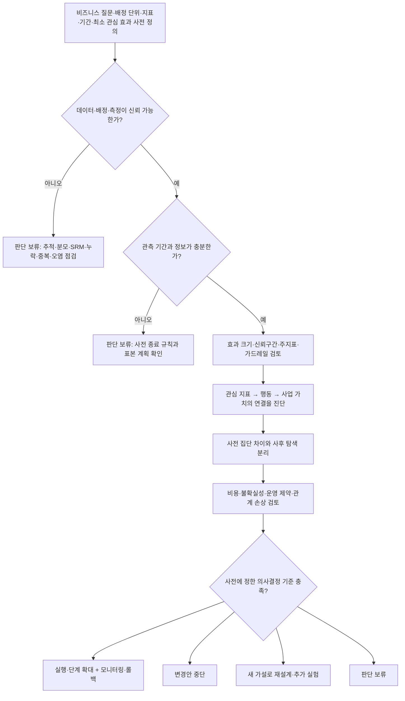

# CRM 실험 진단 워크플로우 v0.1 — 저자 검토안

저자: 허재혁. TRI-V를 확장하는 편집·학습용 제안. 검증된 이론·성능 주장 아님. MBTI처럼 고객에게 고정 유형을 붙이는 모델이 아니라, 실험의 상태를 진단하고 다음 행동을 선택하는 워크플로우다.

## 1. 판단 순서

## 2. 유형 분류보다 상태 기록
각 실험에 아래 상태를 기록한다. 상승·하락은 단순 점추정의 부호와 의사결정에 충분한 근거를 구분한다.
- 품질: 정상 / 의심 / 분석 불가
- 관측·정보: 성숙 / 미성숙 / 부족
- 관심: 오픈·클릭 등. 채널에서 관측 불가능하면 해당 없음.
- 행동: 예약·방문·시승 완료·활성화 등
- 가치: 배정 고객당 매출·기여이익·비용 등
- 관계·운영: 수신 거부·불만·반품·대기·처리 부담
- 증거 상태: 실질적 개선 근거 / 실질적 악화 근거 / 의미 있는 차이 없음의 근거 / 불확실

‘유의하지 않음’을 차이 없음으로 자동 분류하지 않는다. 동등성·비열등성 주장은 별도의 가설·허용 한계·검정이 필요하다. 모든 조합을 억지로 유형화하지 않고 판단을 바꾸는 패턴을 우선한다.

## 3. 진단 카드 후보 — 모두 가설적 사례
| 관측 패턴 | 경쟁 설명·확인할 것 | 다음 행동 후보 |
|---|---|---|
| 클릭 상승·매출 하락 | 유인성 문구, 랜딩 불일치, 낮은 구매 의향 유입, 품절, 추적 오류, 구매 지연 | 클릭자만 비교하지 말고 배정군 전체 결과·랜딩·관측 기간 검토 후 후속 가설 |
| 오픈 상승·매출 정체/하락 | 이메일 원격 콘텐츠 사전 로딩, 제목-내용 불일치, 클릭·구매 장벽 | 오픈을 실제 열람으로 단정하지 않고 채널 측정 점검 |
| 클릭 하락·매출 상승 | 덜 누르지만 고의도 고객 반응, 클릭 계측 차이, 우연 | 배정 고객당 가치·불확실성·관계 지표 확인 |
| 전환 상승·기여이익 하락 | 할인·원가·반품·저마진 상품 구성 | 순매출과 비용 정의 확인, 조건별 민감도 검토 |
| 예약 상승·시승 정체 | 노쇼·취소·예약 슬롯·지점 연결 오류 | 방문까지의 이탈과 접점 수용량 확인 |
| 시승 상승·계약 정체 | 긴 의사결정 기간·가격·재고·금융 조건 | 단기 시승을 매출로 환산하지 말고 성숙한 후속 성과 확인 |
| 매출 상승·수신 거부/불만 상승 | 과잉 접촉·혜택 압박·빈도 증가 | 사전 가드레일 기준 적용, 관계 영향 검토 |
| 전체 정체·일부 집단 개선 | 실제 효과 차이, 표본 변동, 다중 탐색 | 사전 분석·상호작용·다중 비교 확인; 탐색 발견은 독립 후속 검증 |
| 초기 개선·후기 소멸 | 신규성·요일·캠페인 변경·표본 변동 | 임의 조기 종료 금지, 사전 기간과 시간별 분석 계획 확인 |
| 지표 전반 개선·품질 검사 실패 | 잘못된 배정·누락·중복·수집 변화 | 개선 수치를 채택 근거로 쓰지 말고 품질 문제 해결 |
| 주지표 비유의·불확실성 큼 | 정보 부족·실질적 효과와 무효과 모두 가능 | ‘효과 없음’ 선언 금지; 사전 종료 기준과 후속 설계 확인 |
| 매출 정체·접촉 비용 하락 | 효율 개선, 핵심 성과 손실 가능성 | 사전 비열등성·최소 가치 기준이 있는지 확인 |

원인 후보는 관측만으로 확정할 수 없다. 동일 패턴에 여러 원인이 가능하며 원인 검증은 추가 데이터 또는 후속 실험이 필요하다.

## 4. 지표 사전 원칙
- 이메일 오픈은 실제 열람과 다를 수 있다. Apple Mail Privacy Protection은 원격 콘텐츠를 백그라운드에서 내려받을 수 있다. SMS 기본 실습에 이메일 오픈 지표를 억지로 추가하지 않는다.
- CTR은 유일 클릭 고객/배정 고객인지, 유일 클릭 고객/전달 고객인지 명시한다. 주 인과 비교는 배정 기준을 유지하고 전달 기준 지표는 진단용으로 구분한다.
- 클릭자·방문자만 조건화한 전환율은 처리 이후 선택에 영향받으므로 전체 배정군의 인과 효과와 구분한다.
- 매출은 총매출·취소/반품 차감 순매출·배정 고객당 매출을 구분한다. 이익은 할인·원가·메시지·실행 비용의 포함 범위를 명시한다.
- 같은 관측 기간, 통화, 분모로 비교한다. OEM 계약·출고 지연과 미성숙 코호트를 별도로 표시한다.
- 계획한 다중 비교·중간 조회 절차를 기록하며 결과를 보고 주지표를 바꾸지 않는다.

## 5. 책과 데이터 연결
- 실제 공개 실험: Hillstrom으로 방문·구매·지출·무발송 대비 효과를 학습한다. 오픈·클릭 컬럼은 없으므로 이를 실제 관측한 사례로 꾸미지 않는다.
- JH Motors 합성 실습: 정상·무효과·배정 이상·누락 데이터는 이미 존재. 클릭-매출·이익·운영 지연 등 추가 진단 카드는 생성 규칙과 비용 가정부터 설계 후 제작한다. 현재 생성 완료로 표시하지 않는다.
- 공공 자동차 통계: 권역·차종 등 산업 배경 참고. 실험 전환율이나 개인 CRM 이력으로 해석하지 않는다.

## 6. 진단 카드 표준
관측 상황 / 지표 정의·기간 / 데이터 품질 / 효과·불확실성 / 경쟁 설명 / 확인 SQL·차트 / 안전장치 / 다음 행동 / 알 수 없는 것 / 후속 실험.

## 7. 검증 과제
- [ ] 추가 시나리오의 생성 모수와 오류를 사전 문서화
- [ ] 경우의 수보다 의사결정을 바꾸는 대표 패턴 선정
- [ ] 생성·집계·계산의 독립 대조
- [ ] 워크플로우가 잘못된 데이터에서 자동 출시 결론을 내리지 않는지 검사
- [ ] 외부 통계·OEM 업무 검토와 실제 독자 이해 테스트
